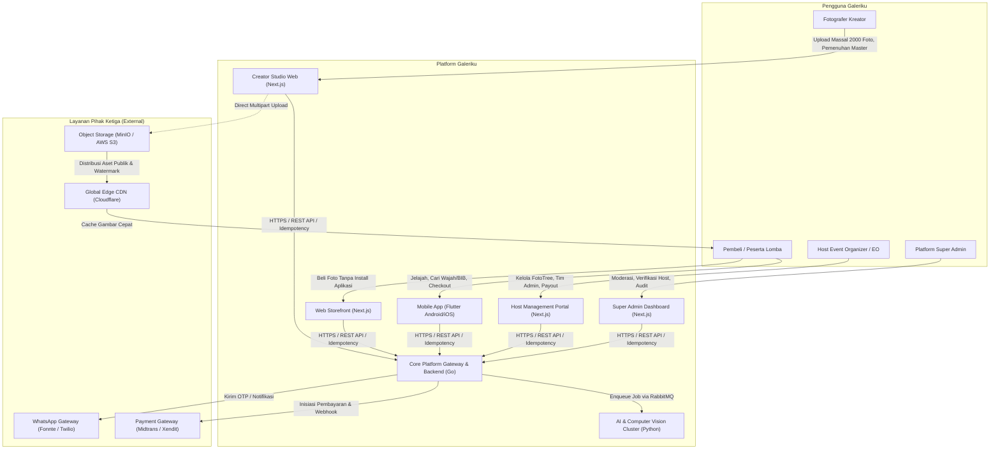
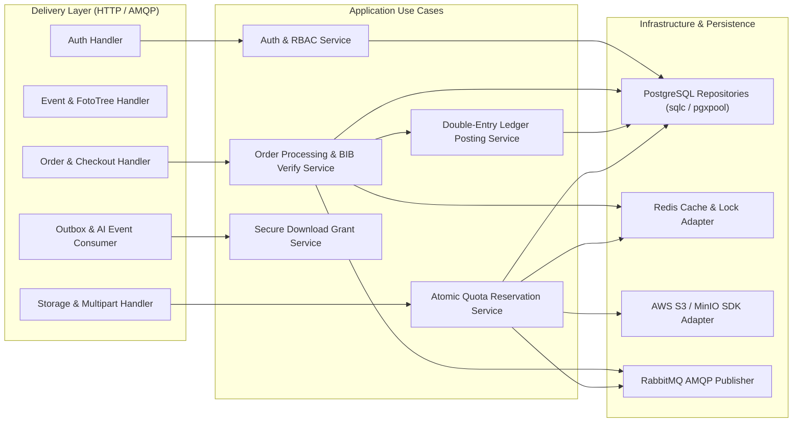
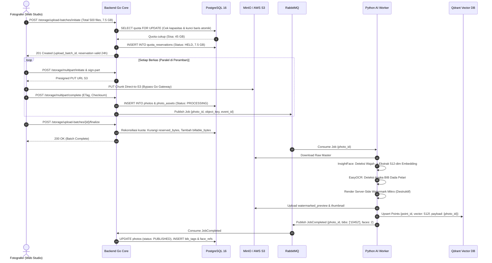
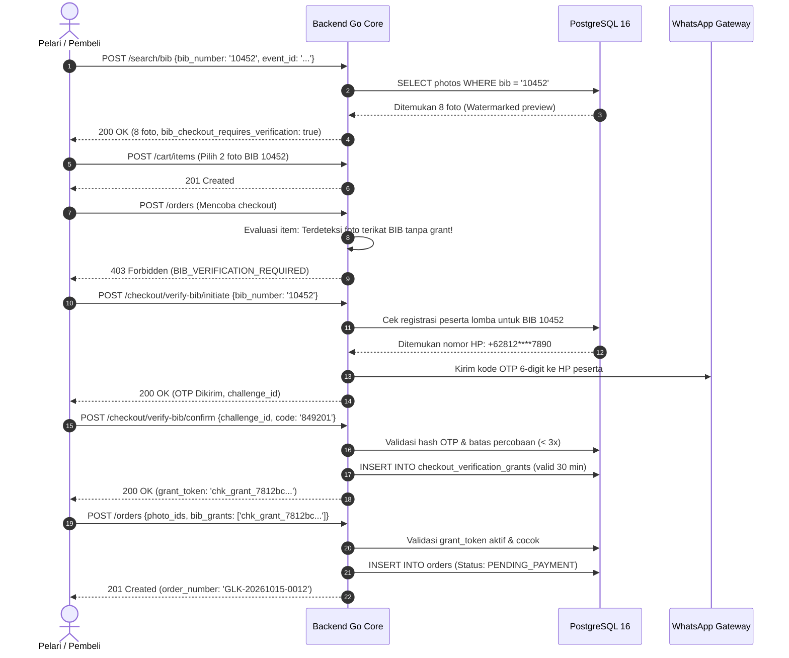
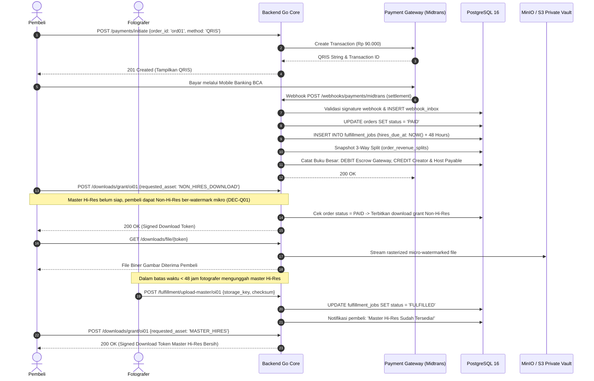
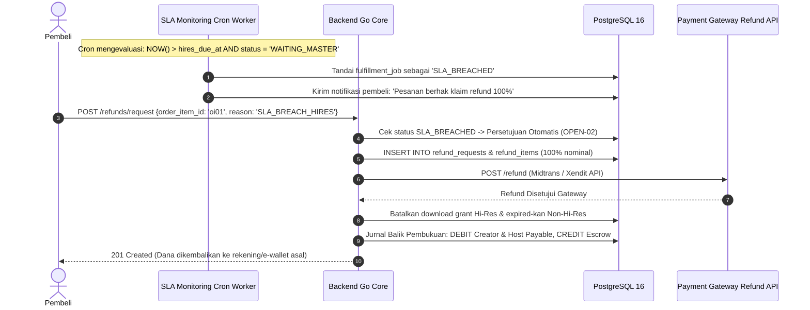

# Galeriku — System Architecture & Technical Design Specification
**Sumber Kebutuhan:** PRD.md (Versi 2.2 Enhanced Master Blueprint)
**Dokumen Pendukung:** PRD_REVIEW.md, UI_UX_SPEC.md, DATABASE_SPEC.md, API_SPEC.md
**Pola Arsitektur:** Modular Monolith (Go Backend Core) + Asynchronous AI Worker Services (Python) + Event-Driven Messaging (RabbitMQ)
**Tanggal Dokumen:** 15 Oktober 2026
**Status:** Architectural Master Specification — Baseline Tahap 5 Persiapan Development

> [!IMPORTANT]
> **Prinsip Arsitektur Utama Galeriku:**
> 1. **Modular Monolith Go Core**: Core platform dibangun menggunakan arsitektur modular hexagonal/clean architecture di dalam satu binary Go performa tinggi untuk kemudahan deployment, konsistensi transaksi ACID, dan latensi ultra-rendah (< 50ms p95).
> 2. **Isolasi Beban AI (Python Subsystem)**: Ekstraksi embedding wajah (InsightFace) dan OCR BIB (EasyOCR/PaddleOCR) diisolasi dalam container worker Python terpisah dengan akselerasi GPU/CPU, terhubung secara asinkronus melalui RabbitMQ.
> 3. **Penyimpanan Terpisah Vektor & Relasional**: PostgreSQL 16 menangani seluruh data relasional, transaksi pesanan, kuota, dan double-entry ledger. Qdrant menangani pengindeksan vektor biometrik wajah 512-dimensi secara terisolasi.
> 4. **Direct-to-S3 Upload (Zero Gateway Choke)**: Unggahan foto massal (1 s/d 2000 file) tidak melewati server backend Go, melainkan langsung ke bucket S3 via presigned multipart URL setelah reservasi kuota atomik disetujui (DEC-Q03).
> 5. **Pemisahan Master Hi-Res & Destructive Watermarking**: Master foto resolusi penuh tersimpan di private bucket S3 terenkripsi. Semua pratinjau publik dan file Non-Hi-Res sementara dirasterisasi server-side dengan watermark mikro destruktif (DEC-Q01).

---

## 1. C4 Model Arsitektur Sistem

### 1.1 Level 1: System Context Diagram
Diagram konteks sistem menggambarkan interaksi platform Galeriku dengan seluruh persona pengguna dan layanan eksternal:



---

### 1.2 Level 2: Container Architecture Diagram
Diagram kontainer menguraikan komponen perangkat lunak independen yang membentuk ekosistem Galeriku:

```mermaid
flowchart TD
    subgraph FrontendClients ["Frontend Presentation Tier"]
        flutterApp["Flutter App (iOS & Android)"]
        nextApps["Next.js SSR/SPA (Storefront, Studio, Host, Admin)"]
    end

    subgraph EdgeTier ["Edge & Ingress Tier"]
        traefik["Traefik / Nginx API Gateway & Reverse Proxy"]
        cdnEdge["Cloudflare CDN & WAF"]
    end

    subgraph ApplicationTier ["Application & Processing Tier"]
        goCore["Galeriku Go Core Monolith (REST API, Ledger, Quota, Auth)"]
        pyAiWorker["Python AI Worker (InsightFace, EasyOCR, Watermark Engine)"]
    end

    subgraph DataStorageTier ["Data & Persistence Tier"]
        pgDb[("PostgreSQL 16 (Source of Truth, 76 Tables, Ledger)")]
        qdrantDb[("Qdrant Vector DB (512-dim Face Embeddings)")]
        redisCache[("Redis 7 (Distributed Cache, Session, Rate Limiter)")]
        rabbitMQ[("RabbitMQ 3 (AMQP 0-9-1 Message Broker)")]
        minioS3[("MinIO / AWS S3 (Private Master Vault & Public Media)")]
    end

    flutterApp & nextApps -->|HTTPS| cdnEdge
    cdnEdge -->|Route API Traffic| traefik
    traefik -->|Forward HTTP /api/v1| goCore
    goCore -->|Read / Write SQL (ACID)| pgDb
    goCore -->|Session & Rate Limiting| redisCache
    goCore -->|Publish Job (Outbox Pattern)| rabbitMQ
    rabbitMQ -->|Consume AI Tasks| pyAiWorker
    pyAiWorker -->|Index & Search Vectors| qdrantDb
    pyAiWorker -->|Fetch Raw & Write Watermarked Derivative| minioS3
    pyAiWorker -->|Callback / Complete Job Event| rabbitMQ
    rabbitMQ -->|Consume AI Results & Update Status| goCore
```

---

### 1.3 Level 3: Component Diagram Backend Go Core
Backend Go dibangun menggunakan Clean Architecture dengan pembagian layer yang tegas:
- **Domain Entities & Invariants**: Model murni tanpa dependensi eksternal.
- **Use Cases (Application Services)**: Logika bisnis transaksi, kalkulasi revenue split, dan alur pemesanan.
- **Adapters / Repositories**: Implementasi akses database PostgreSQL (pgx/sqlc) dan Redis.
- **Delivery / Handlers**: HTTP Controller RESTful (Gin / Fiber / standard net/http) dan RabbitMQ Consumer.



---

## 2. Sequence Diagram Alur Bisnis Kritis

### 2.1 Alur Unggahan Massal (1-2000 Foto) Direct-to-S3 & Pemrosesan AI Asinkronus (DEC-Q03)
Alur ini mendemonstrasikan bagaimana fotografer mengunggah hingga 2000 foto secara paralel tanpa membebani memori backend Go:



---

### 2.2 Alur Proteksi Pencarian & Checkout Berbasis BIB (DEC-Q02)
Menjamin nomor BIB tidak disalahgunakan untuk membeli foto milik orang lain tanpa izin:



---

### 2.3 Alur Pembayaran, Unduhan Non-Hi-Res Seketika, dan Pemenuhan SLA 48 Jam (DEC-Q01)



---

### 2.4 Alur Klaim Refund Otomatis Jika SLA 48 Jam Terlampaui (OPEN-01 & OPEN-02)



---

### 2.5 Alur Penarikan Persetujuan Biometrik (UU PDP Right to be Forgotten)

```mermaid
sequenceDiagram
    autonumber
    actor User as Pengguna / Pemilik Wajah
    participant GoAPI as Backend Go Core
    participant DB as PostgreSQL 16
    participant RMQ as RabbitMQ
    participant AI as Biometric Purge Worker
    participant Qdrant as Qdrant Vector DB

    User->>GoAPI: DELETE /biometrics/consent {reason: 'Tarik izin wajah'}
    GoAPI->>DB: INSERT INTO consent_audit_logs (event_type: 'CONSENT_REVOKED')
    GoAPI->>DB: UPDATE biometric_subjects SET processing_status = 'PURGED'
    GoAPI->>DB: INSERT INTO biometric_deletion_jobs (status: 'PROCESSING')
    GoAPI->>RMQ: Publish BiometricPurgeCommand {subject_id, user_id}
    GoAPI-->>User: 202 Accepted (Pembersihan data sedang berjalan)

    RMQ->>AI: Consume BiometricPurgeCommand
    AI->>DB: Ambil seluruh point_id di tabel face_vector_refs untuk subject_id ini
    AI->>Qdrant: DELETE /collections/galeriku_faces_v1/points (Hapus seluruh vektor)
    Qdrant-->>AI: Vektor berhasil dihapus permanen
    AI->>DB: UPDATE face_vector_refs SET status = 'PURGED'
    AI->>DB: UPDATE biometric_deletion_jobs SET status = 'COMPLETED'
    Note over DB: Foto asli di photos TIDAK dihapus; hanya referensi biometrik yang dihapus
```

---

## 3. Matriks Keamanan dan Model Ancaman (STRIDE Threat Model)

| Kategori Ancaman | Deskripsi Potensi Serangan di Galeriku | Mitigasi Arsitektur & Aturan Keamanan |
|---|---|---|
| **Spoofing (Pemalsuan Identitas)** | Pelaku mengaku sebagai peserta lomba untuk mengunduh foto orang lain via pencarian BIB. | **DEC-Q02**: Otorisasi checkout BIB wajib memasukkan kode OTP nomor HP terdaftar peserta atau kode event unik. |
| **Tampering (Manipulasi Data)** | Fotografer atau pembeli memanipulasi payload HTTP untuk mengubah harga foto atau persentase komisi bagi hasil. | **Zero-Trust Backend**: Harga diambil murni dari database master. Snapshot pembagian komisi 3 pihak dihitung di backend. |
| **Repudiation (Penyangkalan Tindakan)** | Host Admin menyangkal telah mencairkan dana payout atau fotografer menyangkal telah mengunggah master rusak. | **Immutable Audit Trail**: Semua tindakan administratif dicatat di `admin_actions`. Mutasi saldo dicatat di `ledger_entries`. |
| **Information Disclosure (Kebocoran Data)** | Scraping URL master foto resolusi penuh tanpa membayar atau pencurian data wajah biometrik peserta. | **S3 Private Vault**: Master Hi-Res disimpan di private bucket; download hanya via short-lived signed URL (15 menit). Raw selfie dihapus dari memori. |
| **Denial of Service (DoS / DDoS)** | Flooding upload ribuan berkas palsu untuk menghabiskan kapasitas penyimpanan server atau kehabisan memori Go. | **Direct-to-S3 Multipart + Atomic Quota Hold (DEC-Q03)**: Sesi upload divalidasi dan dikunci kapasitasnya sebelum presigned URL diterbitkan. |
| **Elevation of Privilege (Eskalasi Hak Akses)** | Anggota tim Host Admin mencoba mengakses rekening bank organisasi atau mengubah kepemimpinan Host Leader. | **Role-Based Capability Bounds**: Host Admin dibatasi kuotanya (`max_admin_count`) dan dilarang mengubah data payout atau rekening bank. |

---

## 4. Keandalan, Skalabilitas, dan Disaster Recovery

### 4.1 Skalabilitas Horizontal Komponen
- **Go Core API Nodes**: Bersifat sepenuhnya *stateless*. Dapat diskalakan horizontal secara otomatis (Kubernetes HPA) berdasarkan utilisasi CPU (> 70%) atau koneksi aktif HTTP.
- **Python AI Workers**: Bekerja berdasarkan *competing consumer pattern* pada RabbitMQ. Dapat diskalakan dari 2 worker hingga puluhan worker sesuai antrean unggahan foto setelah event besar selesai.
- **Database Read Replicas**: Beban kueri penjelajahan katalog foto dan pencarian BIB publik dialihkan ke PostgreSQL Read Replica melalui PgBouncer connection pooler.

### 4.2 Disaster Recovery & Target SLA
- **RPO (Recovery Point Objective)**: < 5 menit melalui PostgreSQL continuous WAL archiving ke S3 bucket lintas zona (*cross-region replication*).
- **RTO (Recovery Time Objective)**: < 1 jam melalui infrastruktur *Infrastructure-as-Code* (Terraform / Docker Compose) terautomasi.
- **Zero Data Loss on Crash**: Pola *Transactional Outbox* menjamin seluruh pesan ke RabbitMQ disimpan dalam transaksi PostgreSQL yang sama sebelum dipublikasikan.

---
*Dokumen ini disetujui sebagai cetak biru arsitektur teknis resmi pengembangan platform Galeriku.*