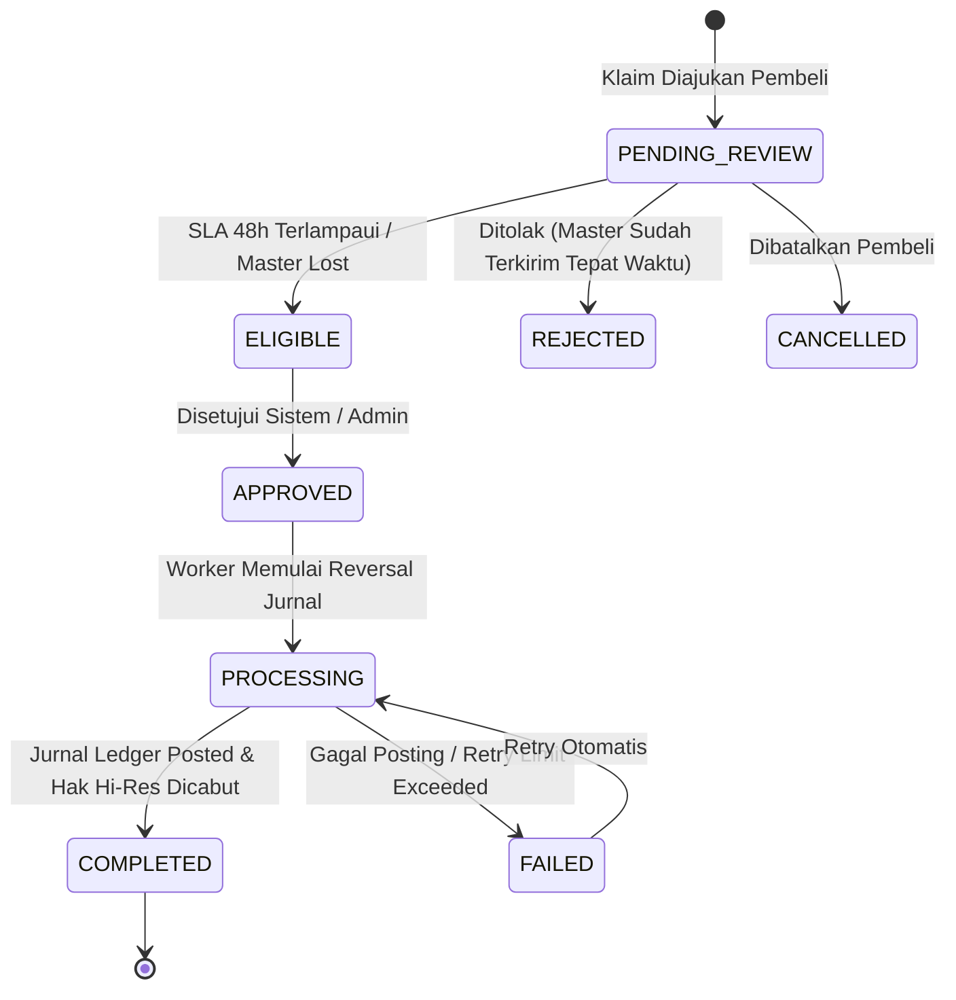

# Galeriku — Database Specification & Schema Architecture
**Sumber Kebutuhan:** PRD.md (Versi 2.2 Enhanced Master Blueprint)
**Dokumen Pendukung:** PRD_REVIEW.md, UI_UX_SPEC.md, Temuan Reverse-Engineering FotoYu v1.11.11
**Target Engine:** PostgreSQL 16 (Relational Core, Ledger & Transactions) + Qdrant (Vector Engine) + S3/MinIO (Object Storage)
**Tanggal Dokumen:** 15 Oktober 2026 (Updated with Full Refund & Revenue Clawback Specification)
**Status:** Architectural Master Specification — Baseline Tahap 3 Persiapan Development

> [!IMPORTANT]
> **Prinsip Integritas Spesifikasi Database Galeriku:**
> 1. **Zero-Trust Backend**: Semua otorisasi akses, harga final, saldo, hak download, dan status refund divalidasi dan dihitung otoritatif di backend.
> 2. **Pemisahan Biometrik (UU PDP No. 27/2022)**: Data wajah mentah (selfie) dan vektor embedding (512-dimensi) **TIDAK PERNAH** disimpan dalam PostgreSQL relasional. PostgreSQL hanya memegang ID referensi pointer (`face_vector_refs`).
> 3. **Presisi Finansial Bulat (BIGINT)**: Seluruh nominal moneter IDR wajib integer Rupiah bertipe `BIGINT`. Dilarang keras menggunakan tipe data `FLOAT` atau `DOUBLE`.
> 4. **Integritas Pembukuan Berpasangan (Double-Entry Ledger)**: Setiap transaksi keuangan wajib memiliki jurnal berpasangan di mana total debit harus tepat sama dengan total kredit.
> 5. **Pembalikan Pendapatan 3 Pihak (Clawback)**: Refund membalik alokasi pendapatan kreator, Host, dan platform secara atomik melalui jurnal penyesuaian (*reversal journal*) tanpa mengubah histori transaksi lama.

---

## 1. Arsitektur Data, Teknologi Stack, dan Prinsip Desain

### 1.1 Stack Teknologi Data
- **PostgreSQL 16 (Relational Database)**: Sumber kebenaran tunggal (*Single Source of Truth*) untuk identitas pengguna, hak akses, FotoTree & katalog event, metadata foto, keranjang, pesanan, status pembayaran, double-entry ledger, kuota upload, dan log audit kepatuhan.
- **Qdrant (Vector Database Engine)**: Penyimpanan khusus embedding biometrik wajah 512-dimensi yang diekstrak oleh model InsightFace (MobileFaceNet / ArcFace). Berjalan terisolasi dengan metrik jarak Cosine (*Cosine Similarity*).
- **MinIO / AWS S3 (Private Object Vault & Public CDN Storage)**:
  - *Private Master Vault*: Menyimpan file master resolusi penuh (*Hi-Res*) fotografer dan dokumen legalitas Host. Akses hanya melalui Pre-signed URL berdurasi singkat pasca-validasi hak unduh backend.
  - *Public Media Storage*: Menyimpan thumbnail, pratinjau ber-watermark mikro destruktif, dan aset statis yang didistribusikan melalui CDN.
- **RabbitMQ / Transactional Outbox**: Penjamin pengiriman pesan asinkronus andal untuk pemrosesan AI, notifikasi, dan rekonsiliasi pembayaran pihak ketiga tanpa kehilangan data.

### 1.2 Prinsip Integritas dan Standar Representasi
- **Primary Key UUIDv7**: Menggabungkan timestamp milidetik pada bagian awal (48-bit) dengan keacakan kriptografis pada sisa bit. Menghilangkan fragmentasi indeks B-Tree bawaan UUIDv4 sembari mempertahankan keunikan global tanpa ketergantungan urutan sekuensial.
- **Mata Uang & Angka Finansial**: Seluruh harga foto, biaya platform, komisi host, potongan biaya payment gateway, dan saldo dompet menggunakan tipe data `BIGINT` satuan Rupiah penuh. Tidak ada desimal sen.
- **Double-Entry Ledger Invariant**: Mutasi akun keuangan platform hanya dapat dicatat melalui transaksi jurnal yang seimbang (`SUM(debit) == SUM(credit)`). Jurnal yang sudah diposting berstatus *immutable*.
- **Kepatuhan Regulasi Biometrik (UU PDP No. 27/2022)**: Persetujuan biometrik dicatat secara eksplisit dengan versi dokumen, IP, dan timestamp. Penarikan persetujuan (*Consent Withdrawal*) memicu *Two-Phase Deletion Workflow* yang membersihkan titik vektor di Qdrant dan file sementara di S3 tanpa merusak riwayat transaksi keuangan.

---

## 2. Peta 8 Domain dan Ringkasan 76 Tabel

| Domain ID | Nama Domain | Jumlah Tabel | Cakupan Tanggung Jawab Fungsional |
|---|---|:---:|---|
| **01** | **Identity and Host** | 11 | Autentikasi multi-peran, profil publik, katalog kemampuan (*capabilities*), organisasi Host B2B, verifikasi legalitas, lokasi venue, dan manajemen tim admin. |
| **02** | **Events, Creators and Photos** | 12 | Struktur hirarki FotoTree (Event, Sesi, Lokasi, Rute), keanggotaan fotografer (Internal/Independent), metadata foto logis, multi-event links, aset fisik, tag BIB, dan moderasi. |
| **03** | **AI and Biometric Privacy** | 10 | Persetujuan biometrik UU PDP, subjek identitas biometrik, pointer vektor Qdrant, antrean pekerjaan AI, log audit persetujuan, dan orkestrasi pembersihan data (*Right to be Forgotten*). |
| **04** | **Cart, Orders and Checkout** | 8 | Keranjang belanja pembeli, pesanan pembelian (*orders*), item pesanan, riwayat transisi status, serta verifikasi anti-fraud checkout nomor BIB berbasis OTP/kode event (DEC-Q02). |
| **05** | **Payments, Refunds, Fulfillment and Downloads** | 8 | Integrasi payment gateway, webhook inbox, tiket pengajuan refund, pekerjaan pemenuhan master Hi-Res (SLA 48 jam), dan penerbitan izin unduh aman (*download grants*). |
| **06** | **Host Fee, Ledger and Settlement** | 10 | Aturan bagi hasil 3 pihak (Platform, Host, Creator), snapshot transaksi finansial, buku besar berpasangan (*double-entry*), penahanan settlement (*hold period*), dan pencairan dana (*payouts*). |
| **07** | **Upload, Storage and Quota** | 9 | Akun penyimpanan, kebijakan kuota berversi, reservasi kuota atomik unggahan (DEC-Q03), batch upload massal 1-2000 file, sesi S3 multipart, dan inventaris objek fisik. |
| **08** | **Platform Ops, Audit and Reliability** | 8 | Audit keamanan global, catatan tindakan admin, kunci idempotensi request, transactional outbox untuk pesan RabbitMQ, deduplikasi webhook pihak ketiga, dan pengaturan sistem dinamis. |

---

## 3. Kamus Data Lengkap (Data Dictionary) 76 Tabel

### Domain 01 - Identity and Host
Total tabel dalam domain ini: **11 tabel**.

#### Tabel: `users`
> **Makna Fungsional:** Identitas global user; user dapat memiliki beberapa capability.

| Kolom | Tipe Data PostgreSQL | Nullable | Constraint & Key | Nilai Default | Penjelasan Aturan Bisnis |
|---|---|:---:|:---:|:---:|---|
| `id` | `UUID` | NOT NULL | PRIMARY KEY | `gen_random_uuid()` | Primary identifier unik UUIDv7 (time-ordered) untuk indexing terklaster efisien. |
| `email_normalized` | `VARCHAR(128)` | NULL | UNIQUE | `-` | Alamat email huruf kecil unik terstandarisasi untuk autentikasi dan kontak. |
| `phone_e164` | `VARCHAR(128)` | NULL | UNIQUE | `-` | Nomor ponsel format internasional E.164 (+62...) untuk otentikasi 2FA / OTP. |
| `account_status` | `VARCHAR(64)` | NOT NULL | - | `-` | Status akun pengguna: ACTIVE, SUSPENDED, PENDING_VERIFICATION, DEACTIVATED. |
| `created_at` | `TIMESTAMPTZ` | NOT NULL | - | `CURRENT_TIMESTAMP` | Atribut operasional created_at untuk domain tabel users. |
| `updated_at` | `TIMESTAMPTZ` | NOT NULL | - | `CURRENT_TIMESTAMP` | Atribut operasional updated_at untuk domain tabel users. |

#### Tabel: `user_profiles`
> **Makna Fungsional:** Profil publik/non-sensitif. Jangan menaruh rekening atau rahasia autentikasi di sini.

| Kolom | Tipe Data PostgreSQL | Nullable | Constraint & Key | Nilai Default | Penjelasan Aturan Bisnis |
|---|---|:---:|:---:|:---:|---|
| `id` | `UUID` | NOT NULL | PRIMARY KEY | `gen_random_uuid()` | Primary identifier unik UUIDv7 (time-ordered) untuk indexing terklaster efisien. |
| `user_id` | `UUID` | NOT NULL | FOREIGN KEY, UNIQUE | `-` | Relasi foreign key ke users.id entitas pemilik record. |
| `display_name` | `TEXT` | NOT NULL | - | `-` | Nama tampilan publik fotografer, pembeli, atau admin pada antarmuka. |
| `avatar_asset_key` | `TEXT` | NULL | - | `-` | S3 object key publik untuk file gambar avatar profil pengguna. |
| `locale` | `TEXT` | NOT NULL | - | `-` | Pengaturan regional dan bahasa antarmuka pengguna (default 'id-ID'). |
| `created_at` | `TIMESTAMPTZ` | NOT NULL | - | `CURRENT_TIMESTAMP` | Atribut operasional created_at untuk domain tabel user_profiles. |

#### Tabel: `capabilities`
> **Makna Fungsional:** Katalog capability seperti BUYER, CREATOR, HOST_LEADER, PLATFORM_ADMIN.

| Kolom | Tipe Data PostgreSQL | Nullable | Constraint & Key | Nilai Default | Penjelasan Aturan Bisnis |
|---|---|:---:|:---:|:---:|---|
| `id` | `UUID` | NOT NULL | PRIMARY KEY | `gen_random_uuid()` | Primary identifier unik UUIDv7 (time-ordered) untuk indexing terklaster efisien. |
| `code` | `TEXT` | NOT NULL | UNIQUE | `-` | Kode unik capability sistem (BUYER, CREATOR, HOST_LEADER, PLATFORM_ADMIN). |
| `description` | `TEXT` | NOT NULL | - | `-` | Deskripsi fungsional hak akses capability sistem. |

#### Tabel: `user_capabilities`
> **Makna Fungsional:** Capability global. Hak pada organisasi/event tetap harus diperiksa lewat membership.

| Kolom | Tipe Data PostgreSQL | Nullable | Constraint & Key | Nilai Default | Penjelasan Aturan Bisnis |
|---|---|:---:|:---:|:---:|---|
| `id` | `UUID` | NOT NULL | PRIMARY KEY | `gen_random_uuid()` | Primary identifier unik UUIDv7 (time-ordered) untuk indexing terklaster efisien. |
| `user_id` | `UUID` | NOT NULL | FOREIGN KEY | `-` | Relasi foreign key ke users.id entitas pemilik record. |
| `capability_id` | `UUID` | NOT NULL | FOREIGN KEY | `-` | Relasi foreign key ke capabilities.id katalog kemampuan. |
| `status` | `VARCHAR(64)` | NOT NULL | - | `-` | Atribut operasional status untuk domain tabel user_capabilities. |
| `granted_by` | `UUID` | NULL | FOREIGN KEY | `-` | User admin/otoritas yang memberikan izin capability ini. |
| `granted_at` | `TIMESTAMPTZ` | NULL | - | `NULL` | Timestamp saat izin capability disetujui dan mulai aktif. |
| `revoked_at` | `TIMESTAMPTZ` | NULL | - | `NULL` | Timestamp saat izin capability dicabut atau kedaluwarsa. |

#### Tabel: `host_organizations`
> **Makna Fungsional:** Entitas bisnis Host.

| Kolom | Tipe Data PostgreSQL | Nullable | Constraint & Key | Nilai Default | Penjelasan Aturan Bisnis |
|---|---|:---:|:---:|:---:|---|
| `id` | `UUID` | NOT NULL | PRIMARY KEY | `gen_random_uuid()` | Primary identifier unik UUIDv7 (time-ordered) untuk indexing terklaster efisien. |
| `legal_name` | `TEXT` | NOT NULL | - | `-` | Nama badan hukum resmi organisasi Host (PT / CV / Yayasan / EO). |
| `display_name` | `TEXT` | NOT NULL | - | `-` | Nama tampilan publik fotografer, pembeli, atau admin pada antarmuka. |
| `business_field` | `TEXT` | NOT NULL | - | `-` | Kategori industri (e.g. Marathon Organizer, Cycling Club, Trail Run). |
| `verification_status` | `VARCHAR(64)` | NOT NULL | - | `-` | Status verifikasi legalitas & KYC: PENDING, APPROVED, REJECTED. |
| `created_at` | `TIMESTAMPTZ` | NOT NULL | - | `CURRENT_TIMESTAMP` | Atribut operasional created_at untuk domain tabel host_organizations. |

#### Tabel: `host_applications`
> **Makna Fungsional:** Siklus pengajuan dan approval Host.

| Kolom | Tipe Data PostgreSQL | Nullable | Constraint & Key | Nilai Default | Penjelasan Aturan Bisnis |
|---|---|:---:|:---:|:---:|---|
| `id` | `UUID` | NOT NULL | PRIMARY KEY | `gen_random_uuid()` | Primary identifier unik UUIDv7 (time-ordered) untuk indexing terklaster efisien. |
| `host_organization_id` | `UUID` | NOT NULL | FOREIGN KEY | `-` | Relasi foreign key ke host_organizations.id pemilik organisasi. |
| `submitted_by` | `UUID` | NOT NULL | FOREIGN KEY | `-` | Atribut operasional submitted_by untuk domain tabel host_applications. |
| `status` | `VARCHAR(64)` | NOT NULL | - | `-` | Atribut operasional status untuk domain tabel host_applications. |
| `reviewed_by` | `UUID` | NULL | - | `-` | User Platform Admin yang memproses peninjauan aplikasi. |
| `review_reason_code` | `TEXT` | NULL | - | `-` | Atribut operasional review_reason_code untuk domain tabel host_applications. |
| `submitted_at` | `TIMESTAMPTZ` | NULL | - | `CURRENT_TIMESTAMP` | Timestamp formulir permohonan Host diajukan. |
| `reviewed_at` | `TIMESTAMPTZ` | NULL | - | `CURRENT_TIMESTAMP` | Timestamp peninjauan selesai dilakukan. |

#### Tabel: `host_legal_documents`
> **Makna Fungsional:** Dokumen tetap privat di object storage; database menyimpan metadata.

| Kolom | Tipe Data PostgreSQL | Nullable | Constraint & Key | Nilai Default | Penjelasan Aturan Bisnis |
|---|---|:---:|:---:|:---:|---|
| `id` | `UUID` | NOT NULL | PRIMARY KEY | `gen_random_uuid()` | Primary identifier unik UUIDv7 (time-ordered) untuk indexing terklaster efisien. |
| `host_application_id` | `UUID` | NOT NULL | FOREIGN KEY | `-` | Atribut operasional host_application_id untuk domain tabel host_legal_documents. |
| `object_key` | `VARCHAR(255)` | NOT NULL | - | `-` | Kunci unik penyimpanan fisik objek pada bucket S3 / MinIO. |
| `document_type` | `TEXT` | NOT NULL | - | `-` | Kategori dokumen legalitas (KTP_DIREKSI, NPWP_BADAN, NIB_OSS, AKTA_PENDIRIAN). |
| `mime_type` | `TEXT` | NOT NULL | - | `-` | MIME type standar (image/jpeg, image/webp, image/png). |
| `size_bytes` | `BIGINT` | NOT NULL | - | `-` | Atribut operasional size_bytes untuk domain tabel host_legal_documents. |
| `review_status` | `VARCHAR(64)` | NOT NULL | - | `-` | Status verifikasi nomor BIB: DETECTED, CONFIRMED, REJECTED, EDITED. |
| `created_at` | `TIMESTAMPTZ` | NOT NULL | - | `CURRENT_TIMESTAMP` | Atribut operasional created_at untuk domain tabel host_legal_documents. |

#### Tabel: `host_locations`
> **Makna Fungsional:** Lokasi/venue organisasi; koordinat/geofence perlu validasi geospasial.

| Kolom | Tipe Data PostgreSQL | Nullable | Constraint & Key | Nilai Default | Penjelasan Aturan Bisnis |
|---|---|:---:|:---:|:---:|---|
| `id` | `UUID` | NOT NULL | PRIMARY KEY | `gen_random_uuid()` | Primary identifier unik UUIDv7 (time-ordered) untuk indexing terklaster efisien. |
| `host_organization_id` | `UUID` | NOT NULL | FOREIGN KEY | `-` | Relasi foreign key ke host_organizations.id pemilik organisasi. |
| `name` | `TEXT` | NOT NULL | - | `-` | Nama resmi entitas (lokasi, event, sesi, koleksi, atau akun). |
| `address` | `JSONB` | NOT NULL | - | `-` | Atribut operasional address untuk domain tabel host_locations. |
| `latitude` | `NUMERIC(10, 7)` | NULL | - | `-` | Koordinat lintang geografis venue/checkpoint (WGS 84). |
| `longitude` | `NUMERIC(10, 7)` | NULL | - | `-` | Koordinat bujur geografis venue/checkpoint (WGS 84). |
| `geofence` | `JSONB` | NULL | - | `-` | Atribut operasional geofence untuk domain tabel host_locations. |
| `created_at` | `TIMESTAMPTZ` | NOT NULL | - | `CURRENT_TIMESTAMP` | Atribut operasional created_at untuk domain tabel host_locations. |

#### Tabel: `host_memberships`
> **Makna Fungsional:** Host Leader/Admin terikat organisasi; tidak memberi akses finansial secara implisit.

| Kolom | Tipe Data PostgreSQL | Nullable | Constraint & Key | Nilai Default | Penjelasan Aturan Bisnis |
|---|---|:---:|:---:|:---:|---|
| `id` | `UUID` | NOT NULL | PRIMARY KEY | `gen_random_uuid()` | Primary identifier unik UUIDv7 (time-ordered) untuk indexing terklaster efisien. |
| `host_organization_id` | `UUID` | NOT NULL | FOREIGN KEY | `-` | Relasi foreign key ke host_organizations.id pemilik organisasi. |
| `user_id` | `UUID` | NOT NULL | FOREIGN KEY | `-` | Relasi foreign key ke users.id entitas pemilik record. |
| `membership_role` | `VARCHAR(64)` | NOT NULL | - | `-` | Peran dalam organisasi: LEADER, ADMIN, EVENT_COORDINATOR, FINANCE. |
| `status` | `VARCHAR(64)` | NOT NULL | - | `-` | Atribut operasional status untuk domain tabel host_memberships. |
| `invited_by` | `UUID` | NULL | - | `-` | Atribut operasional invited_by untuk domain tabel host_memberships. |
| `created_at` | `TIMESTAMPTZ` | NOT NULL | - | `CURRENT_TIMESTAMP` | Atribut operasional created_at untuk domain tabel host_memberships. |
| `revoked_at` | `TIMESTAMPTZ` | NULL | - | `NULL` | Timestamp saat izin capability dicabut atau kedaluwarsa. |

#### Tabel: `host_invitations`
> **Makna Fungsional:** Token undangan hanya disimpan dalam bentuk hash; penerimaan harus atomik.

| Kolom | Tipe Data PostgreSQL | Nullable | Constraint & Key | Nilai Default | Penjelasan Aturan Bisnis |
|---|---|:---:|:---:|:---:|---|
| `id` | `UUID` | NOT NULL | PRIMARY KEY | `gen_random_uuid()` | Primary identifier unik UUIDv7 (time-ordered) untuk indexing terklaster efisien. |
| `host_organization_id` | `UUID` | NOT NULL | FOREIGN KEY | `-` | Relasi foreign key ke host_organizations.id pemilik organisasi. |
| `invited_by` | `UUID` | NOT NULL | - | `-` | Atribut operasional invited_by untuk domain tabel host_invitations. |
| `invitee_user_id` | `UUID` | NULL | FOREIGN KEY | `-` | Atribut operasional invitee_user_id untuk domain tabel host_invitations. |
| `invitee_email` | `TEXT` | NULL | - | `-` | Atribut operasional invitee_email untuk domain tabel host_invitations. |
| `role` | `TEXT` | NOT NULL | - | `-` | Atribut operasional role untuk domain tabel host_invitations. |
| `token_hash` | `VARCHAR(255)` | NOT NULL | - | `-` | SHA-256 hash token rahasia undangan untuk mencegah kebocoran. |
| `status` | `VARCHAR(64)` | NOT NULL | - | `-` | Atribut operasional status untuk domain tabel host_invitations. |
| `expires_at` | `TIMESTAMPTZ` | NOT NULL | - | `-` | Atribut operasional expires_at untuk domain tabel host_invitations. |

#### Tabel: `host_admin_limits`
> **Makna Fungsional:** Batas admin dikonfigurasi, bukan ditanam permanen dalam kode.

| Kolom | Tipe Data PostgreSQL | Nullable | Constraint & Key | Nilai Default | Penjelasan Aturan Bisnis |
|---|---|:---:|:---:|:---:|---|
| `id` | `UUID` | NOT NULL | PRIMARY KEY | `gen_random_uuid()` | Primary identifier unik UUIDv7 (time-ordered) untuk indexing terklaster efisien. |
| `host_organization_id` | `UUID` | NOT NULL | FOREIGN KEY, UNIQUE | `-` | Relasi foreign key ke host_organizations.id pemilik organisasi. |
| `max_admins` | `INTEGER` | NOT NULL | - | `-` | Atribut operasional max_admins untuk domain tabel host_admin_limits. |
| `policy_version` | `TEXT` | NOT NULL | - | `-` | Atribut operasional policy_version untuk domain tabel host_admin_limits. |
| `updated_by` | `UUID` | NOT NULL | - | `-` | User Super Admin yang terakhir mengubah parameter konfigurasi sistem. |
| `updated_at` | `TIMESTAMPTZ` | NOT NULL | - | `CURRENT_TIMESTAMP` | Atribut operasional updated_at untuk domain tabel host_admin_limits. |

### Domain 02 - Events, Creators and Photos
Total tabel dalam domain ini: **12 tabel**.

#### Tabel: `events`
> **Makna Fungsional:** FotoTree/event yang dikelola organisasi Host.

| Kolom | Tipe Data PostgreSQL | Nullable | Constraint & Key | Nilai Default | Penjelasan Aturan Bisnis |
|---|---|:---:|:---:|:---:|---|
| `id` | `UUID` | NOT NULL | PRIMARY KEY | `gen_random_uuid()` | Primary identifier unik UUIDv7 (time-ordered) untuk indexing terklaster efisien. |
| `host_organization_id` | `UUID` | NOT NULL | FOREIGN KEY | `-` | Relasi foreign key ke host_organizations.id pemilik organisasi. |
| `slug` | `VARCHAR(128)` | NOT NULL | - | `-` | Slug URL unik ramah SEO untuk halaman web storefront publik. |
| `name` | `TEXT` | NOT NULL | - | `-` | Nama resmi entitas (lokasi, event, sesi, koleksi, atau akun). |
| `status` | `VARCHAR(64)` | NOT NULL | - | `-` | Atribut operasional status untuk domain tabel events. |
| `starts_at` | `TIMESTAMPTZ` | NULL | - | `NULL` | Atribut operasional starts_at untuk domain tabel events. |
| `ends_at` | `TIMESTAMPTZ` | NULL | - | `NULL` | Atribut operasional ends_at untuk domain tabel events. |
| `created_by` | `UUID` | NOT NULL | FOREIGN KEY | `-` | Atribut operasional created_by untuk domain tabel events. |

#### Tabel: `event_sessions`
> **Makna Fungsional:** Sesi/tahapan dalam event.

| Kolom | Tipe Data PostgreSQL | Nullable | Constraint & Key | Nilai Default | Penjelasan Aturan Bisnis |
|---|---|:---:|:---:|:---:|---|
| `id` | `UUID` | NOT NULL | PRIMARY KEY | `gen_random_uuid()` | Primary identifier unik UUIDv7 (time-ordered) untuk indexing terklaster efisien. |
| `event_id` | `UUID` | NOT NULL | FOREIGN KEY | `-` | Atribut operasional event_id untuk domain tabel event_sessions. |
| `name` | `TEXT` | NOT NULL | - | `-` | Nama resmi entitas (lokasi, event, sesi, koleksi, atau akun). |
| `starts_at` | `TIMESTAMPTZ` | NULL | - | `NULL` | Atribut operasional starts_at untuk domain tabel event_sessions. |
| `ends_at` | `TIMESTAMPTZ` | NULL | - | `NULL` | Atribut operasional ends_at untuk domain tabel event_sessions. |
| `venue_id` | `UUID` | NULL | FOREIGN KEY | `-` | Atribut operasional venue_id untuk domain tabel event_sessions. |
| `status` | `VARCHAR(64)` | NOT NULL | - | `-` | Atribut operasional status untuk domain tabel event_sessions. |

#### Tabel: `event_access_codes`
> **Makna Fungsional:** Kode akses event. Simpan hash, bukan kode mentah bila cukup.

| Kolom | Tipe Data PostgreSQL | Nullable | Constraint & Key | Nilai Default | Penjelasan Aturan Bisnis |
|---|---|:---:|:---:|:---:|---|
| `id` | `UUID` | NOT NULL | PRIMARY KEY | `gen_random_uuid()` | Primary identifier unik UUIDv7 (time-ordered) untuk indexing terklaster efisien. |
| `event_id` | `UUID` | NOT NULL | FOREIGN KEY | `-` | Atribut operasional event_id untuk domain tabel event_access_codes. |
| `code_hash` | `VARCHAR(255)` | NOT NULL | - | `-` | Argon2id/SHA-256 hash kode rahasia event untuk akses terlindungi. |
| `code_type` | `TEXT` | NOT NULL | - | `-` | Atribut operasional code_type untuk domain tabel event_access_codes. |
| `expires_at` | `TIMESTAMPTZ` | NULL | - | `NULL` | Atribut operasional expires_at untuk domain tabel event_access_codes. |
| `max_uses` | `INTEGER` | NULL | - | `-` | Batas kuota maksimal penggunaan kode event yang diizinkan. |
| `use_count` | `INTEGER` | NOT NULL | - | `-` | Atribut operasional use_count untuk domain tabel event_access_codes. |
| `status` | `VARCHAR(64)` | NOT NULL | - | `-` | Atribut operasional status untuk domain tabel event_access_codes. |

#### Tabel: `event_creator_memberships`
> **Makna Fungsional:** Jenis INTERNAL/INDEPENDENT berlaku per event, bukan role global.

| Kolom | Tipe Data PostgreSQL | Nullable | Constraint & Key | Nilai Default | Penjelasan Aturan Bisnis |
|---|---|:---:|:---:|:---:|---|
| `id` | `UUID` | NOT NULL | PRIMARY KEY | `gen_random_uuid()` | Primary identifier unik UUIDv7 (time-ordered) untuk indexing terklaster efisien. |
| `event_id` | `UUID` | NOT NULL | FOREIGN KEY | `-` | Atribut operasional event_id untuk domain tabel event_creator_memberships. |
| `creator_user_id` | `UUID` | NOT NULL | FOREIGN KEY | `-` | User fotografer yang terdaftar dalam keanggotaan event. |
| `creator_type` | `TEXT` | NOT NULL | - | `-` | Atribut operasional creator_type untuk domain tabel event_creator_memberships. |
| `status` | `VARCHAR(64)` | NOT NULL | - | `-` | Atribut operasional status untuk domain tabel event_creator_memberships. |
| `approved_by` | `UUID` | NULL | - | `-` | Atribut operasional approved_by untuk domain tabel event_creator_memberships. |
| `effective_from` | `TIMESTAMPTZ` | NULL | - | `NULL` | Waktu mulai berlakunya aturan bagi hasil. |
| `effective_until` | `TIMESTAMPTZ` | NULL | - | `-` | Atribut operasional effective_until untuk domain tabel event_creator_memberships. |

#### Tabel: `event_locations`
> **Makna Fungsional:** Titik rute, area pemotretan atau lokasi event.

| Kolom | Tipe Data PostgreSQL | Nullable | Constraint & Key | Nilai Default | Penjelasan Aturan Bisnis |
|---|---|:---:|:---:|:---:|---|
| `id` | `UUID` | NOT NULL | PRIMARY KEY | `gen_random_uuid()` | Primary identifier unik UUIDv7 (time-ordered) untuk indexing terklaster efisien. |
| `event_id` | `UUID` | NOT NULL | FOREIGN KEY | `-` | Atribut operasional event_id untuk domain tabel event_locations. |
| `name` | `TEXT` | NOT NULL | - | `-` | Nama resmi entitas (lokasi, event, sesi, koleksi, atau akun). |
| `latitude` | `NUMERIC(10, 7)` | NOT NULL | - | `-` | Koordinat lintang geografis venue/checkpoint (WGS 84). |
| `longitude` | `NUMERIC(10, 7)` | NOT NULL | - | `-` | Koordinat bujur geografis venue/checkpoint (WGS 84). |
| `route_order` | `INTEGER` | NULL | - | `-` | Atribut operasional route_order untuk domain tabel event_locations. |
| `geofence` | `JSONB` | NULL | - | `-` | Atribut operasional geofence untuk domain tabel event_locations. |
| `status` | `VARCHAR(64)` | NOT NULL | - | `-` | Atribut operasional status untuk domain tabel event_locations. |

#### Tabel: `photos`
> **Makna Fungsional:** Entitas foto logis, bukan bytes gambar.

| Kolom | Tipe Data PostgreSQL | Nullable | Constraint & Key | Nilai Default | Penjelasan Aturan Bisnis |
|---|---|:---:|:---:|:---:|---|
| `id` | `UUID` | NOT NULL | PRIMARY KEY | `gen_random_uuid()` | Primary identifier unik UUIDv7 (time-ordered) untuk indexing terklaster efisien. |
| `uploader_user_id` | `UUID` | NOT NULL | FOREIGN KEY | `-` | User fotografer yang mengunggah foto ke sistem. |
| `status` | `VARCHAR(64)` | NOT NULL | - | `-` | Atribut operasional status untuk domain tabel photos. |
| `captured_at` | `TIMESTAMPTZ` | NULL | - | `-` | Atribut operasional captured_at untuk domain tabel photos. |
| `width_px` | `INTEGER` | NULL | - | `-` | Atribut operasional width_px untuk domain tabel photos. |
| `height_px` | `INTEGER` | NULL | - | `-` | Atribut operasional height_px untuk domain tabel photos. |
| `moderation_status` | `TEXT` | NOT NULL | - | `-` | Atribut operasional moderation_status untuk domain tabel photos. |
| `created_at` | `TIMESTAMPTZ` | NOT NULL | - | `CURRENT_TIMESTAMP` | Atribut operasional created_at untuk domain tabel photos. |

#### Tabel: `photo_event_links`
> **Makna Fungsional:** Join table agar satu foto dapat terkait lebih dari satu event jika produk mengizinkan.

| Kolom | Tipe Data PostgreSQL | Nullable | Constraint & Key | Nilai Default | Penjelasan Aturan Bisnis |
|---|---|:---:|:---:|:---:|---|
| `id` | `UUID` | NOT NULL | PRIMARY KEY | `gen_random_uuid()` | Primary identifier unik UUIDv7 (time-ordered) untuk indexing terklaster efisien. |
| `photo_id` | `UUID` | NOT NULL | FOREIGN KEY | `-` | Relasi foreign key ke photos.id entitas foto logis. |
| `event_id` | `UUID` | NOT NULL | FOREIGN KEY | `-` | Atribut operasional event_id untuk domain tabel photo_event_links. |
| `linked_by` | `UUID` | NULL | - | `-` | Atribut operasional linked_by untuk domain tabel photo_event_links. |
| `status` | `VARCHAR(64)` | NOT NULL | - | `-` | Atribut operasional status untuk domain tabel photo_event_links. |
| `linked_at` | `TIMESTAMPTZ` | NOT NULL | - | `-` | Atribut operasional linked_at untuk domain tabel photo_event_links. |

#### Tabel: `photo_assets`
> **Makna Fungsional:** Master, preview ber-watermark, thumbnail, derivatif, objek sementara.

| Kolom | Tipe Data PostgreSQL | Nullable | Constraint & Key | Nilai Default | Penjelasan Aturan Bisnis |
|---|---|:---:|:---:|:---:|---|
| `id` | `UUID` | NOT NULL | PRIMARY KEY | `gen_random_uuid()` | Primary identifier unik UUIDv7 (time-ordered) untuk indexing terklaster efisien. |
| `photo_id` | `UUID` | NOT NULL | FOREIGN KEY | `-` | Relasi foreign key ke photos.id entitas foto logis. |
| `asset_type` | `VARCHAR(64)` | NOT NULL | - | `-` | Jenis aset: MASTER_HIRES, WATERMARKED_PREVIEW, NON_HIRES_DOWNLOAD, THUMBNAIL. |
| `object_key` | `VARCHAR(255)` | NOT NULL | UNIQUE | `-` | Kunci unik penyimpanan fisik objek pada bucket S3 / MinIO. |
| `mime_type` | `TEXT` | NOT NULL | - | `-` | MIME type standar (image/jpeg, image/webp, image/png). |
| `size_bytes` | `BIGINT` | NOT NULL | - | `-` | Atribut operasional size_bytes untuk domain tabel photo_assets. |
| `checksum_sha256` | `TEXT` | NULL | - | `-` | Atribut operasional checksum_sha256 untuk domain tabel photo_assets. |
| `processing_status` | `VARCHAR(64)` | NOT NULL | - | `-` | Status pemrosesan subjek biometrik: ACTIVE, REVOKED, PURGED. |
| `watermark_status` | `TEXT` | NOT NULL | - | `-` | Atribut operasional watermark_status untuk domain tabel photo_assets. |

#### Tabel: `photo_bib_tags`
> **Makna Fungsional:** Tag BIB dari OCR, kreator atau admin; hasil OCR dapat perlu review.

| Kolom | Tipe Data PostgreSQL | Nullable | Constraint & Key | Nilai Default | Penjelasan Aturan Bisnis |
|---|---|:---:|:---:|:---:|---|
| `id` | `UUID` | NOT NULL | PRIMARY KEY | `gen_random_uuid()` | Primary identifier unik UUIDv7 (time-ordered) untuk indexing terklaster efisien. |
| `photo_id` | `UUID` | NOT NULL | FOREIGN KEY | `-` | Relasi foreign key ke photos.id entitas foto logis. |
| `bib_normalized` | `TEXT` | NOT NULL | - | `-` | Nomor BIB peserta lomba terstandarisasi (alfanumerik tanpa spasi). |
| `source` | `VARCHAR(64)` | NOT NULL | - | `-` | Atribut operasional source untuk domain tabel photo_bib_tags. |
| `confidence` | `NUMERIC(5, 4)` | NULL | - | `-` | Skor keyakinan deteksi OCR atau AI (skala 0.0000 - 1.0000). |
| `review_status` | `VARCHAR(64)` | NOT NULL | - | `-` | Status verifikasi nomor BIB: DETECTED, CONFIRMED, REJECTED, EDITED. |
| `created_at` | `TIMESTAMPTZ` | NOT NULL | - | `CURRENT_TIMESTAMP` | Atribut operasional created_at untuk domain tabel photo_bib_tags. |

#### Tabel: `photo_moderation_reviews`
> **Makna Fungsional:** Histori moderasi; jangan menimpa keputusan lama.

| Kolom | Tipe Data PostgreSQL | Nullable | Constraint & Key | Nilai Default | Penjelasan Aturan Bisnis |
|---|---|:---:|:---:|:---:|---|
| `id` | `UUID` | NOT NULL | PRIMARY KEY | `gen_random_uuid()` | Primary identifier unik UUIDv7 (time-ordered) untuk indexing terklaster efisien. |
| `photo_id` | `UUID` | NOT NULL | FOREIGN KEY | `-` | Relasi foreign key ke photos.id entitas foto logis. |
| `reviewer_user_id` | `UUID` | NULL | FOREIGN KEY | `-` | User admin atau fotografer yang memverifikasi review. |
| `decision` | `VARCHAR(64)` | NOT NULL | - | `-` | Keputusan moderasi: APPROVED, FLAGGED, REJECTED, TAKEN_DOWN. |
| `reason_code` | `TEXT` | NULL | - | `-` | Kode standar alasan penolakan atau pelanggaran konten. |
| `notes` | `TEXT` | NULL | - | `-` | Catatan deskriptif peninjau moderasi. |
| `created_at` | `TIMESTAMPTZ` | NOT NULL | - | `CURRENT_TIMESTAMP` | Atribut operasional created_at untuk domain tabel photo_moderation_reviews. |

#### Tabel: `photo_collections`
> **Makna Fungsional:** Koleksi pengguna jika fitur koleksi pribadi diterapkan.

| Kolom | Tipe Data PostgreSQL | Nullable | Constraint & Key | Nilai Default | Penjelasan Aturan Bisnis |
|---|---|:---:|:---:|:---:|---|
| `id` | `UUID` | NOT NULL | PRIMARY KEY | `gen_random_uuid()` | Primary identifier unik UUIDv7 (time-ordered) untuk indexing terklaster efisien. |
| `owner_user_id` | `UUID` | NOT NULL | FOREIGN KEY | `-` | User pemilik koleksi atau album pribadi foto. |
| `name` | `TEXT` | NOT NULL | - | `-` | Nama resmi entitas (lokasi, event, sesi, koleksi, atau akun). |
| `visibility` | `TEXT` | NOT NULL | - | `-` | Atribut operasional visibility untuk domain tabel photo_collections. |
| `created_at` | `TIMESTAMPTZ` | NOT NULL | - | `CURRENT_TIMESTAMP` | Atribut operasional created_at untuk domain tabel photo_collections. |

#### Tabel: `photo_collection_items`
> **Makna Fungsional:** Item koleksi; unique pasangan collection/photo.

| Kolom | Tipe Data PostgreSQL | Nullable | Constraint & Key | Nilai Default | Penjelasan Aturan Bisnis |
|---|---|:---:|:---:|:---:|---|
| `id` | `UUID` | NOT NULL | PRIMARY KEY | `gen_random_uuid()` | Primary identifier unik UUIDv7 (time-ordered) untuk indexing terklaster efisien. |
| `photo_collection_id` | `UUID` | NOT NULL | FOREIGN KEY | `-` | Relasi foreign key ke photo_collections.id album. |
| `photo_id` | `UUID` | NOT NULL | FOREIGN KEY | `-` | Relasi foreign key ke photos.id entitas foto logis. |
| `added_at` | `TIMESTAMPTZ` | NOT NULL | - | `CURRENT_TIMESTAMP` | Timestamp foto ditambahkan ke dalam koleksi pengguna. |

### Domain 03 - AI and Biometric Privacy
Total tabel dalam domain ini: **10 tabel**.

#### Tabel: `biometric_consents`
> **Makna Fungsional:** Riwayat consent; buat record/version baru, jangan menulis ulang histori.

| Kolom | Tipe Data PostgreSQL | Nullable | Constraint & Key | Nilai Default | Penjelasan Aturan Bisnis |
|---|---|:---:|:---:|:---:|---|
| `id` | `UUID` | NOT NULL | PRIMARY KEY | `gen_random_uuid()` | Primary identifier unik UUIDv7 (time-ordered) untuk indexing terklaster efisien. |
| `subject_user_id` | `UUID` | NOT NULL | FOREIGN KEY | `-` | User pemilik data biometrik wajah (UU PDP Data Principal). |
| `consent_purpose` | `TEXT` | NOT NULL | - | `-` | Tujuan pemrosesan biometrik: FACE_SEARCH_DISCOVERY, PROFILE_MATCH. |
| `policy_version` | `TEXT` | NOT NULL | - | `-` | Atribut operasional policy_version untuk domain tabel biometric_consents. |
| `status` | `VARCHAR(64)` | NOT NULL | - | `-` | Atribut operasional status untuk domain tabel biometric_consents. |
| `granted_at` | `TIMESTAMPTZ` | NULL | - | `NULL` | Timestamp saat izin capability disetujui dan mulai aktif. |
| `withdrawn_at` | `TIMESTAMPTZ` | NULL | - | `-` | Atribut operasional withdrawn_at untuk domain tabel biometric_consents. |

#### Tabel: `biometric_subjects`
> **Makna Fungsional:** Referensi subjek; bukan tempat menyimpan vektor atau selfie mentah.

| Kolom | Tipe Data PostgreSQL | Nullable | Constraint & Key | Nilai Default | Penjelasan Aturan Bisnis |
|---|---|:---:|:---:|:---:|---|
| `id` | `UUID` | NOT NULL | PRIMARY KEY | `gen_random_uuid()` | Primary identifier unik UUIDv7 (time-ordered) untuk indexing terklaster efisien. |
| `user_id` | `UUID` | NULL | FOREIGN KEY | `-` | Relasi foreign key ke users.id entitas pemilik record. |
| `processing_status` | `VARCHAR(64)` | NOT NULL | - | `-` | Status pemrosesan subjek biometrik: ACTIVE, REVOKED, PURGED. |
| `created_at` | `TIMESTAMPTZ` | NOT NULL | - | `CURRENT_TIMESTAMP` | Atribut operasional created_at untuk domain tabel biometric_subjects. |
| `deletion_requested_at` | `TIMESTAMPTZ` | NULL | - | `-` | Atribut operasional deletion_requested_at untuk domain tabel biometric_subjects. |
| `deleted_at` | `TIMESTAMPTZ` | NULL | - | `-` | Atribut operasional deleted_at untuk domain tabel biometric_subjects. |

#### Tabel: `face_vector_refs`
> **Makna Fungsional:** Referensi ke Qdrant; vector payload disimpan di vector store.

| Kolom | Tipe Data PostgreSQL | Nullable | Constraint & Key | Nilai Default | Penjelasan Aturan Bisnis |
|---|---|:---:|:---:|:---:|---|
| `id` | `UUID` | NOT NULL | PRIMARY KEY | `gen_random_uuid()` | Primary identifier unik UUIDv7 (time-ordered) untuk indexing terklaster efisien. |
| `biometric_subject_id` | `UUID` | NOT NULL | FOREIGN KEY | `-` | Atribut operasional biometric_subject_id untuk domain tabel face_vector_refs. |
| `photo_id` | `UUID` | NOT NULL | FOREIGN KEY | `-` | Relasi foreign key ke photos.id entitas foto logis. |
| `vector_store` | `TEXT` | NOT NULL | - | `-` | Engine database vektor yang digunakan (selalu 'qdrant'). |
| `collection_name` | `TEXT` | NOT NULL | - | `-` | Nama collection di Qdrant (e.g. galeriku_faces_v1). |
| `vector_point_id` | `UUID` | NOT NULL | FOREIGN KEY | `-` | Point ID string (UUID) titik vektor di database Qdrant. |
| `status` | `VARCHAR(64)` | NOT NULL | - | `-` | Atribut operasional status untuk domain tabel face_vector_refs. |
| `created_at` | `TIMESTAMPTZ` | NOT NULL | - | `CURRENT_TIMESTAMP` | Atribut operasional created_at untuk domain tabel face_vector_refs. |
| `deleted_at` | `TIMESTAMPTZ` | NULL | - | `-` | Atribut operasional deleted_at untuk domain tabel face_vector_refs. |

#### Tabel: `ai_jobs`
> **Makna Fungsional:** OCR, embedding, match, thumbnail atau job AI lain.

| Kolom | Tipe Data PostgreSQL | Nullable | Constraint & Key | Nilai Default | Penjelasan Aturan Bisnis |
|---|---|:---:|:---:|:---:|---|
| `id` | `UUID` | NOT NULL | PRIMARY KEY | `gen_random_uuid()` | Primary identifier unik UUIDv7 (time-ordered) untuk indexing terklaster efisien. |
| `requested_by` | `UUID` | NULL | FOREIGN KEY | `-` | User atau worker sistem yang memicu pekerjaan pemrosesan AI. |
| `job_type` | `VARCHAR(64)` | NOT NULL | - | `-` | Tipe job: FACE_DETECTION, OCR_BIB, WATERMARK_RENDER, HIRES_EXPORT. |
| `subject_id` | `UUID` | NULL | FOREIGN KEY | `-` | Atribut operasional subject_id untuk domain tabel ai_jobs. |
| `status` | `VARCHAR(64)` | NOT NULL | - | `-` | Atribut operasional status untuk domain tabel ai_jobs. |
| `idempotency_key` | `TEXT` | NULL | UNIQUE | `-` | Atribut operasional idempotency_key untuk domain tabel ai_jobs. |
| `attempt_count` | `INTEGER` | NOT NULL | - | `-` | Jumlah percobaan input kode OTP verifikasi yang telah dilakukan. |
| `created_at` | `TIMESTAMPTZ` | NOT NULL | - | `CURRENT_TIMESTAMP` | Atribut operasional created_at untuk domain tabel ai_jobs. |
| `completed_at` | `TIMESTAMPTZ` | NULL | - | `NULL` | Atribut operasional completed_at untuk domain tabel ai_jobs. |

#### Tabel: `ai_job_results`
> **Makna Fungsional:** Simpan metadata minimum; hindari menyimpan biometrik mentah dalam hasil.

| Kolom | Tipe Data PostgreSQL | Nullable | Constraint & Key | Nilai Default | Penjelasan Aturan Bisnis |
|---|---|:---:|:---:|:---:|---|
| `id` | `UUID` | NOT NULL | PRIMARY KEY | `gen_random_uuid()` | Primary identifier unik UUIDv7 (time-ordered) untuk indexing terklaster efisien. |
| `ai_job_id` | `UUID` | NOT NULL | FOREIGN KEY | `-` | Atribut operasional ai_job_id untuk domain tabel ai_job_results. |
| `result_type` | `VARCHAR(64)` | NOT NULL | - | `-` | Tipe hasil pekerjaan: DETECTED_FACES, DETECTED_BIBS, PROCESSED_ASSET. |
| `result_reference` | `JSONB` | NULL | - | `-` | Atribut operasional result_reference untuk domain tabel ai_job_results. |
| `confidence` | `NUMERIC(5, 4)` | NULL | - | `-` | Skor keyakinan deteksi OCR atau AI (skala 0.0000 - 1.0000). |
| `status` | `VARCHAR(64)` | NOT NULL | - | `-` | Atribut operasional status untuk domain tabel ai_job_results. |
| `created_at` | `TIMESTAMPTZ` | NOT NULL | - | `CURRENT_TIMESTAMP` | Atribut operasional created_at untuk domain tabel ai_job_results. |

#### Tabel: `ai_search_sessions`
> **Makna Fungsional:** Sesi pencarian AI/BIB dengan lifetime terbatas.

| Kolom | Tipe Data PostgreSQL | Nullable | Constraint & Key | Nilai Default | Penjelasan Aturan Bisnis |
|---|---|:---:|:---:|:---:|---|
| `id` | `UUID` | NOT NULL | PRIMARY KEY | `gen_random_uuid()` | Primary identifier unik UUIDv7 (time-ordered) untuk indexing terklaster efisien. |
| `user_id` | `UUID` | NULL | FOREIGN KEY | `-` | Relasi foreign key ke users.id entitas pemilik record. |
| `event_id` | `UUID` | NULL | FOREIGN KEY | `-` | Atribut operasional event_id untuk domain tabel ai_search_sessions. |
| `search_type` | `TEXT` | NOT NULL | - | `-` | Atribut operasional search_type untuk domain tabel ai_search_sessions. |
| `consent_id` | `UUID` | NULL | FOREIGN KEY | `-` | Atribut operasional consent_id untuk domain tabel ai_search_sessions. |
| `status` | `VARCHAR(64)` | NOT NULL | - | `-` | Atribut operasional status untuk domain tabel ai_search_sessions. |
| `created_at` | `TIMESTAMPTZ` | NOT NULL | - | `CURRENT_TIMESTAMP` | Atribut operasional created_at untuk domain tabel ai_search_sessions. |
| `expires_at` | `TIMESTAMPTZ` | NULL | - | `NULL` | Atribut operasional expires_at untuk domain tabel ai_search_sessions. |

#### Tabel: `ai_search_results`
> **Makna Fungsional:** Hasil pencarian sementara; perlu kebijakan retensi.

| Kolom | Tipe Data PostgreSQL | Nullable | Constraint & Key | Nilai Default | Penjelasan Aturan Bisnis |
|---|---|:---:|:---:|:---:|---|
| `id` | `UUID` | NOT NULL | PRIMARY KEY | `gen_random_uuid()` | Primary identifier unik UUIDv7 (time-ordered) untuk indexing terklaster efisien. |
| `search_session_id` | `UUID` | NOT NULL | FOREIGN KEY | `-` | Atribut operasional search_session_id untuk domain tabel ai_search_results. |
| `photo_id` | `UUID` | NOT NULL | FOREIGN KEY | `-` | Relasi foreign key ke photos.id entitas foto logis. |
| `rank` | `INTEGER` | NOT NULL | - | `-` | Atribut operasional rank untuk domain tabel ai_search_results. |
| `score` | `TEXT` | NULL | - | `-` | Atribut operasional score untuk domain tabel ai_search_results. |
| `created_at` | `TIMESTAMPTZ` | NOT NULL | - | `CURRENT_TIMESTAMP` | Atribut operasional created_at untuk domain tabel ai_search_results. |

#### Tabel: `biometric_deletion_jobs`
> **Makna Fungsional:** Orkestrasi penghapusan yang dapat diulang.

| Kolom | Tipe Data PostgreSQL | Nullable | Constraint & Key | Nilai Default | Penjelasan Aturan Bisnis |
|---|---|:---:|:---:|:---:|---|
| `id` | `UUID` | NOT NULL | PRIMARY KEY | `gen_random_uuid()` | Primary identifier unik UUIDv7 (time-ordered) untuk indexing terklaster efisien. |
| `biometric_subject_id` | `UUID` | NOT NULL | FOREIGN KEY | `-` | Atribut operasional biometric_subject_id untuk domain tabel biometric_deletion_jobs. |
| `status` | `VARCHAR(64)` | NOT NULL | - | `-` | Atribut operasional status untuk domain tabel biometric_deletion_jobs. |
| `requested_at` | `TIMESTAMPTZ` | NOT NULL | - | `-` | Atribut operasional requested_at untuk domain tabel biometric_deletion_jobs. |
| `completed_at` | `TIMESTAMPTZ` | NULL | - | `NULL` | Atribut operasional completed_at untuk domain tabel biometric_deletion_jobs. |
| `attempt_count` | `INTEGER` | NOT NULL | - | `-` | Jumlah percobaan input kode OTP verifikasi yang telah dilakukan. |
| `last_error_code` | `TEXT` | NULL | - | `-` | Atribut operasional last_error_code untuk domain tabel biometric_deletion_jobs. |

#### Tabel: `biometric_deletion_tasks`
> **Makna Fungsional:** Lacak PostgreSQL/Qdrant/cache/queue secara independen.

| Kolom | Tipe Data PostgreSQL | Nullable | Constraint & Key | Nilai Default | Penjelasan Aturan Bisnis |
|---|---|:---:|:---:|:---:|---|
| `id` | `UUID` | NOT NULL | PRIMARY KEY | `gen_random_uuid()` | Primary identifier unik UUIDv7 (time-ordered) untuk indexing terklaster efisien. |
| `deletion_job_id` | `UUID` | NOT NULL | FOREIGN KEY | `-` | Atribut operasional deletion_job_id untuk domain tabel biometric_deletion_tasks. |
| `system_name` | `VARCHAR(64)` | NOT NULL | - | `-` | Sub-sistem target pembersihan: QDRANT_INDEX, S3_VAULT, DB_REFS, REDIS_CACHE. |
| `target_reference` | `TEXT` | NULL | - | `-` | Atribut operasional target_reference untuk domain tabel biometric_deletion_tasks. |
| `status` | `VARCHAR(64)` | NOT NULL | - | `-` | Atribut operasional status untuk domain tabel biometric_deletion_tasks. |
| `attempt_count` | `INTEGER` | NOT NULL | - | `-` | Jumlah percobaan input kode OTP verifikasi yang telah dilakukan. |
| `last_attempt_at` | `TIMESTAMPTZ` | NULL | - | `-` | Atribut operasional last_attempt_at untuk domain tabel biometric_deletion_tasks. |
| `completed_at` | `TIMESTAMPTZ` | NULL | - | `NULL` | Atribut operasional completed_at untuk domain tabel biometric_deletion_tasks. |

#### Tabel: `consent_audit_logs`
> **Makna Fungsional:** Audit minimum tanpa menyimpan raw biometric atau token.

| Kolom | Tipe Data PostgreSQL | Nullable | Constraint & Key | Nilai Default | Penjelasan Aturan Bisnis |
|---|---|:---:|:---:|:---:|---|
| `id` | `UUID` | NOT NULL | PRIMARY KEY | `gen_random_uuid()` | Primary identifier unik UUIDv7 (time-ordered) untuk indexing terklaster efisien. |
| `subject_ref` | `UUID` | NULL | - | `-` | UUID referensi subjek biometrik yang diaudit. |
| `event_type` | `VARCHAR(64)` | NOT NULL | - | `-` | Tipe peristiwa audit (CONSENT_GIVEN, CONSENT_REVOKED, PURGE_VERIFIED). |
| `policy_version` | `TEXT` | NULL | - | `-` | Atribut operasional policy_version untuk domain tabel consent_audit_logs. |
| `request_id` | `UUID` | NULL | FOREIGN KEY | `-` | Atribut operasional request_id untuk domain tabel consent_audit_logs. |
| `occurred_at` | `TIMESTAMPTZ` | NOT NULL | - | `CURRENT_TIMESTAMP` | Atribut operasional occurred_at untuk domain tabel consent_audit_logs. |
| `metadata` | `JSONB` | NOT NULL | - | `-` | Atribut operasional metadata untuk domain tabel consent_audit_logs. |

### Domain 04 - Cart, Orders and Checkout
Total tabel dalam domain ini: **8 tabel**.

#### Tabel: `carts`
> **Makna Fungsional:** Keranjang aktif/terbengkalai; checkout menghasilkan snapshot order.

| Kolom | Tipe Data PostgreSQL | Nullable | Constraint & Key | Nilai Default | Penjelasan Aturan Bisnis |
|---|---|:---:|:---:|:---:|---|
| `id` | `UUID` | NOT NULL | PRIMARY KEY | `gen_random_uuid()` | Primary identifier unik UUIDv7 (time-ordered) untuk indexing terklaster efisien. |
| `buyer_user_id` | `UUID` | NOT NULL | FOREIGN KEY | `-` | User pembeli yang memiliki keranjang atau pesanan ini. |
| `status` | `VARCHAR(64)` | NOT NULL | - | `-` | Atribut operasional status untuk domain tabel carts. |
| `currency_code` | `TEXT` | NOT NULL | - | `-` | Atribut operasional currency_code untuk domain tabel carts. |
| `created_at` | `TIMESTAMPTZ` | NOT NULL | - | `CURRENT_TIMESTAMP` | Atribut operasional created_at untuk domain tabel carts. |
| `updated_at` | `TIMESTAMPTZ` | NOT NULL | - | `CURRENT_TIMESTAMP` | Atribut operasional updated_at untuk domain tabel carts. |

#### Tabel: `cart_items`
> **Makna Fungsional:** Unique cart/photo/product agar tidak duplikat jika aturan produk mengizinkan.

| Kolom | Tipe Data PostgreSQL | Nullable | Constraint & Key | Nilai Default | Penjelasan Aturan Bisnis |
|---|---|:---:|:---:|:---:|---|
| `id` | `UUID` | NOT NULL | PRIMARY KEY | `gen_random_uuid()` | Primary identifier unik UUIDv7 (time-ordered) untuk indexing terklaster efisien. |
| `cart_id` | `UUID` | NOT NULL | FOREIGN KEY | `-` | Atribut operasional cart_id untuk domain tabel cart_items. |
| `photo_id` | `UUID` | NOT NULL | FOREIGN KEY | `-` | Relasi foreign key ke photos.id entitas foto logis. |
| `product_type` | `TEXT` | NOT NULL | - | `-` | Atribut operasional product_type untuk domain tabel cart_items. |
| `added_at` | `TIMESTAMPTZ` | NOT NULL | - | `CURRENT_TIMESTAMP` | Timestamp foto ditambahkan ke dalam koleksi pengguna. |

#### Tabel: `orders`
> **Makna Fungsional:** Snapshot total saat order; uang IDR integer rupiah.

| Kolom | Tipe Data PostgreSQL | Nullable | Constraint & Key | Nilai Default | Penjelasan Aturan Bisnis |
|---|---|:---:|:---:|:---:|---|
| `id` | `UUID` | NOT NULL | PRIMARY KEY | `gen_random_uuid()` | Primary identifier unik UUIDv7 (time-ordered) untuk indexing terklaster efisien. |
| `buyer_user_id` | `UUID` | NOT NULL | FOREIGN KEY | `-` | User pembeli yang memiliki keranjang atau pesanan ini. |
| `status` | `VARCHAR(64)` | NOT NULL | - | `-` | Atribut operasional status untuk domain tabel orders. |
| `currency_code` | `TEXT` | NOT NULL | - | `-` | Atribut operasional currency_code untuk domain tabel orders. |
| `subtotal_idr` | `BIGINT` | NOT NULL | - | `-` | Atribut operasional subtotal_idr untuk domain tabel orders. |
| `discount_idr` | `BIGINT` | NOT NULL | - | `-` | Atribut operasional discount_idr untuk domain tabel orders. |
| `total_idr` | `BIGINT` | NOT NULL | - | `-` | Atribut operasional total_idr untuk domain tabel orders. |
| `placed_at` | `TIMESTAMPTZ` | NULL | - | `-` | Atribut operasional placed_at untuk domain tabel orders. |
| `created_at` | `TIMESTAMPTZ` | NOT NULL | - | `CURRENT_TIMESTAMP` | Atribut operasional created_at untuk domain tabel orders. |

#### Tabel: `order_items`
> **Makna Fungsional:** Snapshot harga, seller, event dan produk saat pembelian.

| Kolom | Tipe Data PostgreSQL | Nullable | Constraint & Key | Nilai Default | Penjelasan Aturan Bisnis |
|---|---|:---:|:---:|:---:|---|
| `id` | `UUID` | NOT NULL | PRIMARY KEY | `gen_random_uuid()` | Primary identifier unik UUIDv7 (time-ordered) untuk indexing terklaster efisien. |
| `order_id` | `UUID` | NOT NULL | FOREIGN KEY | `-` | Relasi foreign key ke orders.id transaksi induk. |
| `photo_id` | `UUID` | NOT NULL | FOREIGN KEY | `-` | Relasi foreign key ke photos.id entitas foto logis. |
| `seller_user_id` | `UUID` | NOT NULL | FOREIGN KEY | `-` | Atribut operasional seller_user_id untuk domain tabel order_items. |
| `event_id` | `UUID` | NULL | FOREIGN KEY | `-` | Atribut operasional event_id untuk domain tabel order_items. |
| `product_type` | `TEXT` | NOT NULL | - | `-` | Atribut operasional product_type untuk domain tabel order_items. |
| `unit_price_idr` | `BIGINT` | NOT NULL | - | `-` | Harga satuan item foto saat pesanan dibuat (BIGINT). |
| `quantity` | `INTEGER` | NOT NULL | - | `-` | Atribut operasional quantity untuk domain tabel order_items. |
| `line_total_idr` | `BIGINT` | NOT NULL | - | `-` | Atribut operasional line_total_idr untuk domain tabel order_items. |

#### Tabel: `order_status_events`
> **Makna Fungsional:** Audit transisi status order.

| Kolom | Tipe Data PostgreSQL | Nullable | Constraint & Key | Nilai Default | Penjelasan Aturan Bisnis |
|---|---|:---:|:---:|:---:|---|
| `id` | `UUID` | NOT NULL | PRIMARY KEY | `gen_random_uuid()` | Primary identifier unik UUIDv7 (time-ordered) untuk indexing terklaster efisien. |
| `order_id` | `UUID` | NOT NULL | FOREIGN KEY | `-` | Relasi foreign key ke orders.id transaksi induk. |
| `from_status` | `TEXT` | NULL | - | `-` | Status pesanan sebelum terjadi transisi. |
| `to_status` | `TEXT` | NOT NULL | - | `-` | Status pesanan baru setelah transisi state berhasil. |
| `reason_code` | `TEXT` | NULL | - | `-` | Kode standar alasan penolakan atau pelanggaran konten. |
| `actor_user_id` | `UUID` | NULL | FOREIGN KEY | `-` | User yang melakukan tindakan pengubahan (nullable jika dipicu sistem). |
| `created_at` | `TIMESTAMPTZ` | NOT NULL | - | `CURRENT_TIMESTAMP` | Atribut operasional created_at untuk domain tabel order_status_events. |

#### Tabel: `checkout_verifications`
> **Makna Fungsional:** Verifikasi OTP/kode pendaftaran sebelum checkout.

| Kolom | Tipe Data PostgreSQL | Nullable | Constraint & Key | Nilai Default | Penjelasan Aturan Bisnis |
|---|---|:---:|:---:|:---:|---|
| `id` | `UUID` | NOT NULL | PRIMARY KEY | `gen_random_uuid()` | Primary identifier unik UUIDv7 (time-ordered) untuk indexing terklaster efisien. |
| `user_id` | `UUID` | NOT NULL | FOREIGN KEY | `-` | Relasi foreign key ke users.id entitas pemilik record. |
| `event_id` | `UUID` | NULL | FOREIGN KEY | `-` | Atribut operasional event_id untuk domain tabel checkout_verifications. |
| `verification_type` | `TEXT` | NOT NULL | - | `-` | Atribut operasional verification_type untuk domain tabel checkout_verifications. |
| `status` | `VARCHAR(64)` | NOT NULL | - | `-` | Atribut operasional status untuk domain tabel checkout_verifications. |
| `verified_at` | `TIMESTAMPTZ` | NULL | - | `-` | Atribut operasional verified_at untuk domain tabel checkout_verifications. |
| `expires_at` | `TIMESTAMPTZ` | NULL | - | `NULL` | Atribut operasional expires_at untuk domain tabel checkout_verifications. |
| `attempt_count` | `INTEGER` | NOT NULL | - | `-` | Jumlah percobaan input kode OTP verifikasi yang telah dilakukan. |

#### Tabel: `verification_challenges`
> **Makna Fungsional:** Challenge OTP; kode tidak disimpan plaintext.

| Kolom | Tipe Data PostgreSQL | Nullable | Constraint & Key | Nilai Default | Penjelasan Aturan Bisnis |
|---|---|:---:|:---:|:---:|---|
| `id` | `UUID` | NOT NULL | PRIMARY KEY | `gen_random_uuid()` | Primary identifier unik UUIDv7 (time-ordered) untuk indexing terklaster efisien. |
| `checkout_verification_id` | `UUID` | NOT NULL | FOREIGN KEY | `-` | Atribut operasional checkout_verification_id untuk domain tabel verification_challenges. |
| `destination_hash` | `TEXT` | NULL | - | `-` | Hash nomor HP/email tujuan pengiriman kode OTP verifikasi. |
| `code_hash` | `VARCHAR(255)` | NOT NULL | - | `-` | Argon2id/SHA-256 hash kode rahasia event untuk akses terlindungi. |
| `status` | `VARCHAR(64)` | NOT NULL | - | `-` | Atribut operasional status untuk domain tabel verification_challenges. |
| `expires_at` | `TIMESTAMPTZ` | NOT NULL | - | `-` | Atribut operasional expires_at untuk domain tabel verification_challenges. |
| `attempt_count` | `INTEGER` | NOT NULL | - | `-` | Jumlah percobaan input kode OTP verifikasi yang telah dilakukan. |
| `created_at` | `TIMESTAMPTZ` | NOT NULL | - | `CURRENT_TIMESTAMP` | Atribut operasional created_at untuk domain tabel verification_challenges. |

#### Tabel: `checkout_verification_grants`
> **Makna Fungsional:** Grant verifikasi terbatas dan terikat cakupan; checkout divalidasi backend.

| Kolom | Tipe Data PostgreSQL | Nullable | Constraint & Key | Nilai Default | Penjelasan Aturan Bisnis |
|---|---|:---:|:---:|:---:|---|
| `id` | `UUID` | NOT NULL | PRIMARY KEY | `gen_random_uuid()` | Primary identifier unik UUIDv7 (time-ordered) untuk indexing terklaster efisien. |
| `user_id` | `UUID` | NOT NULL | FOREIGN KEY | `-` | Relasi foreign key ke users.id entitas pemilik record. |
| `event_id` | `UUID` | NULL | FOREIGN KEY | `-` | Atribut operasional event_id untuk domain tabel checkout_verification_grants. |
| `order_id` | `UUID` | NULL | FOREIGN KEY | `-` | Relasi foreign key ke orders.id transaksi induk. |
| `verification_id` | `UUID` | NOT NULL | FOREIGN KEY | `-` | Atribut operasional verification_id untuk domain tabel checkout_verification_grants. |
| `scope` | `VARCHAR(64)` | NOT NULL | - | `-` | Ruang lingkup keunikan idempotency: PAYMENT_CREATE, REFUND_EXEC, UPLOAD_INIT. |
| `expires_at` | `TIMESTAMPTZ` | NOT NULL | - | `-` | Atribut operasional expires_at untuk domain tabel checkout_verification_grants. |
| `consumed_at` | `TIMESTAMPTZ` | NULL | - | `-` | Atribut operasional consumed_at untuk domain tabel checkout_verification_grants. |

### Domain 05 - Payments, Refunds, Fulfillment and Downloads
Total tabel dalam domain ini: **8 tabel**.

#### Tabel: `payments`
> **Makna Fungsional:** Sumber kebenaran status final tetap hasil verifikasi backend/provider.

| Kolom | Tipe Data PostgreSQL | Nullable | Constraint & Key | Nilai Default | Penjelasan Aturan Bisnis |
|---|---|:---:|:---:|:---:|---|
| `id` | `UUID` | NOT NULL | PRIMARY KEY | `gen_random_uuid()` | Primary identifier unik UUIDv7 (time-ordered) untuk indexing terklaster efisien. |
| `order_id` | `UUID` | NOT NULL | FOREIGN KEY | `-` | Relasi foreign key ke orders.id transaksi induk. |
| `provider` | `TEXT` | NOT NULL | - | `-` | Nama penyedia integrasi pihak ketiga (Midtrans, Xendit, WhatsApp). |
| `provider_payment_id` | `UUID` | NULL | FOREIGN KEY | `-` | ID transaksi unik dari payment gateway rekanan. |
| `status` | `VARCHAR(64)` | NOT NULL | - | `-` | Atribut operasional status untuk domain tabel payments. |
| `amount_idr` | `BIGINT` | NOT NULL | - | `-` | Nilai mutasi jurnal dalam Rupiah bulat (BIGINT, CHECK > 0). |
| `idempotency_key` | `TEXT` | NOT NULL | UNIQUE | `-` | Atribut operasional idempotency_key untuk domain tabel payments. |
| `created_at` | `TIMESTAMPTZ` | NOT NULL | - | `CURRENT_TIMESTAMP` | Atribut operasional created_at untuk domain tabel payments. |
| `captured_at` | `TIMESTAMPTZ` | NULL | - | `-` | Atribut operasional captured_at untuk domain tabel payments. |

#### Tabel: `payment_events`
> **Makna Fungsional:** Webhook inbox/payment event; simpan payload sensitif secara minim.

| Kolom | Tipe Data PostgreSQL | Nullable | Constraint & Key | Nilai Default | Penjelasan Aturan Bisnis |
|---|---|:---:|:---:|:---:|---|
| `id` | `UUID` | NOT NULL | PRIMARY KEY | `gen_random_uuid()` | Primary identifier unik UUIDv7 (time-ordered) untuk indexing terklaster efisien. |
| `payment_id` | `UUID` | NULL | FOREIGN KEY | `-` | Atribut operasional payment_id untuk domain tabel payment_events. |
| `provider_event_id` | `UUID` | NOT NULL | UNIQUE, FOREIGN KEY | `-` | ID unik webhook dari penyedia untuk mencegah pemrosesan duplikat. |
| `event_type` | `VARCHAR(64)` | NOT NULL | - | `-` | Tipe peristiwa audit (CONSENT_GIVEN, CONSENT_REVOKED, PURGE_VERIFIED). |
| `signature_valid` | `BOOLEAN` | NOT NULL | - | `-` | Atribut operasional signature_valid untuk domain tabel payment_events. |
| `payload_hash` | `TEXT` | NULL | - | `-` | Atribut operasional payload_hash untuk domain tabel payment_events. |
| `received_at` | `TIMESTAMPTZ` | NOT NULL | - | `-` | Atribut operasional received_at untuk domain tabel payment_events. |
| `processed_at` | `TIMESTAMPTZ` | NULL | - | `-` | Atribut operasional processed_at untuk domain tabel payment_events. |

#### Tabel: `refund_requests`
> **Makna Fungsional:** Eligible SLA bukan berarti provider sudah mengembalikan dana.

| Kolom | Tipe Data PostgreSQL | Nullable | Constraint & Key | Nilai Default | Penjelasan Aturan Bisnis |
|---|---|:---:|:---:|:---:|---|
| `id` | `UUID` | NOT NULL | PRIMARY KEY | `gen_random_uuid()` | Primary identifier unik UUIDv7 (time-ordered) untuk indexing terklaster efisien. |
| `order_id` | `UUID` | NOT NULL | FOREIGN KEY | `-` | Relasi foreign key ke orders.id transaksi induk. |
| `requested_by` | `UUID` | NULL | - | `-` | User atau worker sistem yang memicu pekerjaan pemrosesan AI. |
| `reason_code` | `TEXT` | NOT NULL | - | `-` | Kode standar alasan penolakan atau pelanggaran konten. |
| `eligibility_status` | `TEXT` | NOT NULL | - | `-` | Atribut operasional eligibility_status untuk domain tabel refund_requests. |
| `decision_status` | `TEXT` | NOT NULL | - | `-` | Atribut operasional decision_status untuk domain tabel refund_requests. |
| `exception_code` | `TEXT` | NULL | - | `-` | Atribut operasional exception_code untuk domain tabel refund_requests. |
| `decision_by` | `UUID` | NULL | - | `-` | Atribut operasional decision_by untuk domain tabel refund_requests. |
| `decision_at` | `TIMESTAMPTZ` | NULL | - | `-` | Atribut operasional decision_at untuk domain tabel refund_requests. |

#### Tabel: `refund_items`
> **Makna Fungsional:** Detail item refund, nominal clawback 3 pihak, alokasi biaya gateway, dan status eksekusi.

| Kolom | Tipe Data PostgreSQL | Nullable | Constraint & Key | Nilai Default | Penjelasan Aturan Bisnis |
|---|---|:---:|:---:|:---:|---|
| `id` | `UUID` | NOT NULL | PRIMARY KEY | `gen_random_uuid()` | Primary identifier unik UUIDv7 (time-ordered) untuk indexing terklaster efisien. |
| `refund_request_id` | `UUID` | NOT NULL | FOREIGN KEY | `-` | Relasi foreign key ke refund_requests.id tiket pengajuan refund. |
| `order_item_id` | `UUID` | NOT NULL | FOREIGN KEY | `-` | Relasi foreign key ke order_items.id item foto yang direfund. |
| `reason_code` | `TEXT` | NOT NULL | - | `-` | Kode standar alasan penolakan atau pelanggaran konten. |
| `eligible_amount_idr` | `BIGINT` | NOT NULL | - | `-` | Atribut operasional eligible_amount_idr untuk domain tabel refund_items. |
| `buyer_credit_amount_idr` | `BIGINT` | NOT NULL | - | `-` | Atribut operasional buyer_credit_amount_idr untuk domain tabel refund_items. |
| `gateway_fee_idr` | `BIGINT` | NOT NULL | - | `-` | Biaya pemrosesan transaksi yang dipotong oleh payment gateway (BIGINT). |
| `creator_clawback_idr` | `BIGINT` | NOT NULL | - | `-` | Atribut operasional creator_clawback_idr untuk domain tabel refund_items. |
| `host_clawback_idr` | `BIGINT` | NOT NULL | - | `-` | Atribut operasional host_clawback_idr untuk domain tabel refund_items. |
| `platform_clawback_idr` | `BIGINT` | NOT NULL | - | `-` | Atribut operasional platform_clawback_idr untuk domain tabel refund_items. |
| `destination_type` | `TEXT` | NOT NULL | - | `-` | Atribut operasional destination_type untuk domain tabel refund_items. |
| `status` | `VARCHAR(64)` | NOT NULL | - | `-` | Atribut operasional status untuk domain tabel refund_items. |
| `idempotency_key` | `TEXT` | NOT NULL | UNIQUE | `-` | Atribut operasional idempotency_key untuk domain tabel refund_items. |
| `completed_at` | `TIMESTAMPTZ` | NULL | - | `NULL` | Atribut operasional completed_at untuk domain tabel refund_items. |

#### Tabel: `fulfillment_jobs`
> **Makna Fungsional:** SLA dilacak per item untuk mendukung partial fulfillment.

| Kolom | Tipe Data PostgreSQL | Nullable | Constraint & Key | Nilai Default | Penjelasan Aturan Bisnis |
|---|---|:---:|:---:|:---:|---|
| `id` | `UUID` | NOT NULL | PRIMARY KEY | `gen_random_uuid()` | Primary identifier unik UUIDv7 (time-ordered) untuk indexing terklaster efisien. |
| `order_item_id` | `UUID` | NOT NULL | FOREIGN KEY | `-` | Relasi foreign key ke order_items.id item foto yang direfund. |
| `status` | `VARCHAR(64)` | NOT NULL | - | `-` | Atribut operasional status untuk domain tabel fulfillment_jobs. |
| `hires_due_at` | `TIMESTAMPTZ` | NOT NULL | - | `-` | Batas waktu fotografer mengunggah master Hi-Res (T + 48 jam SLA). |
| `hires_ready_at` | `TIMESTAMPTZ` | NULL | - | `-` | Atribut operasional hires_ready_at untuk domain tabel fulfillment_jobs. |
| `failure_code` | `TEXT` | NULL | - | `-` | Atribut operasional failure_code untuk domain tabel fulfillment_jobs. |
| `attempt_count` | `INTEGER` | NOT NULL | - | `-` | Jumlah percobaan input kode OTP verifikasi yang telah dilakukan. |
| `created_at` | `TIMESTAMPTZ` | NOT NULL | - | `CURRENT_TIMESTAMP` | Atribut operasional created_at untuk domain tabel fulfillment_jobs. |

#### Tabel: `fulfillment_events`
> **Makna Fungsional:** Riwayat transisi fulfillment.

| Kolom | Tipe Data PostgreSQL | Nullable | Constraint & Key | Nilai Default | Penjelasan Aturan Bisnis |
|---|---|:---:|:---:|:---:|---|
| `id` | `UUID` | NOT NULL | PRIMARY KEY | `gen_random_uuid()` | Primary identifier unik UUIDv7 (time-ordered) untuk indexing terklaster efisien. |
| `fulfillment_job_id` | `UUID` | NOT NULL | FOREIGN KEY | `-` | Atribut operasional fulfillment_job_id untuk domain tabel fulfillment_events. |
| `event_type` | `VARCHAR(64)` | NOT NULL | - | `-` | Tipe peristiwa audit (CONSENT_GIVEN, CONSENT_REVOKED, PURGE_VERIFIED). |
| `from_status` | `TEXT` | NULL | - | `-` | Status pesanan sebelum terjadi transisi. |
| `to_status` | `TEXT` | NOT NULL | - | `-` | Status pesanan baru setelah transisi state berhasil. |
| `reason_code` | `TEXT` | NULL | - | `-` | Kode standar alasan penolakan atau pelanggaran konten. |
| `created_at` | `TIMESTAMPTZ` | NOT NULL | - | `CURRENT_TIMESTAMP` | Atribut operasional created_at untuk domain tabel fulfillment_events. |

#### Tabel: `download_grants`
> **Makna Fungsional:** Grant spesifik aset dan order item; signed URL harus berumur terbatas.

| Kolom | Tipe Data PostgreSQL | Nullable | Constraint & Key | Nilai Default | Penjelasan Aturan Bisnis |
|---|---|:---:|:---:|:---:|---|
| `id` | `UUID` | NOT NULL | PRIMARY KEY | `gen_random_uuid()` | Primary identifier unik UUIDv7 (time-ordered) untuk indexing terklaster efisien. |
| `order_item_id` | `UUID` | NOT NULL | FOREIGN KEY | `-` | Relasi foreign key ke order_items.id item foto yang direfund. |
| `user_id` | `UUID` | NOT NULL | FOREIGN KEY | `-` | Relasi foreign key ke users.id entitas pemilik record. |
| `asset_id` | `UUID` | NOT NULL | FOREIGN KEY | `-` | Atribut operasional asset_id untuk domain tabel download_grants. |
| `grant_type` | `TEXT` | NOT NULL | - | `-` | Atribut operasional grant_type untuk domain tabel download_grants. |
| `expires_at` | `TIMESTAMPTZ` | NOT NULL | - | `-` | Atribut operasional expires_at untuk domain tabel download_grants. |
| `created_at` | `TIMESTAMPTZ` | NOT NULL | - | `CURRENT_TIMESTAMP` | Atribut operasional created_at untuk domain tabel download_grants. |
| `revoked_at` | `TIMESTAMPTZ` | NULL | - | `NULL` | Timestamp saat izin capability dicabut atau kedaluwarsa. |

#### Tabel: `download_events`
> **Makna Fungsional:** Audit event pemberian/akses/download; bukan bukti sempurna bahwa file tersimpan di perangkat.

| Kolom | Tipe Data PostgreSQL | Nullable | Constraint & Key | Nilai Default | Penjelasan Aturan Bisnis |
|---|---|:---:|:---:|:---:|---|
| `id` | `UUID` | NOT NULL | PRIMARY KEY | `gen_random_uuid()` | Primary identifier unik UUIDv7 (time-ordered) untuk indexing terklaster efisien. |
| `download_grant_id` | `UUID` | NULL | FOREIGN KEY | `-` | Relasi foreign key ke download_grants.id izin unduhan terkait. |
| `user_id` | `UUID` | NULL | FOREIGN KEY | `-` | Relasi foreign key ke users.id entitas pemilik record. |
| `asset_id` | `UUID` | NULL | FOREIGN KEY | `-` | Atribut operasional asset_id untuk domain tabel download_events. |
| `event_type` | `VARCHAR(64)` | NOT NULL | - | `-` | Tipe peristiwa audit (CONSENT_GIVEN, CONSENT_REVOKED, PURGE_VERIFIED). |
| `request_id` | `UUID` | NULL | FOREIGN KEY | `-` | Atribut operasional request_id untuk domain tabel download_events. |
| `occurred_at` | `TIMESTAMPTZ` | NOT NULL | - | `CURRENT_TIMESTAMP` | Atribut operasional occurred_at untuk domain tabel download_events. |

### Domain 06 - Host Fee, Ledger and Settlement
Total tabel dalam domain ini: **10 tabel**.

#### Tabel: `host_fee_rules`
> **Makna Fungsional:** Rule family untuk INTERNAL/INDEPENDENT; precedence org vs event harus ditentukan.

| Kolom | Tipe Data PostgreSQL | Nullable | Constraint & Key | Nilai Default | Penjelasan Aturan Bisnis |
|---|---|:---:|:---:|:---:|---|
| `id` | `UUID` | NOT NULL | PRIMARY KEY | `gen_random_uuid()` | Primary identifier unik UUIDv7 (time-ordered) untuk indexing terklaster efisien. |
| `host_organization_id` | `UUID` | NOT NULL | FOREIGN KEY | `-` | Relasi foreign key ke host_organizations.id pemilik organisasi. |
| `event_id` | `UUID` | NULL | FOREIGN KEY | `-` | Atribut operasional event_id untuk domain tabel host_fee_rules. |
| `creator_type` | `TEXT` | NOT NULL | - | `-` | Atribut operasional creator_type untuk domain tabel host_fee_rules. |
| `status` | `VARCHAR(64)` | NOT NULL | - | `-` | Atribut operasional status untuk domain tabel host_fee_rules. |
| `created_at` | `TIMESTAMPTZ` | NOT NULL | - | `CURRENT_TIMESTAMP` | Atribut operasional created_at untuk domain tabel host_fee_rules. |

#### Tabel: `host_fee_rule_versions`
> **Makna Fungsional:** Versi tidak diubah setelah aktif; persen basis points adalah usulan.

| Kolom | Tipe Data PostgreSQL | Nullable | Constraint & Key | Nilai Default | Penjelasan Aturan Bisnis |
|---|---|:---:|:---:|:---:|---|
| `id` | `UUID` | NOT NULL | PRIMARY KEY | `gen_random_uuid()` | Primary identifier unik UUIDv7 (time-ordered) untuk indexing terklaster efisien. |
| `host_fee_rule_id` | `UUID` | NOT NULL | FOREIGN KEY | `-` | Atribut operasional host_fee_rule_id untuk domain tabel host_fee_rule_versions. |
| `version_number` | `INTEGER` | NOT NULL | - | `-` | Nomor urut versi kebijakan atau aturan yang bersifat inkremental. |
| `fee_rate_bps` | `INTEGER` | NOT NULL | - | `-` | Atribut operasional fee_rate_bps untuk domain tabel host_fee_rule_versions. |
| `calculation_base` | `TEXT` | NOT NULL | - | `-` | Atribut operasional calculation_base untuk domain tabel host_fee_rule_versions. |
| `rounding_policy` | `TEXT` | NOT NULL | - | `-` | Atribut operasional rounding_policy untuk domain tabel host_fee_rule_versions. |
| `effective_from` | `TIMESTAMPTZ` | NOT NULL | - | `-` | Waktu mulai berlakunya aturan bagi hasil. |
| `effective_until` | `TIMESTAMPTZ` | NULL | - | `-` | Atribut operasional effective_until untuk domain tabel host_fee_rule_versions. |
| `created_by` | `UUID` | NOT NULL | - | `-` | Atribut operasional created_by untuk domain tabel host_fee_rule_versions. |

#### Tabel: `order_revenue_splits`
> **Makna Fungsional:** Snapshot nominal per pihak; beneficiary_id polimorfik perlu desain lebih kuat.

| Kolom | Tipe Data PostgreSQL | Nullable | Constraint & Key | Nilai Default | Penjelasan Aturan Bisnis |
|---|---|:---:|:---:|:---:|---|
| `id` | `UUID` | NOT NULL | PRIMARY KEY | `gen_random_uuid()` | Primary identifier unik UUIDv7 (time-ordered) untuk indexing terklaster efisien. |
| `order_id` | `UUID` | NOT NULL | FOREIGN KEY | `-` | Relasi foreign key ke orders.id transaksi induk. |
| `order_item_id` | `UUID` | NULL | FOREIGN KEY | `-` | Relasi foreign key ke order_items.id item foto yang direfund. |
| `beneficiary_type` | `VARCHAR(64)` | NOT NULL | - | `-` | Tipe penerima dana pencairan: CREATOR atau HOST_ORGANIZATION. |
| `beneficiary_id` | `UUID` | NULL | FOREIGN KEY | `-` | UUID user kreator atau host_organization penerima dana pencairan. |
| `rule_version_id` | `UUID` | NULL | FOREIGN KEY | `-` | Atribut operasional rule_version_id untuk domain tabel order_revenue_splits. |
| `basis_amount_idr` | `BIGINT` | NOT NULL | - | `-` | Atribut operasional basis_amount_idr untuk domain tabel order_revenue_splits. |
| `rate_bps` | `INTEGER` | NULL | - | `-` | Atribut operasional rate_bps untuk domain tabel order_revenue_splits. |
| `amount_idr` | `BIGINT` | NOT NULL | - | `-` | Nilai mutasi jurnal dalam Rupiah bulat (BIGINT, CHECK > 0). |
| `created_at` | `TIMESTAMPTZ` | NOT NULL | - | `CURRENT_TIMESTAMP` | Atribut operasional created_at untuk domain tabel order_revenue_splits. |

#### Tabel: `ledger_accounts`
> **Makna Fungsional:** Pertimbangkan party/beneficiary registry untuk foreign key yang kuat.

| Kolom | Tipe Data PostgreSQL | Nullable | Constraint & Key | Nilai Default | Penjelasan Aturan Bisnis |
|---|---|:---:|:---:|:---:|---|
| `id` | `UUID` | NOT NULL | PRIMARY KEY | `gen_random_uuid()` | Primary identifier unik UUIDv7 (time-ordered) untuk indexing terklaster efisien. |
| `owner_type` | `VARCHAR(64)` | NOT NULL | - | `-` | Tipe entitas pemilik akun penyimpanan: CREATOR atau HOST_ORGANIZATION. |
| `owner_id` | `UUID` | NULL | FOREIGN KEY | `-` | UUID identitas entitas pemilik akun penyimpanan terkait. |
| `account_code` | `TEXT` | NOT NULL | - | `-` | Kode unik buku besar akuntansi (e.g. 1010-CASH, 2010-ESCROW, 4010-REV). |
| `currency_code` | `TEXT` | NOT NULL | - | `-` | Atribut operasional currency_code untuk domain tabel ledger_accounts. |
| `status` | `VARCHAR(64)` | NOT NULL | - | `-` | Atribut operasional status untuk domain tabel ledger_accounts. |

#### Tabel: `ledger_transactions`
> **Makna Fungsional:** Jurnal append-only; koreksi dengan transaksi kompensasi.

| Kolom | Tipe Data PostgreSQL | Nullable | Constraint & Key | Nilai Default | Penjelasan Aturan Bisnis |
|---|---|:---:|:---:|:---:|---|
| `id` | `UUID` | NOT NULL | PRIMARY KEY | `gen_random_uuid()` | Primary identifier unik UUIDv7 (time-ordered) untuk indexing terklaster efisien. |
| `transaction_type` | `TEXT` | NOT NULL | - | `-` | Tipe jurnal: ORDER_PAYMENT, ESCROW_RELEASE, REFUND_SETTLEMENT, PAYOUT. |
| `source_type` | `TEXT` | NOT NULL | - | `-` | Tipe dokumen sumber: ORDER, PAYMENT, REFUND, SETTLEMENT, PAYOUT. |
| `source_id` | `UUID` | NULL | FOREIGN KEY | `-` | UUID dokumen sumber yang memicu pencatatan transaksi jurnal. |
| `idempotency_key` | `TEXT` | NOT NULL | UNIQUE | `-` | Atribut operasional idempotency_key untuk domain tabel ledger_transactions. |
| `status` | `VARCHAR(64)` | NOT NULL | - | `-` | Atribut operasional status untuk domain tabel ledger_transactions. |
| `posted_at` | `TIMESTAMPTZ` | NULL | - | `-` | Timestamp transaksi dibukukan secara permanen (immutable). |
| `created_at` | `TIMESTAMPTZ` | NOT NULL | - | `CURRENT_TIMESTAMP` | Atribut operasional created_at untuk domain tabel ledger_transactions. |

#### Tabel: `ledger_entries`
> **Makna Fungsional:** Double-entry; total debit dan kredit per transaksi wajib seimbang.

| Kolom | Tipe Data PostgreSQL | Nullable | Constraint & Key | Nilai Default | Penjelasan Aturan Bisnis |
|---|---|:---:|:---:|:---:|---|
| `id` | `UUID` | NOT NULL | PRIMARY KEY | `gen_random_uuid()` | Primary identifier unik UUIDv7 (time-ordered) untuk indexing terklaster efisien. |
| `ledger_transaction_id` | `UUID` | NOT NULL | FOREIGN KEY | `-` | Relasi foreign key ke ledger_transactions.id header jurnal. |
| `ledger_account_id` | `UUID` | NOT NULL | FOREIGN KEY | `-` | Relasi foreign key ke ledger_accounts.id akun buku besar terkait. |
| `direction` | `VARCHAR(64)` | NOT NULL | - | `-` | Arah pergerakan nilai jurnal akuntansi: DEBIT atau CREDIT. |
| `amount_idr` | `BIGINT` | NOT NULL | CHECK (>0) | `-` | Nilai mutasi jurnal dalam Rupiah bulat (BIGINT, CHECK > 0). |
| `created_at` | `TIMESTAMPTZ` | NOT NULL | - | `CURRENT_TIMESTAMP` | Atribut operasional created_at untuk domain tabel ledger_entries. |

#### Tabel: `settlement_batches`
> **Makna Fungsional:** Batch per periode bila settlement agregat diperlukan.

| Kolom | Tipe Data PostgreSQL | Nullable | Constraint & Key | Nilai Default | Penjelasan Aturan Bisnis |
|---|---|:---:|:---:|:---:|---|
| `id` | `UUID` | NOT NULL | PRIMARY KEY | `gen_random_uuid()` | Primary identifier unik UUIDv7 (time-ordered) untuk indexing terklaster efisien. |
| `period_start` | `TIMESTAMPTZ` | NOT NULL | - | `-` | Awal rentang periode transaksi yang dirangkum dalam batch settlement. |
| `period_end` | `TIMESTAMPTZ` | NOT NULL | - | `-` | Akhir rentang periode transaksi yang dirangkum dalam batch settlement. |
| `status` | `VARCHAR(64)` | NOT NULL | - | `-` | Atribut operasional status untuk domain tabel settlement_batches. |
| `created_at` | `TIMESTAMPTZ` | NOT NULL | - | `CURRENT_TIMESTAMP` | Atribut operasional created_at untuk domain tabel settlement_batches. |
| `approved_by` | `UUID` | NULL | - | `-` | Atribut operasional approved_by untuk domain tabel settlement_batches. |

#### Tabel: `settlements`
> **Makna Fungsional:** Available hanya setelah fulfillment Hi-Res dan hold period dipenuhi.

| Kolom | Tipe Data PostgreSQL | Nullable | Constraint & Key | Nilai Default | Penjelasan Aturan Bisnis |
|---|---|:---:|:---:|:---:|---|
| `id` | `UUID` | NOT NULL | PRIMARY KEY | `gen_random_uuid()` | Primary identifier unik UUIDv7 (time-ordered) untuk indexing terklaster efisien. |
| `settlement_batch_id` | `UUID` | NULL | FOREIGN KEY | `-` | Relasi foreign key ke settlement_batches.id kelompok settlement. |
| `beneficiary_type` | `VARCHAR(64)` | NOT NULL | - | `-` | Tipe penerima dana pencairan: CREATOR atau HOST_ORGANIZATION. |
| `beneficiary_id` | `UUID` | NULL | FOREIGN KEY | `-` | UUID user kreator atau host_organization penerima dana pencairan. |
| `status` | `VARCHAR(64)` | NOT NULL | - | `-` | Atribut operasional status untuk domain tabel settlements. |
| `hold_until` | `TIMESTAMPTZ` | NOT NULL | - | `-` | Batas akhir masa penahanan dana sebelum status berganti menjadi AVAILABLE. |
| `amount_idr` | `BIGINT` | NOT NULL | - | `-` | Nilai mutasi jurnal dalam Rupiah bulat (BIGINT, CHECK > 0). |
| `created_at` | `TIMESTAMPTZ` | NOT NULL | - | `CURRENT_TIMESTAMP` | Atribut operasional created_at untuk domain tabel settlements. |
| `released_at` | `TIMESTAMPTZ` | NULL | - | `-` | Atribut operasional released_at untuk domain tabel settlements. |

#### Tabel: `payouts`
> **Makna Fungsional:** Pembayaran payout eksternal harus dapat direkonsiliasi.

| Kolom | Tipe Data PostgreSQL | Nullable | Constraint & Key | Nilai Default | Penjelasan Aturan Bisnis |
|---|---|:---:|:---:|:---:|---|
| `id` | `UUID` | NOT NULL | PRIMARY KEY | `gen_random_uuid()` | Primary identifier unik UUIDv7 (time-ordered) untuk indexing terklaster efisien. |
| `settlement_id` | `UUID` | NOT NULL | FOREIGN KEY | `-` | Relasi foreign key ke settlements.id rekonsiliasi yang dicairkan. |
| `host_bank_account_id` | `UUID` | NULL | FOREIGN KEY | `-` | Atribut operasional host_bank_account_id untuk domain tabel payouts. |
| `provider_payout_id` | `UUID` | NULL | FOREIGN KEY | `-` | Atribut operasional provider_payout_id untuk domain tabel payouts. |
| `status` | `VARCHAR(64)` | NOT NULL | - | `-` | Atribut operasional status untuk domain tabel payouts. |
| `amount_idr` | `BIGINT` | NOT NULL | - | `-` | Nilai mutasi jurnal dalam Rupiah bulat (BIGINT, CHECK > 0). |
| `idempotency_key` | `TEXT` | NOT NULL | UNIQUE | `-` | Atribut operasional idempotency_key untuk domain tabel payouts. |
| `submitted_at` | `TIMESTAMPTZ` | NULL | - | `CURRENT_TIMESTAMP` | Timestamp formulir permohonan Host diajukan. |
| `completed_at` | `TIMESTAMPTZ` | NULL | - | `NULL` | Atribut operasional completed_at untuk domain tabel payouts. |

#### Tabel: `payout_events`
> **Makna Fungsional:** Riwayat status payout/provider.

| Kolom | Tipe Data PostgreSQL | Nullable | Constraint & Key | Nilai Default | Penjelasan Aturan Bisnis |
|---|---|:---:|:---:|:---:|---|
| `id` | `UUID` | NOT NULL | PRIMARY KEY | `gen_random_uuid()` | Primary identifier unik UUIDv7 (time-ordered) untuk indexing terklaster efisien. |
| `payout_id` | `UUID` | NOT NULL | FOREIGN KEY | `-` | Atribut operasional payout_id untuk domain tabel payout_events. |
| `provider_event_id` | `UUID` | NULL | FOREIGN KEY | `-` | ID unik webhook dari penyedia untuk mencegah pemrosesan duplikat. |
| `event_type` | `VARCHAR(64)` | NOT NULL | - | `-` | Tipe peristiwa audit (CONSENT_GIVEN, CONSENT_REVOKED, PURGE_VERIFIED). |
| `status` | `VARCHAR(64)` | NOT NULL | - | `-` | Atribut operasional status untuk domain tabel payout_events. |
| `received_at` | `TIMESTAMPTZ` | NOT NULL | - | `-` | Atribut operasional received_at untuk domain tabel payout_events. |
| `processed_at` | `TIMESTAMPTZ` | NULL | - | `-` | Atribut operasional processed_at untuk domain tabel payout_events. |

### Domain 07 - Upload, Storage and Quota
Total tabel dalam domain ini: **9 tabel**.

#### Tabel: `storage_accounts`
> **Makna Fungsional:** Akun penyimpanan; lebih fleksibel daripada langsung melekat ke user.

| Kolom | Tipe Data PostgreSQL | Nullable | Constraint & Key | Nilai Default | Penjelasan Aturan Bisnis |
|---|---|:---:|:---:|:---:|---|
| `id` | `UUID` | NOT NULL | PRIMARY KEY | `gen_random_uuid()` | Primary identifier unik UUIDv7 (time-ordered) untuk indexing terklaster efisien. |
| `owner_type` | `VARCHAR(64)` | NOT NULL | - | `-` | Tipe entitas pemilik akun penyimpanan: CREATOR atau HOST_ORGANIZATION. |
| `owner_id` | `UUID` | NULL | FOREIGN KEY | `-` | UUID identitas entitas pemilik akun penyimpanan terkait. |
| `status` | `VARCHAR(64)` | NOT NULL | - | `-` | Atribut operasional status untuk domain tabel storage_accounts. |
| `created_at` | `TIMESTAMPTZ` | NOT NULL | - | `CURRENT_TIMESTAMP` | Atribut operasional created_at untuk domain tabel storage_accounts. |

#### Tabel: `quota_policy_versions`
> **Makna Fungsional:** Membedakan inventaris fisik dan kategori yang ditagihkan.

| Kolom | Tipe Data PostgreSQL | Nullable | Constraint & Key | Nilai Default | Penjelasan Aturan Bisnis |
|---|---|:---:|:---:|:---:|---|
| `id` | `UUID` | NOT NULL | PRIMARY KEY | `gen_random_uuid()` | Primary identifier unik UUIDv7 (time-ordered) untuk indexing terklaster efisien. |
| `policy_code` | `TEXT` | NOT NULL | - | `-` | Kode paket kuota penyimpanan (e.g. FREE_TIER, PRO_50GB, ENTERPRISE_1TB). |
| `version_number` | `INTEGER` | NOT NULL | - | `-` | Nomor urut versi kebijakan atau aturan yang bersifat inkremental. |
| `billable_categories` | `JSONB` | NOT NULL | - | `-` | Atribut operasional billable_categories untuk domain tabel quota_policy_versions. |
| `limit_bytes` | `BIGINT` | NOT NULL | - | `-` | Atribut operasional limit_bytes untuk domain tabel quota_policy_versions. |
| `effective_from` | `TIMESTAMPTZ` | NOT NULL | - | `-` | Waktu mulai berlakunya aturan bagi hasil. |
| `effective_until` | `TIMESTAMPTZ` | NULL | - | `-` | Atribut operasional effective_until untuk domain tabel quota_policy_versions. |

#### Tabel: `storage_quotas`
> **Makna Fungsional:** Ringkasan kuota; transaksi atomik mengendalikan reservasi.

| Kolom | Tipe Data PostgreSQL | Nullable | Constraint & Key | Nilai Default | Penjelasan Aturan Bisnis |
|---|---|:---:|:---:|:---:|---|
| `id` | `UUID` | NOT NULL | PRIMARY KEY | `gen_random_uuid()` | Primary identifier unik UUIDv7 (time-ordered) untuk indexing terklaster efisien. |
| `storage_account_id` | `UUID` | NOT NULL | FOREIGN KEY | `-` | Relasi foreign key ke storage_accounts.id akun penyimpanan terkait. |
| `policy_version_id` | `UUID` | NOT NULL | FOREIGN KEY | `-` | Relasi foreign key ke quota_policy_versions.id versi aturan kuota. |
| `quota_limit_bytes` | `BIGINT` | NOT NULL | - | `-` | Atribut operasional quota_limit_bytes untuk domain tabel storage_quotas. |
| `billable_bytes` | `BIGINT` | NOT NULL | - | `-` | Atribut operasional billable_bytes untuk domain tabel storage_quotas. |
| `reserved_bytes` | `BIGINT` | NOT NULL | - | `-` | Atribut operasional reserved_bytes untuk domain tabel storage_quotas. |
| `updated_at` | `TIMESTAMPTZ` | NOT NULL | - | `CURRENT_TIMESTAMP` | Atribut operasional updated_at untuk domain tabel storage_quotas. |

#### Tabel: `quota_reservations`
> **Makna Fungsional:** Reservasi sebelum upload URL diberikan, lalu rekonsiliasi.

| Kolom | Tipe Data PostgreSQL | Nullable | Constraint & Key | Nilai Default | Penjelasan Aturan Bisnis |
|---|---|:---:|:---:|:---:|---|
| `id` | `UUID` | NOT NULL | PRIMARY KEY | `gen_random_uuid()` | Primary identifier unik UUIDv7 (time-ordered) untuk indexing terklaster efisien. |
| `storage_quota_id` | `UUID` | NOT NULL | FOREIGN KEY | `-` | Relasi foreign key ke storage_quotas.id neraca kuota penyimpanan. |
| `upload_batch_id` | `UUID` | NOT NULL | FOREIGN KEY, UNIQUE | `-` | Relasi foreign key ke upload_batches.id sesi unggahan massal. |
| `reserved_bytes` | `BIGINT` | NOT NULL | - | `-` | Atribut operasional reserved_bytes untuk domain tabel quota_reservations. |
| `committed_bytes` | `BIGINT` | NOT NULL | - | `-` | Atribut operasional committed_bytes untuk domain tabel quota_reservations. |
| `status` | `VARCHAR(64)` | NOT NULL | - | `-` | Atribut operasional status untuk domain tabel quota_reservations. |
| `expires_at` | `TIMESTAMPTZ` | NOT NULL | - | `-` | Atribut operasional expires_at untuk domain tabel quota_reservations. |
| `released_at` | `TIMESTAMPTZ` | NULL | - | `-` | Atribut operasional released_at untuk domain tabel quota_reservations. |

#### Tabel: `upload_batches`
> **Makna Fungsional:** Satu batch sampai 2.000 file sesuai policy; validasi backend wajib.

| Kolom | Tipe Data PostgreSQL | Nullable | Constraint & Key | Nilai Default | Penjelasan Aturan Bisnis |
|---|---|:---:|:---:|:---:|---|
| `id` | `UUID` | NOT NULL | PRIMARY KEY | `gen_random_uuid()` | Primary identifier unik UUIDv7 (time-ordered) untuk indexing terklaster efisien. |
| `storage_account_id` | `UUID` | NOT NULL | FOREIGN KEY | `-` | Relasi foreign key ke storage_accounts.id akun penyimpanan terkait. |
| `owner_user_id` | `UUID` | NOT NULL | FOREIGN KEY | `-` | User pemilik koleksi atau album pribadi foto. |
| `status` | `VARCHAR(64)` | NOT NULL | - | `-` | Atribut operasional status untuk domain tabel upload_batches. |
| `expected_file_count` | `INTEGER` | NOT NULL | - | `-` | Atribut operasional expected_file_count untuk domain tabel upload_batches. |
| `expected_bytes` | `BIGINT` | NOT NULL | - | `-` | Ukuran file yang dideklarasikan oleh browser sebelum diunggah (bytes). |
| `actual_bytes` | `BIGINT` | NOT NULL | - | `-` | Ukuran file sebenarnya setelah seluruh part selesai diunggah dan ditutup. |
| `expires_at` | `TIMESTAMPTZ` | NULL | - | `NULL` | Atribut operasional expires_at untuk domain tabel upload_batches. |
| `created_at` | `TIMESTAMPTZ` | NOT NULL | - | `CURRENT_TIMESTAMP` | Atribut operasional created_at untuk domain tabel upload_batches. |

#### Tabel: `upload_items`
> **Makna Fungsional:** Unique batch/client token untuk idempotensi item.

| Kolom | Tipe Data PostgreSQL | Nullable | Constraint & Key | Nilai Default | Penjelasan Aturan Bisnis |
|---|---|:---:|:---:|:---:|---|
| `id` | `UUID` | NOT NULL | PRIMARY KEY | `gen_random_uuid()` | Primary identifier unik UUIDv7 (time-ordered) untuk indexing terklaster efisien. |
| `upload_batch_id` | `UUID` | NOT NULL | FOREIGN KEY | `-` | Relasi foreign key ke upload_batches.id sesi unggahan massal. |
| `client_file_token` | `TEXT` | NOT NULL | - | `-` | Token penanda file unik yang diterbitkan aplikasi web/mobile pengunggah. |
| `expected_bytes` | `BIGINT` | NOT NULL | - | `-` | Ukuran file yang dideklarasikan oleh browser sebelum diunggah (bytes). |
| `actual_bytes` | `BIGINT` | NULL | - | `-` | Ukuran file sebenarnya setelah seluruh part selesai diunggah dan ditutup. |
| `object_key` | `VARCHAR(255)` | NULL | - | `-` | Kunci unik penyimpanan fisik objek pada bucket S3 / MinIO. |
| `checksum_sha256` | `TEXT` | NULL | - | `-` | Atribut operasional checksum_sha256 untuk domain tabel upload_items. |
| `status` | `VARCHAR(64)` | NOT NULL | - | `-` | Atribut operasional status untuk domain tabel upload_items. |
| `created_at` | `TIMESTAMPTZ` | NOT NULL | - | `CURRENT_TIMESTAMP` | Atribut operasional created_at untuk domain tabel upload_items. |

#### Tabel: `multipart_upload_sessions`
> **Makna Fungsional:** Jangan simpan credential/object-storage secret di database.

| Kolom | Tipe Data PostgreSQL | Nullable | Constraint & Key | Nilai Default | Penjelasan Aturan Bisnis |
|---|---|:---:|:---:|:---:|---|
| `id` | `UUID` | NOT NULL | PRIMARY KEY | `gen_random_uuid()` | Primary identifier unik UUIDv7 (time-ordered) untuk indexing terklaster efisien. |
| `upload_item_id` | `UUID` | NOT NULL | FOREIGN KEY | `-` | Atribut operasional upload_item_id untuk domain tabel multipart_upload_sessions. |
| `provider_upload_id` | `UUID` | NOT NULL | FOREIGN KEY | `-` | ID sesi multipart upload yang diterbitkan oleh S3 / MinIO storage. |
| `status` | `VARCHAR(64)` | NOT NULL | - | `-` | Atribut operasional status untuk domain tabel multipart_upload_sessions. |
| `part_count` | `INTEGER` | NOT NULL | - | `-` | Atribut operasional part_count untuk domain tabel multipart_upload_sessions. |
| `expires_at` | `TIMESTAMPTZ` | NOT NULL | - | `-` | Atribut operasional expires_at untuk domain tabel multipart_upload_sessions. |
| `completed_at` | `TIMESTAMPTZ` | NULL | - | `NULL` | Atribut operasional completed_at untuk domain tabel multipart_upload_sessions. |

#### Tabel: `storage_objects`
> **Makna Fungsional:** Inventaris semua objek fisik termasuk derivatif/temporary sesuai observasi.

| Kolom | Tipe Data PostgreSQL | Nullable | Constraint & Key | Nilai Default | Penjelasan Aturan Bisnis |
|---|---|:---:|:---:|:---:|---|
| `id` | `UUID` | NOT NULL | PRIMARY KEY | `gen_random_uuid()` | Primary identifier unik UUIDv7 (time-ordered) untuk indexing terklaster efisien. |
| `object_key` | `VARCHAR(255)` | NOT NULL | UNIQUE | `-` | Kunci unik penyimpanan fisik objek pada bucket S3 / MinIO. |
| `asset_id` | `UUID` | NULL | FOREIGN KEY | `-` | Atribut operasional asset_id untuk domain tabel storage_objects. |
| `storage_account_id` | `UUID` | NULL | FOREIGN KEY | `-` | Relasi foreign key ke storage_accounts.id akun penyimpanan terkait. |
| `object_category` | `VARCHAR(64)` | NOT NULL | - | `-` | Kategori objek penyimpanan: MASTER_HIRES, PREVIEW_WATERMARK, THUMBNAIL. |
| `size_bytes` | `BIGINT` | NOT NULL | - | `-` | Atribut operasional size_bytes untuk domain tabel storage_objects. |
| `storage_status` | `VARCHAR(64)` | NOT NULL | - | `-` | Status fisik objek storage: AVAILABLE, MARKED_FOR_DELETION, PURGED. |
| `checksum_sha256` | `TEXT` | NULL | - | `-` | Atribut operasional checksum_sha256 untuk domain tabel storage_objects. |
| `observed_at` | `TIMESTAMPTZ` | NULL | - | `-` | Atribut operasional observed_at untuk domain tabel storage_objects. |
| `deleted_at` | `TIMESTAMPTZ` | NULL | - | `-` | Atribut operasional deleted_at untuk domain tabel storage_objects. |

#### Tabel: `storage_usage_entries`
> **Makna Fungsional:** Append-only usage record untuk rekonsiliasi dan audit.

| Kolom | Tipe Data PostgreSQL | Nullable | Constraint & Key | Nilai Default | Penjelasan Aturan Bisnis |
|---|---|:---:|:---:|:---:|---|
| `id` | `UUID` | NOT NULL | PRIMARY KEY | `gen_random_uuid()` | Primary identifier unik UUIDv7 (time-ordered) untuk indexing terklaster efisien. |
| `storage_account_id` | `UUID` | NOT NULL | FOREIGN KEY | `-` | Relasi foreign key ke storage_accounts.id akun penyimpanan terkait. |
| `storage_object_id` | `UUID` | NULL | FOREIGN KEY | `-` | Relasi foreign key ke storage_objects.id inventaris berkas terkait. |
| `event_type` | `VARCHAR(64)` | NOT NULL | - | `-` | Tipe peristiwa audit (CONSENT_GIVEN, CONSENT_REVOKED, PURGE_VERIFIED). |
| `physical_delta_bytes` | `BIGINT` | NOT NULL | - | `-` | Atribut operasional physical_delta_bytes untuk domain tabel storage_usage_entries. |
| `billable_delta_bytes` | `BIGINT` | NOT NULL | - | `-` | Atribut operasional billable_delta_bytes untuk domain tabel storage_usage_entries. |
| `source_type` | `TEXT` | NOT NULL | - | `-` | Tipe dokumen sumber: ORDER, PAYMENT, REFUND, SETTLEMENT, PAYOUT. |
| `source_id` | `UUID` | NULL | FOREIGN KEY | `-` | UUID dokumen sumber yang memicu pencatatan transaksi jurnal. |
| `created_at` | `TIMESTAMPTZ` | NOT NULL | - | `CURRENT_TIMESTAMP` | Atribut operasional created_at untuk domain tabel storage_usage_entries. |

### Domain 08 - Platform Ops, Audit and Reliability
Total tabel dalam domain ini: **8 tabel**.

#### Tabel: `audit_logs`
> **Makna Fungsional:** Audit administratif dan aksi sensitif; tanpa secret/token/raw biometric.

| Kolom | Tipe Data PostgreSQL | Nullable | Constraint & Key | Nilai Default | Penjelasan Aturan Bisnis |
|---|---|:---:|:---:|:---:|---|
| `id` | `UUID` | NOT NULL | PRIMARY KEY | `gen_random_uuid()` | Primary identifier unik UUIDv7 (time-ordered) untuk indexing terklaster efisien. |
| `actor_user_id` | `UUID` | NULL | FOREIGN KEY | `-` | User yang melakukan tindakan pengubahan (nullable jika dipicu sistem). |
| `action_code` | `VARCHAR(64)` | NOT NULL | - | `-` | Kode standar aksi keamanan (USER_LOGIN, ROLE_GRANTED, PAYOUT_AUTHORIZED). |
| `target_type` | `TEXT` | NOT NULL | - | `-` | Atribut operasional target_type untuk domain tabel audit_logs. |
| `target_id` | `UUID` | NULL | FOREIGN KEY | `-` | Atribut operasional target_id untuk domain tabel audit_logs. |
| `reason_code` | `TEXT` | NULL | - | `-` | Kode standar alasan penolakan atau pelanggaran konten. |
| `request_id` | `UUID` | NULL | FOREIGN KEY | `-` | Atribut operasional request_id untuk domain tabel audit_logs. |
| `metadata` | `JSONB` | NOT NULL | - | `-` | Atribut operasional metadata untuk domain tabel audit_logs. |
| `created_at` | `TIMESTAMPTZ` | NOT NULL | - | `CURRENT_TIMESTAMP` | Atribut operasional created_at untuk domain tabel audit_logs. |

#### Tabel: `admin_actions`
> **Makna Fungsional:** Aksi admin dengan alasan dan status eksekusi.

| Kolom | Tipe Data PostgreSQL | Nullable | Constraint & Key | Nilai Default | Penjelasan Aturan Bisnis |
|---|---|:---:|:---:|:---:|---|
| `id` | `UUID` | NOT NULL | PRIMARY KEY | `gen_random_uuid()` | Primary identifier unik UUIDv7 (time-ordered) untuk indexing terklaster efisien. |
| `admin_user_id` | `UUID` | NOT NULL | FOREIGN KEY | `-` | User Platform Admin atau Host Admin yang mengeksekusi aksi khusus. |
| `action_type` | `VARCHAR(64)` | NOT NULL | - | `-` | Tipe tindakan administratif (APPROVE_HOST, BAN_USER, OVERRIDE_REFUND). |
| `target_type` | `TEXT` | NOT NULL | - | `-` | Atribut operasional target_type untuk domain tabel admin_actions. |
| `target_id` | `UUID` | NOT NULL | FOREIGN KEY | `-` | Atribut operasional target_id untuk domain tabel admin_actions. |
| `reason_code` | `TEXT` | NOT NULL | - | `-` | Kode standar alasan penolakan atau pelanggaran konten. |
| `status` | `VARCHAR(64)` | NOT NULL | - | `-` | Atribut operasional status untuk domain tabel admin_actions. |
| `created_at` | `TIMESTAMPTZ` | NOT NULL | - | `CURRENT_TIMESTAMP` | Atribut operasional created_at untuk domain tabel admin_actions. |
| `completed_at` | `TIMESTAMPTZ` | NULL | - | `NULL` | Atribut operasional completed_at untuk domain tabel admin_actions. |

#### Tabel: `idempotency_keys`
> **Makna Fungsional:** Unique (scope,key), deteksi penggunaan ulang key dengan payload berbeda.

| Kolom | Tipe Data PostgreSQL | Nullable | Constraint & Key | Nilai Default | Penjelasan Aturan Bisnis |
|---|---|:---:|:---:|:---:|---|
| `id` | `UUID` | NOT NULL | PRIMARY KEY | `gen_random_uuid()` | Primary identifier unik UUIDv7 (time-ordered) untuk indexing terklaster efisien. |
| `scope` | `VARCHAR(64)` | NOT NULL | - | `-` | Ruang lingkup keunikan idempotency: PAYMENT_CREATE, REFUND_EXEC, UPLOAD_INIT. |
| `key` | `TEXT` | NOT NULL | - | `-` | Kunci idempotency unik yang dikirimkan oleh klien pada header HTTP. |
| `request_hash` | `TEXT` | NOT NULL | - | `-` | SHA-256 hash payload request untuk mendeteksi collision request body. |
| `status` | `VARCHAR(64)` | NOT NULL | - | `-` | Atribut operasional status untuk domain tabel idempotency_keys. |
| `response_reference` | `TEXT` | NULL | - | `-` | Atribut operasional response_reference untuk domain tabel idempotency_keys. |
| `expires_at` | `TIMESTAMPTZ` | NULL | - | `NULL` | Atribut operasional expires_at untuk domain tabel idempotency_keys. |
| `created_at` | `TIMESTAMPTZ` | NOT NULL | - | `CURRENT_TIMESTAMP` | Atribut operasional created_at untuk domain tabel idempotency_keys. |

#### Tabel: `outbox_events`
> **Makna Fungsional:** Durable event delivery untuk pekerja/asynchronous systems.

| Kolom | Tipe Data PostgreSQL | Nullable | Constraint & Key | Nilai Default | Penjelasan Aturan Bisnis |
|---|---|:---:|:---:|:---:|---|
| `id` | `UUID` | NOT NULL | PRIMARY KEY | `gen_random_uuid()` | Primary identifier unik UUIDv7 (time-ordered) untuk indexing terklaster efisien. |
| `aggregate_type` | `TEXT` | NOT NULL | - | `-` | Nama root agregat domain peristiwa outbox (ORDER, PHOTO, SETTLEMENT). |
| `aggregate_id` | `UUID` | NOT NULL | FOREIGN KEY | `-` | UUID identitas agregat domain yang mengalami perubahan peristiwa. |
| `event_type` | `VARCHAR(64)` | NOT NULL | - | `-` | Tipe peristiwa audit (CONSENT_GIVEN, CONSENT_REVOKED, PURGE_VERIFIED). |
| `payload` | `JSONB` | NOT NULL | - | `'{}'::jsonb` | Atribut operasional payload untuk domain tabel outbox_events. |
| `status` | `VARCHAR(64)` | NOT NULL | - | `-` | Atribut operasional status untuk domain tabel outbox_events. |
| `attempt_count` | `INTEGER` | NOT NULL | - | `-` | Jumlah percobaan input kode OTP verifikasi yang telah dilakukan. |
| `created_at` | `TIMESTAMPTZ` | NOT NULL | - | `CURRENT_TIMESTAMP` | Atribut operasional created_at untuk domain tabel outbox_events. |
| `published_at` | `TIMESTAMPTZ` | NULL | - | `-` | Atribut operasional published_at untuk domain tabel outbox_events. |

#### Tabel: `webhook_inbox`
> **Makna Fungsional:** Dedup webhook; raw payload disimpan hanya bila diperlukan dan terproteksi.

| Kolom | Tipe Data PostgreSQL | Nullable | Constraint & Key | Nilai Default | Penjelasan Aturan Bisnis |
|---|---|:---:|:---:|:---:|---|
| `id` | `UUID` | NOT NULL | PRIMARY KEY | `gen_random_uuid()` | Primary identifier unik UUIDv7 (time-ordered) untuk indexing terklaster efisien. |
| `provider` | `TEXT` | NOT NULL | - | `-` | Nama penyedia integrasi pihak ketiga (Midtrans, Xendit, WhatsApp). |
| `provider_event_id` | `UUID` | NOT NULL | FOREIGN KEY | `-` | ID unik webhook dari penyedia untuk mencegah pemrosesan duplikat. |
| `payload_hash` | `TEXT` | NULL | - | `-` | Atribut operasional payload_hash untuk domain tabel webhook_inbox. |
| `signature_valid` | `BOOLEAN` | NOT NULL | - | `-` | Atribut operasional signature_valid untuk domain tabel webhook_inbox. |
| `status` | `VARCHAR(64)` | NOT NULL | - | `-` | Atribut operasional status untuk domain tabel webhook_inbox. |
| `received_at` | `TIMESTAMPTZ` | NOT NULL | - | `-` | Atribut operasional received_at untuk domain tabel webhook_inbox. |
| `processed_at` | `TIMESTAMPTZ` | NULL | - | `-` | Atribut operasional processed_at untuk domain tabel webhook_inbox. |

#### Tabel: `notifications`
> **Makna Fungsional:** Notifikasi yang ditujukan kepada user.

| Kolom | Tipe Data PostgreSQL | Nullable | Constraint & Key | Nilai Default | Penjelasan Aturan Bisnis |
|---|---|:---:|:---:|:---:|---|
| `id` | `UUID` | NOT NULL | PRIMARY KEY | `gen_random_uuid()` | Primary identifier unik UUIDv7 (time-ordered) untuk indexing terklaster efisien. |
| `user_id` | `UUID` | NOT NULL | FOREIGN KEY | `-` | Relasi foreign key ke users.id entitas pemilik record. |
| `channel` | `VARCHAR(64)` | NOT NULL | - | `-` | Kanal pengiriman notifikasi: IN_APP, PUSH_NOTIFICATION, EMAIL, WHATSAPP. |
| `template_code` | `TEXT` | NOT NULL | - | `-` | Atribut operasional template_code untuk domain tabel notifications. |
| `status` | `VARCHAR(64)` | NOT NULL | - | `-` | Atribut operasional status untuk domain tabel notifications. |
| `created_at` | `TIMESTAMPTZ` | NOT NULL | - | `CURRENT_TIMESTAMP` | Atribut operasional created_at untuk domain tabel notifications. |

#### Tabel: `notification_deliveries`
> **Makna Fungsional:** Status pengiriman/retry channel notifikasi.

| Kolom | Tipe Data PostgreSQL | Nullable | Constraint & Key | Nilai Default | Penjelasan Aturan Bisnis |
|---|---|:---:|:---:|:---:|---|
| `id` | `UUID` | NOT NULL | PRIMARY KEY | `gen_random_uuid()` | Primary identifier unik UUIDv7 (time-ordered) untuk indexing terklaster efisien. |
| `notification_id` | `UUID` | NOT NULL | FOREIGN KEY | `-` | Relasi foreign key ke notifications.id pesan pemberitahuan induk. |
| `provider` | `TEXT` | NOT NULL | - | `-` | Nama penyedia integrasi pihak ketiga (Midtrans, Xendit, WhatsApp). |
| `provider_message_id` | `UUID` | NULL | FOREIGN KEY | `-` | Atribut operasional provider_message_id untuk domain tabel notification_deliveries. |
| `status` | `VARCHAR(64)` | NOT NULL | - | `-` | Atribut operasional status untuk domain tabel notification_deliveries. |
| `attempt_count` | `INTEGER` | NOT NULL | - | `-` | Jumlah percobaan input kode OTP verifikasi yang telah dilakukan. |
| `last_attempt_at` | `TIMESTAMPTZ` | NULL | - | `-` | Atribut operasional last_attempt_at untuk domain tabel notification_deliveries. |
| `delivered_at` | `TIMESTAMPTZ` | NULL | - | `-` | Atribut operasional delivered_at untuk domain tabel notification_deliveries. |

#### Tabel: `system_settings`
> **Makna Fungsional:** Config non-secret; secret disimpan di secret manager.

| Kolom | Tipe Data PostgreSQL | Nullable | Constraint & Key | Nilai Default | Penjelasan Aturan Bisnis |
|---|---|:---:|:---:|:---:|---|
| `id` | `UUID` | NOT NULL | PRIMARY KEY | `gen_random_uuid()` | Primary identifier unik UUIDv7 (time-ordered) untuk indexing terklaster efisien. |
| `setting_key` | `TEXT` | NOT NULL | UNIQUE | `-` | Kunci konfigurasi sistem tingkat platform (e.g. SLA_HOURS_HIRES, PLATFORM_FEE_PCT). |
| `value` | `JSONB` | NOT NULL | - | `'{}'::jsonb` | Atribut operasional value untuk domain tabel system_settings. |
| `version` | `INTEGER` | NOT NULL | - | `-` | Atribut operasional version untuk domain tabel system_settings. |
| `updated_by` | `UUID` | NULL | - | `-` | User Super Admin yang terakhir mengubah parameter konfigurasi sistem. |
| `updated_at` | `TIMESTAMPTZ` | NOT NULL | - | `CURRENT_TIMESTAMP` | Atribut operasional updated_at untuk domain tabel system_settings. |

---

## 4. Kardinalitas dan Relasi Antar Tabel

### 4.1 Matriks Kardinalitas Intra-Domain
| Domain | Entitas Induk (Parent) | Entitas Anak (Child) | Kardinalitas | Aturan Integritas Referensial & Catatan |
|---|---|---|:---:|---|
| **01 - Identity** | `users` | `user_profiles` | `1 : 0..1` | Profil publik opsional. Dibuat otomatis saat pendaftaran dasar. |
| **01 - Identity** | `users` | `user_capabilities` | `1 : N` | Pengguna dapat memiliki banyak kapabilitas sistem secara modular. |
| **01 - Identity** | `capabilities` | `user_capabilities` | `1 : N` | Master kapabilitas global (BUYER, CREATOR, HOST_LEADER, PLATFORM_ADMIN). |
| **01 - Identity** | `host_organizations` | `host_applications` | `1 : N` | Rekam jejak pengajuan status Host (ON DELETE RESTRICT). |
| **01 - Identity** | `host_applications` | `host_legal_documents` | `1 : N` | Dokumen pendukung verifikasi legalitas (KTP/NPWP/NIB). |
| **01 - Identity** | `host_organizations` | `host_locations` | `1 : N` | Daftar lokasi venue fisik yang dikelola Host. |
| **01 - Identity** | `host_organizations` | `host_memberships` | `1 : N` | Anggota tim operasional Host (Leader, Admin, Finance). |
| **01 - Identity** | `users` | `host_memberships` | `1 : N` | Satu pengguna dapat tergabung dalam beberapa organisasi Host. |
| **01 - Identity** | `host_organizations` | `host_invitations` | `1 : N` | Undangan anggota tim terikat token hash berbatas waktu (ON DELETE CASCADE pada draft). |
| **01 - Identity** | `host_organizations` | `host_admin_limits` | `1 : 0..1` | Konfigurasi kuota maksimal admin Host. |
| **02 - Events** | `host_organizations` | `events` | `1 : N` | Organisasi Host mengelola banyak event FotoTree. |
| **02 - Events** | `events` | `event_sessions` | `1 : N` | Sesi atau cabang dalam satu gelaran event. |
| **02 - Events** | `events` | `event_access_codes` | `1 : N` | Kode akses rahasia partisipan atau fotografer event. |
| **02 - Events** | `events` | `event_creator_memberships` | `1 : N` | Daftar fotografer yang disetujui meliput event (INTERNAL/INDEPENDENT). |
| **02 - Events** | `events` | `event_locations` | `1 : N` | Titik rute, checkpoint, dan spot foto sepanjang lintasan event. |
| **02 - Events** | `photos` | `photo_event_links` | `1 : N` | Join table menghubungkan satu foto ke satu atau beberapa event/sesi. |
| **02 - Events** | `photos` | `photo_assets` | `1 : N` | Berbagai varian representasi fisik foto (Master, Preview Watermark, Thumb). |
| **02 - Events** | `photos` | `photo_bib_tags` | `1 : N` | Daftar nomor BIB hasil deteksi OCR atau input manual. |
| **02 - Events** | `photos` | `photo_moderation_reviews` | `1 : N` | Histori audit moderasi konten foto (ON DELETE RESTRICT). |
| **02 - Events** | `photo_collections` | `photo_collection_items` | `1 : N` | Item foto dalam album pribadi pengguna. |
| **03 - AI** | `users` | `biometric_consents` | `1 : N` | Riwayat persetujuan biometrik UU PDP. Selalu append record baru. |
| **03 - AI** | `biometric_subjects` | `face_vector_refs` | `1 : N` | Referensi titik vektor embedding di Qdrant yang mewakili subjek. |
| **03 - AI** | `photos` | `face_vector_refs` | `1 : N` | Referensi wajah yang terdeteksi di dalam foto tertentu. |
| **03 - AI** | `ai_jobs` | `ai_job_results` | `1 : N` | Hasil eksekusi komputasi worker AI. |
| **03 - AI** | `ai_search_sessions` | `ai_search_results` | `1 : N` | Daftar kandidat foto hasil pencarian visual kemiripan wajah. |
| **03 - AI** | `biometric_subjects` | `biometric_deletion_jobs` | `1 : N` | Pengajuan eksekusi penghapusan data biometrik (*Right to be Forgotten*). |
| **03 - AI** | `biometric_deletion_jobs` | `biometric_deletion_tasks` | `1 : N` | Rincian tugas pembersihan data per subsistem target. |
| **04 - Orders** | `carts` | `cart_items` | `1 : N` | Foto-foto yang dimasukkan ke dalam keranjang belanja. |
| **04 - Orders** | `orders` | `order_items` | `1 : N` | Rincian baris foto dalam pesanan pembelian (Snapshot harga permanen). |
| **04 - Orders** | `orders` | `order_status_events` | `1 : N` | Log transisi status pesanan untuk audit transaksi lengkap. |
| **04 - Orders** | `checkout_verifications` | `verification_challenges` | `1 : N` | Percobaan pengiriman tantangan OTP verifikasi nomor BIB. |
| **04 - Orders** | `checkout_verifications` | `checkout_verification_grants` | `1 : N` | Token izin checkout yang diterbitkan setelah OTP valid. |
| **05 - Payments** | `orders` | `payments` | `1 : N` | Upaya pembayaran transaksi melalui gateway rekanan. |
| **05 - Payments** | `refund_requests` | `refund_items` | `1 : N` | Rincian item pesanan yang diajukan pengembalian dana. |
| **05 - Payments** | `order_items` | `fulfillment_jobs` | `1 : N` | Pekerjaan pemenuhan file master Hi-Res fotografer (SLA 48 jam). |
| **05 - Payments** | `order_items` | `download_grants` | `1 : N` | Izin unduhan file aset berbayar (Non-Hi-Res atau Master Hi-Res). |
| **06 - Ledger** | `host_fee_rules` | `host_fee_rule_versions` | `1 : N` | Versi aturan pembagian fee yang bersifat immutable. |
| **06 - Ledger** | `ledger_transactions` | `ledger_entries` | `1 : N` | Rincian debit/kredit berpasangan dalam jurnal pembukuan. |
| **06 - Ledger** | `settlement_batches` | `settlements` | `1 : N` | Pengelompokan pencairan dana per siklus penagihan. |
| **06 - Ledger** | `settlements` | `payouts` | `1 : N` | Transaksi transfer keluar ke rekening bank penerima. |
| **07 - Storage** | `storage_accounts` | `storage_quotas` | `1 : N` | Neraca pemakaian kuota penyimpanan aktif. |
| **07 - Storage** | `storage_quotas` | `quota_reservations` | `1 : N` | Penahanan kuota sementara selama proses upload multipart. |
| **07 - Storage** | `upload_batches` | `upload_items` | `1 : N` | Rincian berkas dalam satu sesi unggah massal (1 s/d 2000 file). |
| **07 - Storage** | `upload_items` | `multipart_upload_sessions` | `1 : 0..1` | Sesi multipart S3 untuk berkas berukuran besar. |
| **08 - Platform** | `notifications` | `notification_deliveries` | `1 : N` | Riwayat pengiriman pesan notifikasi lintas kanal provider. |

---

## 5. Spesifikasi Refund dan Pembalikan Pendapatan (Revenue Clawback Architecture)

### 5.1 Status Sumber Aturan & Temuan Reverse-Engineering FotoYu
- **Temuan Analisis Reverse-Engineering FotoYu (v1.11.11 APK & Web Bundle)**:
  - FotoYu menerapkan batas waktu pemenuhan master Hi-Res selama 48 jam.
  - FotoYu mengembalikan 100% harga dasar foto (*base price*) ke dompet/saldo internal aplikasi jika SLA terlampaui.
  - FotoYu mengecualikan biaya payment gateway/bank dari pengembalian kepada pengguna.
  - FotoYu melakukan pembalikan (*clawback*) alokasi komisi dari akun kreator, Host, dan platform.
  - FotoYu mengirimkan notifikasi status ke pembeli dan fotografer.
- **Sikap Arsitektural Galeriku**:
  - String dari binary klien FotoYu diperlakukan sebagai petunjuk perilaku antarmuka pengguna, bukan bukti mutlak praktik akuntansi backend.
  - Galeriku membangun arsitektur independen dengan standar akuntansi pembukuan berpasangan (*double-entry*) yang ketat, mematuhi regulasi perlindungan konsumen dan sistem pembayaran Indonesia.
  - Keterlambatan melewati SLA 48 jam membuat pesanan memenuhi syarat refund (*eligible for refund*) setelah melalui pemeriksaan sistem dan pengecualian terdokumentasi.

### 5.2 Pemicu dan Evaluasi Refund
1. **Penetapan Deadline SLA 48 Jam**: Kolom `fulfillment_jobs.hires_due_at` ditetapkan tepat saat pembayaran dinyatakan berhasil (`payments.paid_at + INTERVAL '48 hours'`).
2. **Deteksi Keterlambatan Otomatis**: Jika `CURRENT_TIMESTAMP > hires_due_at` dan status fulfillment masih `WAITING_MASTER`, cron worker menandai item sebagai `ELIGIBLE_FOR_REFUND`.
3. **Pelaporan Master Hilang Lebih Awal (*Early Failure Report*)**: Jika fotografer mengalami kerusakan kartu memori atau kehilangan berkas master fisik, fotografer dapat melaporkan kegagalan lebih awal melalui Creator Studio (`failure_code = 'MASTER_LOST'`). Sistem tidak memaksa pembeli menunggu 48 jam dan segera membuka hak klaim refund.
4. **Larangan Master Generative Upscale**: Master foto yang diunggah dilarang keras merupakan hasil upscaling AI dari thumbnail/preview. Sistem validasi memeriksa metadata EXIF asli, resolusi sensor, dan distribusi noise. Pelanggaran generative upscale ditolak dengan kode `GENERATIVE_UPSCALE_REJECTED` dan dikenakan sanksi reputasi fotografer.
5. **Granularitas Evaluasi Per Order Item**: Dalam pesanan berisi multi-foto, evaluasi SLA, refund, dan pembalikan pendapatan dihitung mandiri per `order_item_id`. Kegagalan pada 1 foto tidak membatalkan 2 foto lainnya yang berhasil dipenuhi.

### 5.3 Data Refund, Kolom `refund_items`, dan Presisi Moneter
Seluruh nominal moneter IDR menggunakan `BIGINT` Rupiah bulat tanpa floating point:

| Kolom | Tipe Data PostgreSQL | Constraint | Tujuan & Makna Bisnis |
|---|:---:|:---:|---|
| `id` | UUID | PK | Identifier unik transaksi item refund (UUIDv7). |
| `refund_request_id` | UUID | FK | Relasi ke tiket pengajuan refund induk (`refund_requests.id`). |
| `order_item_id` | UUID | FK | Menautkan refund ke baris item foto spesifik yang dibeli. |
| `reason_code` | VARCHAR(64) | NOT NULL | Kode alasan: `HIRES_SLA_BREACH`, `MASTER_LOST`, `CORRUPT_FILE`, `GENERATIVE_UPSCALE_REJECTED`. |
| `eligible_amount_idr` | BIGINT | CHECK (>0) | Nilai dasar foto yang dinyatakan berhak dikembalikan (Rp). |
| `buyer_credit_amount_idr` | BIGINT | CHECK (>=0) | Nilai aktual yang benar-benar dikreditkan/dikembalikan ke pembeli. |
| `gateway_fee_idr` | BIGINT | DEFAULT 0 | Biaya payment gateway yang dialokasikan ke transaksi (diserap platform/kreator). |
| `creator_clawback_idr` | BIGINT | DEFAULT 0 | Nominal pembalikan dana dari porsi kreator fotografer. |
| `host_clawback_idr` | BIGINT | DEFAULT 0 | Nominal pembalikan dana dari porsi Host Organization. |
| `platform_clawback_idr` | BIGINT | DEFAULT 0 | Nominal pembalikan komisi platform Galeriku. |
| `destination_type` | VARCHAR(32) | NOT NULL | Tujuan dana: `INTERNAL_WALLET` (default) atau `ORIGINAL_PAYMENT_METHOD`. |
| `status` | VARCHAR(32) | NOT NULL | State machine: `PENDING_REVIEW`, `ELIGIBLE`, `APPROVED`, `PROCESSING`, `COMPLETED`, `FAILED`, `CANCELLED`. |
| `idempotency_key` | VARCHAR(255) | UNIQUE | Kunci unik anti-duplikasi pengembalian dana ganda. |
| `completed_at` | TIMESTAMPTZ | NULL | Waktu penyelesaian aktual refund dan pembalikan ledger. |

### 5.4 Dompet Internal (Buyer Wallet) dan Arsitektur Double-Entry Ledger
- Saldo dompet internal pembeli **BUKAN kolom angka numerik lepas** di tabel user, melainkan dikontrol secara akuntansi oleh Akun Buku Besar Kewajiban (*Buyer Wallet Liability Account*) pada `ledger_accounts`.
- Setiap refund yang disetujui memicu transaksi jurnal berpasangan `ledger_transactions` yang seimbang:

```sql
-- Contoh Jurnal Pembalikan Pendapatan (Clawback) dan Kredit Dompet Pembeli
-- Transaksi: REFUND_HIRES_SLA_BREACH untuk Foto Rp 45.000 (Split: Plat 15%, Host 15%, Creator 70%)
INSERT INTO ledger_transactions (id, transaction_type, source_type, source_id, description, status) 
VALUES ('01927c8b-5a12-7800-b611-txref01', 'REFUND_CLAWBACK', 'REFUND_ITEM', '01927c8b-5a12-7800-b611-refitem01', 'Pembalikan SLA Breach Item Foto P01', 'POSTED');

-- DEBIT: Mengurangi kewajiban payable kepada Kreator dan Host, serta mengurangi pendapatan platform
INSERT INTO ledger_entries (ledger_transaction_id, ledger_account_id, direction, amount_idr)
VALUES 
  ('01927c8b-5a12-7800-b611-txref01', 'acc_creator_payable_budi', 'DEBIT', 31500),  -- 70% clawback
  ('01927c8b-5a12-7800-b611-txref01', 'acc_host_payable_jktmarathon', 'DEBIT', 6750),  -- 15% clawback
  ('01927c8b-5a12-7800-b611-txref01', 'acc_platform_revenue', 'DEBIT', 6750);          -- 15% clawback

-- CREDIT: Menambah saldo kewajiban dompet pembeli sebesar 100% (Rp 45.000)
INSERT INTO ledger_entries (ledger_transaction_id, ledger_account_id, direction, amount_idr)
VALUES 
  ('01927c8b-5a12-7800-b611-txref01', 'acc_buyer_wallet_andi', 'CREDIT', 45000);

-- Verifikasi: Total DEBIT (31500 + 6750 + 6750 = 45000) == Total CREDIT (45000). Seimbang!
```

### 5.5 Pembalikan Tiga Pihak (Clawback Math) dan Biaya Gateway
1. **Rumus Pembalikan Deterministik**:
   - `creator_clawback_idr = order_revenue_splits.creator_amount_idr`
   - `host_clawback_idr = order_revenue_splits.host_amount_idr`
   - `platform_clawback_idr = order_revenue_splits.platform_amount_idr`
2. **Penanganan Biaya Payment Gateway**:
   - Pembeli memperoleh pengembalian **100% harga foto dasar** tanpa dipotong biaya gateway.
   - Biaya payment gateway awal dicatat sebagai Beban Operasional Wanprestasi Platform (*Platform SLA Breach Expense*) dan dapat dibebankan sebagai penalti akun kreator pada rekapitulasi settlement bulanan.
3. **Pencegahan Saldo Negatif Kreator / Host**:
   - Berkat masa penahanan settlement **T + 7 hari** pasca pemenuhan master Hi-Res, dana penjualan masih tertahan di rekening escrow platform saat batas 48 jam dievaluasi. Oleh karena itu, saldo penjualan riil belum dicairkan ke rekening bank fotografer.
   - Jika terjadi sengketa kartu kredit / dispute di luar masa hold, pembalikan dicatat sebagai *Settlement Offset* pada pencairan dana berikutnya.

### 5.6 State Machine Transisi Status Refund



### 5.7 Template Notifikasi Transaksional
- **Notifikasi Pembeli (WhatsApp / In-App)**:
  > *"Halo Budi, pengembalian dana 100% sebesar Rp 45.000 untuk pembelian foto [DSC_0012] pada event Jakarta Marathon 2026 telah berhasil dikreditkan ke Saldo Galeriku Anda karena fotografer melewati batas waktu SLA Hi-Res 48 jam. Saldo dapat langsung digunakan untuk pembelian foto lain atau ditarik ke rekening bank."*
- **Notifikasi Fotografer (Email / In-App Creator Studio)**:
  > *"Perhatian: Batas waktu pemenuhan master Hi-Res 48 jam untuk item [GLK-20261015-0012-01] telah terlampaui. Sistem telah memproses pengembalian dana 100% kepada pembeli dan membatalkan alokasi pendapatan Anda sebesar Rp 31.500. Pastikan Anda mengunggah master tepat waktu pada pesanan berikutnya untuk menjaga reputasi akun."*

### 5.8 Resolusi 10 Keputusan Terbuka Khusus Refund (REF-01 s/d REF-10)

#### REF-01 — Tujuan Pengembalian Dana (Dompet Internal vs Metode Pembayaran Asal)
> **Klasifikasi:** `DECISION & PROPOSAL`  
**Pertanyaan Kunci:** Apakah refund masuk ke dompet internal, metode pembayaran asal, atau pilihan keduanya?

**Keputusan & Solusi Arsitektur Galeriku:**
Keputusan: **Default ke Dompet Internal (Buyer Wallet) dengan hak Penarikan Tunai (*Cash-out*) ke Rekening Bank**. Alasan teknis: Pengembalian ke dompet internal bersifat instan (< 1 detik via ledger entry), tidak memerlukan dependensi proses kliring payment gateway pihak ketiga (yang memakan waktu 3-14 hari kerja untuk QRIS/VA), dan memberikan pengalaman langsung bagi pengguna untuk membeli foto lain. Jika pembeli menginginkan dana tunai, mereka dapat mengajukan penarikan saldo ke rekening bank terdaftar.

#### REF-02 — Titik Awal Penghitungan SLA 48 Jam
> **Klasifikasi:** `DECISION`  
**Pertanyaan Kunci:** Apakah 48 jam dihitung dari pembayaran berhasil, order dibuat, atau waktu lain?

**Keputusan & Solusi Arsitektur Galeriku:**
Keputusan: **Tepat saat timestamp pembayaran lunas (`payments.paid_at`) dikonfirmasi oleh payment gateway**. Alasan: Order draft yang belum dibayar tidak menimbulkan kewajiban pemenuhan bagi fotografer. Penghitungan SLA dimulai dari detik pembayaran berhasil dicatat.

#### REF-03 — Kebijakan 100% Harga Dasar dan Biaya Gateway
> **Klasifikasi:** `DECISION`  
**Pertanyaan Kunci:** Apakah harga dasar 100% dikreditkan tanpa memotong biaya gateway dari pembeli?

**Keputusan & Solusi Arsitektur Galeriku:**
Keputusan: **Pembeli menerima 100% dari harga dasar foto (`unit_price_idr`)**. Alasan: Sesuai UU Perlindungan Konsumen Indonesia, kegagalan pemenuhan barang/jasa oleh penjual tidak boleh membebankan biaya transaksi kepada konsumen. Biaya gateway awal diserap oleh platform atau dibebankan sebagai penalti wanprestasi kepada fotografer.

#### REF-04 — Pengaruh Diskon, Voucher, dan Pajak Terhadap Nilai Refund
> **Klasifikasi:** `DECISION`  
**Pertanyaan Kunci:** Bagaimana diskon, voucher, dan pajak memengaruhi nominal refund?

**Keputusan & Solusi Arsitektur Galeriku:**
Keputusan: **Nilai yang dikembalikan dihitung proporsional terhadap dana riil yang dibayarkan pembeli**. Rumus: `eligible_amount_idr = unit_price_idr - allocated_item_discount_idr`. Diskon voucher tidak dapat diuangkan kembali menjadi uang tunai.

#### REF-05 — Perlakuan Jika Kreator / Host Sudah Menerima Payout
> **Klasifikasi:** `DECISION & RISK MITIGATION`  
**Pertanyaan Kunci:** Apa perlakuan jika kreator/Host sudah menerima payout sebelum refund terjadi?

**Keputusan & Solusi Arsitektur Galeriku:**
Keputusan: **Skenario ini dicegah secara struktural oleh masa penahanan settlement (T + 7 hari)**. Penjelasan: Dana penjualan baru dilepaskan 7 hari setelah master Hi-Res terverifikasi. Jika fotografer belum mengunggah master dalam 48 jam, dana masih berstatus `HELD` di akun escrow platform sehingga pembalikan alokasi (clawback) dapat dilakukan seketika tanpa risiko saldo negatif.

#### REF-06 — Kelayakan Refund Jika File Non-Hi-Res Sudah Diunduh Pembeli
> **Klasifikasi:** `DECISION (DEC-Q01 Alignment)`  
**Pertanyaan Kunci:** Apakah item yang sudah diunduh Non-Hi-Res tetap berhak mendapatkan refund 100%?

**Keputusan & Solusi Arsitektur Galeriku:**
Keputusan: **Tetap berhak mendapatkan refund 100%**. Alasan: Sesuai `DEC-Q01`, file Non-Hi-Res dirasterisasi server-side dengan watermark mikro destruktif pada tingkat piksel, sehingga nilainya terdegradasi dan tidak layak cetak atau penggunaan komersial. Hak akses unduhan Non-Hi-Res dicabut saat refund selesai.

#### REF-07 — Perhitungan Refund Parsial dalam Pesanan Multi-Item
> **Klasifikasi:** `DECISION`  
**Pertanyaan Kunci:** Bagaimana refund parsial dan pesanan multi-item dihitung?

**Keputusan & Solusi Arsitektur Galeriku:**
Keputusan: **Dihitung secara independen pada tingkat baris item (`order_items`)**. Setiap item memiliki `fulfillment_jobs` dan `refund_items` masing-masing. Jika pembeli membeli 3 foto dan 1 foto gagal master, maka hanya 1 foto tersebut yang direfund, sementara 2 foto lainnya tetap dilanjutkan ke jadwal settlement normal.

#### REF-08 — Hak Tarik Tunai Saldo Dompet Internal dan Verifikasi Rekening
> **Klasifikasi:** `PROPOSAL & REQUIREMENT`  
**Pertanyaan Kunci:** Apakah saldo internal dapat ditarik tunai, berapa batas minimal, dan bagaimana verifikasinya?

**Keputusan & Solusi Arsitektur Galeriku:**
Keputusan: **Dapat ditarik tunai dengan batas minimal penarikan Rp 50.000**. Verifikasi penarikan memerlukan nama pemilik rekening bank yang cocok dengan data identitas terdaftar akun serta otentikasi PIN/OTP 2FA.

#### REF-09 — Penanganan Saldo Saat Akun Ditutup atau Dihapus (UU PDP)
> **Klasifikasi:** `DECISION & COMPLIANCE`  
**Pertanyaan Kunci:** Bagaimana saldo ditangani saat akun pengguna ditutup atau dihapus?

**Keputusan & Solusi Arsitektur Galeriku:**
Keputusan: **Akun yang memiliki sisa saldo positif diwajibkan mencairkan seluruh dananya (*zero-balance rule*) sebelum permintaan penutupan akun dapat diproses**. Sesuai prinsip kepatuhan keuangan, platform dilarang menyita hak finansial pengguna secara sepihak saat akun ditutup.

#### REF-10 — Alur Pembuktian Master Hilang dan Dugaan Generative Upscale
> **Klasifikasi:** `PROPOSAL`  
**Pertanyaan Kunci:** Bagaimana master hilang atau dugaan generative upscale dibuktikan dan diputuskan?

**Keputusan & Solusi Arsitektur Galeriku:**
Keputusan: **Fotografer dapat melaporkan `MASTER_LOST` melalui Creator Studio dengan konfirmasi 2-langkah**. Master yang diunggah dipindai oleh modul inspeksi AI untuk mendeteksi artefak generative upscaling (ketiadaan noise sensor asli kamera, anomali frekuensi tinggi). Jika terbukti manipulasi, item ditandai `GENERATIVE_UPSCALE_REJECTED`, pesanan direfund, dan fotografer dikenakan penalti poin.

---

## 6. Relasi Lintas Domain (Cross-Domain Relationships)

1. **`photos` (Domain 02) -> `order_items` (Domain 04)**: Foto yang sudah pernah dibeli **TIDAK BOLEH DIHAPUS KERAS** (`ON DELETE RESTRICT`). Jika fotografer menghapus foto dari portofolionya, status foto diubah menjadi `ARCHIVED` agar pembeli tetap memiliki akses unduhan.
2. **`orders` (Domain 04) -> `order_revenue_splits` (Domain 06)**: Snapshot nilai bagi hasil 3 pihak dikunci tepat saat pembayaran pesanan terkonfirmasi, merujuk ke versi `host_fee_rule_versions` yang sedang aktif.
3. **`order_items` (Domain 04) -> `fulfillment_jobs` (Domain 05)**: Setiap item pesanan otomatis memicu pekerjaan pemenuhan master dengan tenggat `hires_due_at = payments.paid_at + INTERVAL '48 hours'`.
4. **`order_items` (Domain 04) -> `refund_items` (Domain 05)**: Setiap item pesanan yang mengalami kegagalan SLA dapat memiliki 1 record refund item yang menampung detail clawback 3 pihak.
5. **`biometric_subjects` (Domain 03) -> `face_vector_refs` (Domain 03) -> Qdrant Engine**: Database PostgreSQL hanya menyimpan string ID titik vektor. Database Qdrant memegang payload `{photo_id, subject_id, bounding_box}` untuk penapisan instan.
6. **`upload_batches` (Domain 07) -> `quota_reservations` (Domain 07)**: Menjamin tidak terjadi kondisi *race condition* kelebihan kapasitas penyimpanan saat puluhan fotografer mengunggah ribuan foto secara bersamaan.

---

## 7. Constraint Kritis dan Invariant Bisnis

### 7.1 Invariant Double-Entry Ledger (Penyeimbangan Buku Besar)
> Setiap mutasi keuangan yang dibukukan (`status = 'POSTED'`) wajib memenuhi aturan mutlak akuntansi:
> $$\sum \text{Amount Debit} = \sum \text{Amount Credit}$$
> Aturan ini ditegakkan di level database melalui stored procedure posting transaksional.

### 7.2 Integritas Nilai Moneter Rupiah Bulat
> Seluruh kolom uang bertipe `BIGINT` dan memiliki check constraint `CHECK (amount_idr > 0)` untuk mutasi jurnal dan harga foto. Tidak ada floating point arithmetic di seluruh database.

### 7.3 Atomisitas Reservasi Kuota Unggahan (DEC-Q03)
> Sebelum presigned URL unggahan diterbitkan ke peramban fotografer, sistem backend mengunci baris kuota pengguna menggunakan `SELECT ... FOR UPDATE` dan membuat record `quota_reservations`. Jika sisa kuota kurang dari total bytes yang diajukan, proses ditolak secara instan.

### 7.4 Batas Maksimal Pengembalian Dana (Refund Boundary)
> Akumulasi pengembalian dana per item pesanan dilarang keras melebihi nilai transaksi awal:
> $$\sum \text{buyer\_credit\_amount\_idr} \le \text{order\_items.unit\_price\_idr}$$

### 7.5 Hak Akses Host Admin Terbatas
> Host Admin tidak memiliki akses finansial atau hak mengubah nomor rekening bank organisasi. Batas jumlah admin dikonfigurasi dalam `host_admin_limits.max_admin_count` dan diverifikasi atomik pada level transaksi pendaftaran admin.

---

## 8. Analisis dan Resolusi 18 Keputusan Terbuka (OPEN-01 s/d OPEN-18)

### OPEN-01 — Kebijakan refund ketika file Non-Hi-Res sudah diunduh.
> **Klasifikasi Keputusan:** `DECISION & PROPOSAL`

**Analisis Masalah & Kebutuhan:**
Sesuai DEC-Q01, file Non-Hi-Res yang diterima pembeli pasca-pembayaran memuat watermark mikro destruktif di tingkat piksel. Jika fotografer gagal memenuhi master Hi-Res dalam batas waktu 48 jam, pembeli tetap berhak memperoleh refund penuh 100%. Watermark mikro memastikan nilai komersial file Non-Hi-Res sangat rendah (tidak layak cetak ukuran besar/portofolio), sehingga memitigasi moral hazard.

**Keputusan Teknis & Dampak Database:**
Dampak Database: `refund_items.buyer_credit_amount_idr` mencatat 100% nilai item; status hak download `download_grants` untuk Hi-Res dibatalkan, dan Non-Hi-Res grant ditandai kadaluwarsa.

### OPEN-02 — Daftar kode pengecualian refund dan approver berwenang.
> **Klasifikasi Keputusan:** `PROPOSAL`

**Analisis Masalah & Kebutuhan:**
Ditetapkan daftar alasan refund resmi: `HIRES_SLA_BREACH` (otomatis sistem), `MASTER_LOST` (laporan fotografer), `CORRUPT_FILE` (verifikasi admin), dan `GENERATIVE_UPSCALE_REJECTED` (audit moderasi AI/admin). Kesalahan pembeli (*buyer remorse/wrong purchase*) tidak memenuhi syarat refund sesuai PRD Bab 8.2.

**Keputusan Teknis & Dampak Database:**
Dampak Database: Kolom `refund_items.reason_code` menggunakan nilai terkontrol; persetujuan otomatis oleh sistem menggunakan actor `SYSTEM`.

### OPEN-03 — Durasi penahanan settlement (Hold Period) dan awal penghitungannya.
> **Klasifikasi Keputusan:** `REQUIREMENT & DECISION`

**Analisis Masalah & Kebutuhan:**
Masa penahanan dana penjualan ditetapkan selama **T + 7 hari kalender** terhitung sejak seluruh item pesanan berhasil fulfilled (master Hi-Res tersedia dan divalidasi) ATAU setelah tenggat waktu komplain refund terlampaui tanpa sengketa. Masa hold dihitung dari `fulfillment_jobs.fulfilled_at`, bukan dari waktu pembayaran.

**Keputusan Teknis & Dampak Database:**
Dampak Database: Kolom `settlements.hold_until` dihitung dinamis: `fulfilled_at + INTERVAL '7 days'`. Worker settlement mengevaluasi pelepasan dana hanya jika `CURRENT_TIMESTAMP >= hold_until`.

### OPEN-04 — Aturan pemenuhan parsial dan refund untuk pesanan multi-item.
> **Klasifikasi Keputusan:** `DECISION`

**Analisis Masalah & Kebutuhan:**
Pesanan multi-item ditangani secara independen per baris item (`order_items`). Jika dalam 1 pesanan berisi 3 foto, di mana 2 foto terpenuhi tepat waktu dan 1 foto gagal unggah master Hi-Res, maka refund 100% hanya diberikan untuk 1 foto yang gagal tersebut. Porsi dana 2 foto yang sukses tetap diteruskan ke siklus settlement.

**Keputusan Teknis & Dampak Database:**
Dampak Database: `order_items.fulfillment_status` dan `refund_items` beroperasi pada tingkat granular per item. Jurnal pembukuan mencatat pengembalian dana parsial secara proporsional.

### OPEN-05 — Kategori objek penyimpanan yang masuk kuota yang ditagihkan (Billable).
> **Klasifikasi Keputusan:** `DECISION & PROPOSAL`

**Analisis Masalah & Kebutuhan:**
Hanya file master resolusi penuh fotografer (`MASTER_HIRES`) dan dokumen legalitas Host yang masuk ke dalam penghitungan `storage_quotas.billable_bytes`. Pratinjau ber-watermark publik, thumbnail sistem, dan berkas sementara (chunks) tidak dibebankan ke kuota pengguna.

**Keputusan Teknis & Dampak Database:**
Dampak Database: Kolom `storage_objects.object_category` membedakan `MASTER_HIRES` vs `DERIVATIVE_PUBLIC`. Trigger penambahan kuota hanya mengevaluasi kategori berkas master.

### OPEN-06 — Penghitungan part multipart yang gagal atau file sementara.
> **Klasifikasi Keputusan:** `PROPOSAL`

**Analisis Masalah & Kebutuhan:**
Sesi multipart upload S3 yang tidak terselesaikan dalam 24 jam otomatis dibatalkan oleh cron worker melalui S3 Abort Multipart API. Saat dibatalkan, kuota yang direservasi pada `quota_reservations` dilepaskan kembali secara utuh.

**Keputusan Teknis & Dampak Database:**
Dampak Database: Tabel `quota_reservations` memiliki kolom `status` ('HELD', 'COMMITTED', 'RELEASED') dan `expires_at` (24 jam) untuk pembersihan otomatis.

### OPEN-07 — Dukungan relasi satu foto ke beberapa event (Multi-Event Linking).
> **Klasifikasi Keputusan:** `DECISION`

**Analisis Masalah & Kebutuhan:**
Didukung penuh melalui tabel perantara `photo_event_links`. Satu file foto master fisik di S3 dapat ditautkan ke event utama dan beberapa sub-sesi lomba (misal: Half Marathon dan 10K yang start bersamaan) tanpa menggandakan penyimpanan fisik.

**Keputusan Teknis & Dampak Database:**
Dampak Database: `photo_event_links` memiliki unique constraint pada pasangan `(photo_id, event_id)` dengan field opsional `session_id`.

### OPEN-08 — Struktur persentase Host Fee dan prioritas aturan (Precedence).
> **Klasifikasi Keputusan:** `DECISION`

**Analisis Masalah & Kebutuhan:**
Aturan pembagian fee berbasis persentase bilangan rasional dengan 2 angka desimal (NUMERIC(5,2)). Urutan prioritas evaluasi aturan: **Event-Specific Rule > Host Organization Rule > Platform Default Fallback**.

**Keputusan Teknis & Dampak Database:**
Dampak Database: Fungsi resolver fee di backend mencari aturan dengan kondisi: `WHERE event_id = p_event_id` terlebih dahulu; jika tidak ditemukan, beralih ke `WHERE host_organization_id = p_host_org_id AND event_id IS NULL`.

### OPEN-09 — Urutan rumus pembagian fee, potongan payment gateway, dan selisih pembulatan.
> **Klasifikasi Keputusan:** `DECISION`

**Analisis Masalah & Kebutuhan:**
Rumus pembagian deterministik tanpa deviasi desimal:
1. `gross = unit_price_idr`
2. `gateway_fee = biaya_payment_gateway` (dipotong dari bruto transaksi)
3. `net_distributable = gross - gateway_fee`
4. `platform_cut = FLOOR(net_distributable * (platform_percent / 100))`
5. `host_cut = FLOOR(net_distributable * (host_percent / 100))`
6. `creator_cut = net_distributable - platform_cut - host_cut` (kreator menampung sisa rupiah pembulatan agar total genap sama dengan net distributable).

**Keputusan Teknis & Dampak Database:**
Dampak Database: Snapshot disimpan pada `order_revenue_splits`. Constraint menjamin `gross_amount_idr = platform_amount_idr + host_amount_idr + creator_amount_idr + gateway_fee_idr`.

### OPEN-10 — Struktur kepemimpinan Host (Single Leader vs Co-Leader).
> **Klasifikasi Keputusan:** `DECISION`

**Analisis Masalah & Kebutuhan:**
Satu organisasi Host **hanya boleh memiliki tepat 1 Host Leader** aktif pada satu waktu. Pengalihan kepemimpinan (*Ownership Transfer*) wajib melalui mekanisme otorisasi dua langkah dan dicatat dalam audit log.

**Keputusan Teknis & Dampak Database:**
Dampak Database: Indeks unik parsial: `CREATE UNIQUE INDEX uq_active_host_leader ON host_memberships (host_organization_id) WHERE membership_role = 'LEADER' AND status = 'ACTIVE';`

### OPEN-11 — Batas jumlah Host Admin dan partisipasi lintas organisasi.
> **Klasifikasi Keputusan:** `DECISION & PROPOSAL`

**Analisis Masalah & Kebutuhan:**
Setiap Host memiliki batas kuota admin default sebanyak 5 orang (dapat dinaikkan oleh Super Admin via `host_admin_limits`). Seorang pengguna diizinkan menjadi admin di organisasi lain selama menggunakan alamat email terverifikasi yang sama.

**Keputusan Teknis & Dampak Database:**
Dampak Database: Pendaftaran admin baru mengecek `COUNT(*) FILTER (WHERE membership_role = 'ADMIN' AND status = 'ACTIVE') < max_admin_count` di bawah kunci baris.

### OPEN-12 — Integrasi provider pembayaran dan idempotensi webhook.
> **Klasifikasi Keputusan:** `PROPOSAL`

**Analisis Masalah & Kebutuhan:**
Platform menggunakan Midtrans / Xendit untuk Inbound Payment (QRIS, Virtual Account BCA/Mandiri, E-Wallet) dan Iris / Xendit Disbursements untuk Payout keluar. Webhook dilindungi oleh deduplikasi tabel `webhook_inbox` berdasarkan `provider_event_id`.

**Keputusan Teknis & Dampak Database:**
Dampak Database: Indeks unik `uq_webhook_provider_event ON webhook_inbox (provider, provider_event_id)` mencegah pemrosesan webhook ganda pada lonjakan beban lalu lintas.

### OPEN-13 — Kepemilikan akun kuota penyimpanan (Storage Account Ownership).
> **Klasifikasi Keputusan:** `DECISION`

**Analisis Masalah & Kebutuhan:**
Akun penyimpanan (`storage_accounts`) dapat dimiliki oleh entitas `CREATOR` (fotografer independen) atau `HOST_ORGANIZATION` (agensi/EO). Fotografer internal yang mengunggah di bawah tugas resmi event Host menggunakan kuota organisasi Host.

**Keputusan Teknis & Dampak Database:**
Dampak Database: Kolom `owner_type` ('CREATOR', 'HOST_ORGANIZATION') dan `owner_id` (UUID) pada `storage_accounts` memetakan batas tanggung jawab kapasitas kuota.

### OPEN-14 — Retensi audit log persetujuan dan pemulihan data biometrik (UU PDP).
> **Klasifikasi Keputusan:** `RISK & REQUIREMENT`

**Analisis Masalah & Kebutuhan:**
Riwayat persetujuan biometrik (`consent_audit_logs`) dan rekam jejak penghapusan wajib disimpan selama minimal 5 tahun untuk pembuktian kepatuhan hukum kepada otoritas pelindung data pribadi, meskipun vektor di Qdrant dan foto selfie telah dihapus permanen. Prosedur pemulihan disaster recovery PostgreSQL wajib memverifikasi ulang status *deletion tombstone* agar data subjek yang telah ditarik persetujuannya tidak terindeks kembali di Qdrant.

**Keputusan Teknis & Dampak Database:**
Dampak Database: Tabel `biometric_deletion_jobs` dan `biometric_subjects.processing_status = 'PURGED'` bertindak sebagai *tombstone* permanen yang divalidasi oleh sinkronisasi worker.

### OPEN-15 — Standarisasi generasi UUIDv7 pada backend dan database.
> **Klasifikasi Keputusan:** `DECISION`

**Analisis Masalah & Kebutuhan:**
Generasi UUIDv7 dilakukan terutama pada lapisan aplikasi Go menggunakan pustaka `github.com/google/uuid` (v1.6+) sebelum query INSERT dikirimkan. Di tingkat database PostgreSQL 16, fungsi kustom PL/pgSQL disediakan sebagai fungsi fallback default untuk migrasi dan skrip operasional.

**Keputusan Teknis & Dampak Database:**
Dampak Database: Semua kolom ID primer berjenis `UUID` dengan nilai bawaan fungsi UUIDv7 terurut-waktu.

### OPEN-16 — Cakupan, masa berlaku, dan batas pencobaan kode event / OTP verifikasi BIB (DEC-Q02).
> **Klasifikasi Keputusan:** `DECISION`

**Analisis Masalah & Kebutuhan:**
Tantangan verifikasi nomor BIB terikat pada kombinasi `(user_id, event_id, target_bib)`. Kode OTP berbatas waktu 30 menit dengan maksimal 3 kali kesalahan input sebelum sesi verifikasi diblokir permanen selama 1 jam untuk mencegah penyerangan brute-force.

**Keputusan Teknis & Dampak Database:**
Dampak Database: Tabel `verification_challenges` mencatat `attempt_count`, `max_attempts = 3`, dan `expires_at`.

### OPEN-17 — Target RPO, RTO, dan prosedur drill pemulihan bencana.
> **Klasifikasi Keputusan:** `REQUIREMENT`

**Analisis Masalah & Kebutuhan:**
Target keandalan platform Galeriku ditetapkan:
- **RPO (Recovery Point Objective)**: < 5 menit melalui replikasi kontinyu streaming WAL (Write-Ahead Logging).
- **RTO (Recovery Time Objective)**: < 1 jam melalui automasi deployment container dan failover basis data.
- **Restore Drill**: Simulasi pemulihan cadangan data dilakukan secara terjadwal setiap 3 bulan sekali.

**Keputusan Teknis & Dampak Database:**
Dampak Database: Konfigurasi PostgreSQL mengaktifkan `archive_mode = on`, `wal_level = replica`, dan penyimpanan backup snapshot di region berbeda.

### OPEN-18 — Model normalisasi penerima manfaat (Beneficiary) pada pembukuan dan payout.
> **Klasifikasi Keputusan:** `PROPOSAL`

**Analisis Masalah & Kebutuhan:**
Untuk menghindari kelemahan integritas foreign key polimorfik, tabel `settlements` dan `ledger_accounts` menggunakan kolom eksplisit `beneficiary_type` ('CREATOR', 'HOST', 'PLATFORM') dan `beneficiary_id` (UUID), yang divalidasi oleh prosedur aplikasi sebelum pembuatan mutasi rekening.

**Keputusan Teknis & Dampak Database:**
Dampak Database: Indeks komposit `(beneficiary_type, beneficiary_id)` mempercepat kueri saldo dan mutasi dana per pengguna.

---

## 9. Strategi Pengindeksan & Optimasi Kueri

```sql
-- 1. Autentikasi Pengguna & Profil
CREATE UNIQUE INDEX idx_users_email_norm ON users (email_normalized) WHERE email_normalized IS NOT NULL;
CREATE UNIQUE INDEX idx_users_phone_e164 ON users (phone_e164) WHERE phone_e164 IS NOT NULL;

-- 2. Akses Organisasi Host & Tim
CREATE INDEX idx_host_memberships_org_role ON host_memberships (host_organization_id, membership_role, status);
CREATE INDEX idx_host_invitations_token ON host_invitations (token_hash) WHERE status = 'PENDING';

-- 3. Penjelajahan FotoTree & Event
CREATE INDEX idx_events_host_status ON events (host_organization_id, status, starts_at);
CREATE INDEX idx_event_creators_lookup ON event_creator_memberships (event_id, creator_user_id, status);
CREATE INDEX idx_photo_event_lookup ON photo_event_links (event_id, photo_id);

-- 4. Penemuan Foto Berdasarkan BIB (OCR Search)
CREATE INDEX idx_photo_bib_tags_search ON photo_bib_tags (bib_normalized, review_status);
CREATE INDEX idx_photos_uploader_recent ON photos (uploader_user_id, created_at DESC) WHERE status = 'PUBLISHED';

-- 5. AI Biometrik & Sinkronisasi Vektor Qdrant
CREATE INDEX idx_face_vector_refs_subject ON face_vector_refs (biometric_subject_id, status);
CREATE INDEX idx_face_vector_refs_photo ON face_vector_refs (photo_id);

-- 6. Transaksi Pembelian & Pemenuhan Master Hi-Res
CREATE INDEX idx_orders_buyer_status ON orders (buyer_user_id, created_at DESC, status);
CREATE INDEX idx_order_items_order ON order_items (order_id);
CREATE INDEX idx_fulfillment_jobs_due ON fulfillment_jobs (status, hires_due_at) WHERE status = 'WAITING_MASTER';
CREATE INDEX idx_download_grants_lookup ON download_grants (grant_token_hash) WHERE expires_at > CURRENT_TIMESTAMP;

-- 7. Buku Besar Double-Entry, Refund & Settlement
CREATE INDEX idx_refund_items_order_item ON refund_items (order_item_id);
CREATE INDEX idx_refund_items_status ON refund_items (status);
CREATE INDEX idx_ledger_entries_tx ON ledger_entries (ledger_transaction_id);
CREATE INDEX idx_ledger_entries_account_flow ON ledger_entries (ledger_account_id, created_at DESC);
CREATE INDEX idx_settlements_hold_release ON settlements (status, hold_until) WHERE status = 'HELD';

-- 8. Upload Massal & Kontrol Kuota
CREATE INDEX idx_quota_reservations_active ON quota_reservations (storage_quota_id, status, expires_at);
CREATE INDEX idx_upload_items_batch ON upload_items (upload_batch_id, status);

-- 9. Keandalan Sistem & Transactional Outbox
CREATE INDEX idx_outbox_pending ON outbox_events (status, created_at) WHERE status = 'PENDING';
CREATE UNIQUE INDEX idx_idempotency_lookup ON idempotency_keys (scope, key);
```

---

## 10. Strategi Partisi Tabel, Migrasi, Backup, dan Disaster Recovery

### 10.1 Strategi Partisi Rentang Waktu (Declarative Range Partitioning)
Tabel yang memiliki laju pertumbuhan data sangat cepat (*high-write frequency*) wajib dipartisi secara bulanan (*Monthly Range Partitioning*) berdasarkan kolom waktu pencatatan:
1. `audit_logs` (Berdasarkan `created_at`)
2. `payment_events` (Berdasarkan `received_at`)
3. `download_events` (Berdasarkan `occurred_at`)
4. `storage_usage_entries` (Berdasarkan `created_at`)
5. `outbox_events` (Berdasarkan `created_at`)

### 10.2 Prosedur Migrasi Skema Zero-Downtime (Expand-and-Contract)
Seluruh pembaruan skema database produksi wajib mengikuti siklus 4 tahap:
1. **Expand**: Tambahkan kolom baru yang bersifat nullable atau tabel baru tanpa menghapus kolom lama.
2. **Backfill**: Jalankan background worker untuk mengisi data lama ke kolom baru dalam batch kecil agar tidak mengunci tabel (*table lock*).
3. **Dual-Write**: Deploy kode aplikasi yang membaca dan menulis ke format baru.
4. **Contract**: Hapus kolom lama dan terapkan constraint `NOT NULL` setelah seluruh pembacaan berpindah secara stabil.

### 10.3 Strategi Backup dan Pemulihan Bencana (Disaster Recovery)
- **Continuous Archiving**: Mengaktifkan WAL archiving ke cloud storage terisolasi setiap segmen 16MB selesai atau minimal setiap 5 menit.
- **Physical Base Backup**: Dijalankan secara otomatis setiap hari pada pukul 02:00 WIB menggunakan utility `pg_basebackup` dengan kompresi gzip dan enkripsi AES-256.
- **Point-in-Time Recovery (PITR)**: Memungkinkan pemulihan basis data ke titik waktu tertentu dengan presisi hingga level detik sebelum insiden terjadi.
- **SOP Pasca-Restore**: Setelah database dipulihkan dari cadangan fisik:
  1. Validasi saldo akun escrow dan total buku besar double-entry.
  2. Jalankan audit sinkronisasi Qdrant untuk menghapus ulang subjek wajah yang ditarik persetujuannya (*tombstone purge reconciliation*).
  3. Periksa status outbox events yang belum terkirim sebelum menyalakan worker kembali.

---
*Dokumen ini disetujui sebagai acuan arsitektur database resmi pembangunan Galeriku.*