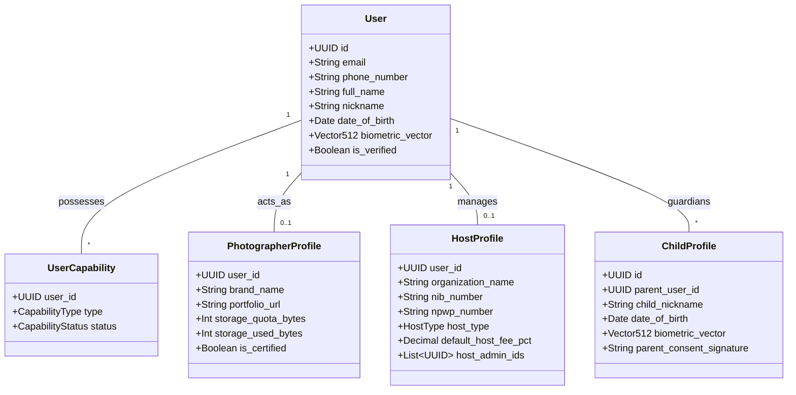
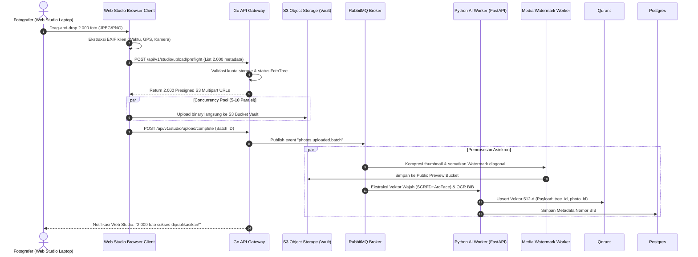
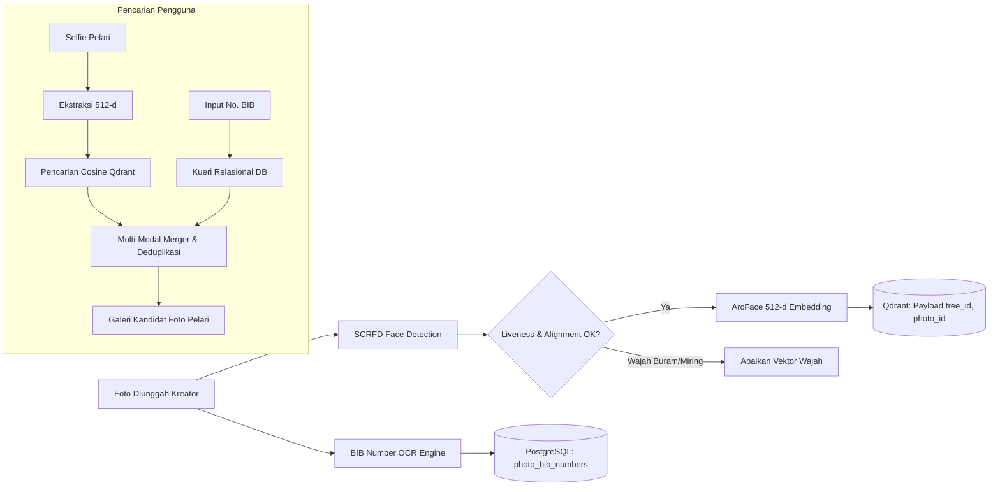
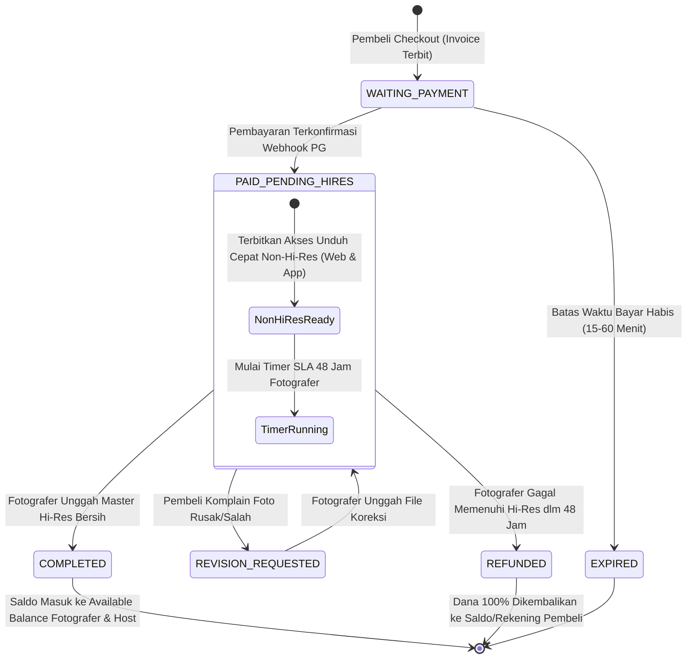
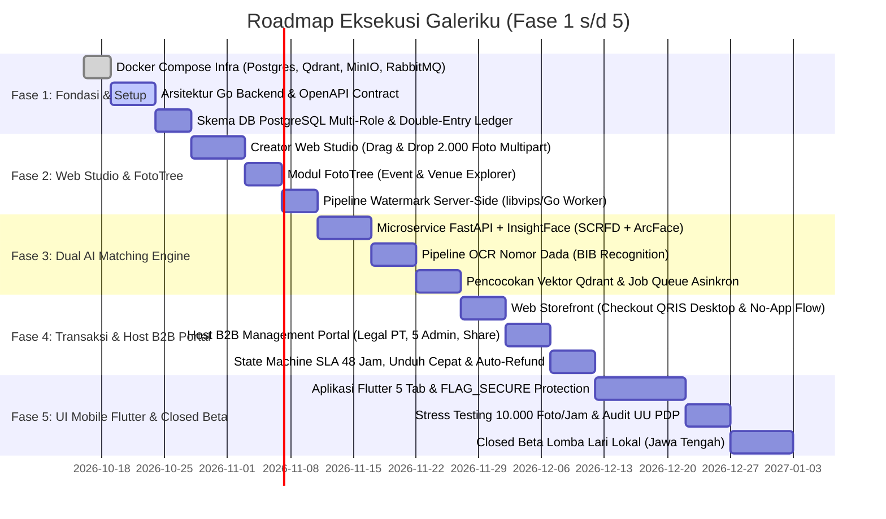

# PRODUCT REQUIREMENTS DOCUMENT (PRD)

## PLATFORM MARKETPLACE FOTO & KONTEN VISUAL BERBASIS AI (FOTOYU-GRADE)

* **Versi Dokumen:** 2.2 Enhanced Master Blueprint (Full Parity Mobile & Web Studio Architecture)
* **Tanggal Rilis:** 15 Oktober 2026
* **Status:** Spesifikasi Induk Resmi untuk Desain, Arsitektur, Pengembangan, dan Peluncuran
* **Nama Produk:** Galeriku (Working Title)
* **Target Pasar:** Indonesia (Ekspansi Regional Asia Tenggara)
* **Kanal Akses:**
  1. **Aplikasi Mobile (Android & iOS):** Klien lapangan pelari/pengunjung, aktivasi biometrik liveness, dan kamera fotografer on-the-go.
  2. **Web Storefront Publik (No-App Experience):** Jelajah katalog, pencarian nomor BIB, keranjang belanja, checkout QRIS desktop, dan unduhan koleksi langsung via browser.
  3. **Galeriku Web Studio:** Portal kerja profesional fotografer (Drag-and-Drop massal 1 – 2.000 foto, ekstraksi EXIF otomatis, dan batch fulfillment Hi-Res SLA 48 jam).
  4. **Host B2B Management Portal:** Portal web bagi pemilik venue/event berbadan hukum (NIB/PT), pendelegasian 5 Host Admin, rekrutmen fotografer resmi, dan penarikan bagi hasil bulanan.
  5. **Super Admin Dashboard:** Manajemen kepatuhan UU PDP, moderasi konten, audit finansial *double-entry*, dan approval legalitas Host.
* **Bahasa Utama:** Bahasa Indonesia (dengan dukungan multi-bahasa EN)
* **Model Bisnis:** Marketplace Foto Digital, Layanan Face & BIB Matching AI, Komisi Penjualan 3-Pihak (Kreator, Host, Platform), Paket Dokumentasi Kreator, Layanan Cetak Fisik & Merchandise

---

## 1. RINGKASAN EKSEKUTIF

### 1.1. Deskripsi Produk
**Galeriku** adalah platform marketplace foto dan konten visual berbasis kecerdasan buatan (*AI*) yang menghubungkan pengunjung/peserta acara, fotografer (*kreator*), pemilik lokasi/penyelenggara (*Host*), dan penikmat dokumentasi dalam satu ekosistem terpadu lintas platform (Mobile & Web).

Platform ini memadukan kemudahan eksplorasi visual bergaya media sosial modern (*short video & photo feed*), penemuan foto personal instan menggunakan AI (*Face Recognition & OCR BIB Number*), katalog pohon dokumentasi (**FotoTree**) berbasis kalender dan geolokasi peta interaktif, studio kerja web fotografer berkapasitas unggah massal hingga **2.000 foto sekaligus**, serta sistem transaksi digital aman dengan jaminan pemenuhan berkas resolusi tinggi (*SLA 48 Jam & Garansi Auto-Refund 100%*).

### 1.2. Konsep Inti Ekosistem: Filosofi "FotoTree" & "Daun"
Berbeda dengan galeri foto konvensional yang hanya memandang dokumentasi sebagai "folder event", Galeriku mengadopsi model ekosistem organik:
* **FotoTree (Pohon Foto):** Entitas wadah dokumentasi utama. FotoTree dapat berupa:
  1. **Acara Berkala / Temporer (*Event-Based*):** Lomba lari maraton, trail run, balap sepeda (*cycling*), triatlon, festival musik, konser, dan wisuda.
  2. **Lokasi Tetap / Berkelanjutan (*Venue-Based*):** Tempat wisata alam, taman hiburan (*theme park*), mal, hotel/resor, *ballroom*, kafe/restoran tematik, dan pusat kebugaran (*sport club/gym*). Konsep ini menjamin perputaran transaksi harian (*daily recurring GMV*) tanpa bergantung pada jadwal lomba akhir pekan semata.
* **Daun (Leaf / Konten):** Setiap lembar foto atau klip video dokumentasi yang diunggah ke dalam FotoTree.
* **Petani Foto (Farmer):** Fotografer atau kreator visual yang mengunggah dan memelihara daun-daun dokumentasi di dalam FotoTree terkait.

### 1.3. Masalah yang Diselesaikan
1. **Bagi Peserta / Pengunjung (Yuser):**
   * Frustrasi memilah ribuan hingga puluhan ribu foto dokumentasi secara manual di Google Drive/Dropbox.
   * Kesulitan menemukan foto saat wajah terhalang kacamata hitam, visor lari, atau kerumunan.
   * Keengganan menginstal aplikasi baru hanya untuk membeli 1–2 foto acara lari (diselesaikan dengan **Web Storefront Tanpa Aplikasi**).
   * Ketiadaan akses langsung untuk mengunduh foto bersih tanpa watermark di hari pelaksanaan acara untuk kebutuhan media sosial instan.
2. **Bagi Fotografer / Kreator:**
   * Sangat lambat dan tidak efisien mengunggah ribuan foto dari smartphone (diselesaikan dengan **Web Studio Drag-and-Drop hingga 2.000 foto langsung dari laptop/PC via S3 Multipart**).
   * Kerumitan manajemen ribuan berkas, penempelan watermark manual, dan distribusi tautan unduh satu per satu.
   * Pembayaran tertunda atau rawan sengketa (*chargeback/fraud*).
   * Keterbatasan ruang penyimpanan awan (*cloud storage*) yang mahal.
3. **Bagi Penyelenggara / Pengelola Tempat (Host):**
   * Dokumentasi acara berserakan tanpa katalogisasi resmi yang mencerminkan *branding* tempat/acara.
   * Kehilangan potensi monetisasi royalti dari fotografer lepas yang memotret di properti mereka.
   * Ketiadaan sistem delegasi tim panitia di lapangan (diselesaikan dengan **Portal Host Web dengan hingga 5 Host Admin**).
4. **Bagi Industri & Regulasi:**
   * Bahaya pengintaian (*stalking*) dan pelanggaran privasi biometrik akibat penjualan foto orang lain tanpa hak, melanggar ketentuan Undang-Undang Perlindungan Data Pribadi (UU PDP No. 27 Tahun 2022).

### 1.4. Prinsip Fundamental Produk
* **Satu Akun Multi-Peran:** Identitas pengguna tunggal dapat berperan sebagai pembeli, fotografer, maupun host sekaligus tanpa perlu berganti kredensial email/login.
* **Web & Mobile Saling Melengkapi (*Omnichannel Parity*):** Pembeli dapat berbelanja di web tanpa instal aplikasi; fotografer mengunggah ribuan foto di web studio laptop; dan pelari melakukan verifikasi biometrik liveness di aplikasi mobile.
* **Privasi Ketat & Anti-Creep:** Pengguna **hanya boleh membeli foto yang memuat dirinya sendiri atau anak kandungnya**. Pembelian foto orang lain tanpa izin dilarang keras secara hukum dan diblokir oleh sistem AI.
* **Perlindungan Anak Di Bawah Umur:** Akun anak wajib berada di bawah kendali akun induk orang tua dengan verifikasi biometrik bersama (*Parent-Child Wefie Verification*).
* **Kepuasan Instan (*Instant Gratification*):** Pembeli langsung berhak mengunduh versi bersih *Non-Hi-Res* (1080p web-ready) sesaat setelah pembayaran lunas, sementara file *Master Hi-Res* wajib dipenuhi kreator dalam SLA 48 jam.
* **Keadilan Finansial 3 Pihak:** Pembagian komisi otomatis antara Fotografer, Host pemilik tempat/event, dan Platform dengan transparansi pencatatan *double-entry immutable ledger*.
* **Dual AI Matching:** Penggabungan kecerdasan biometrik wajah (*Face Vector Embedding*) dan pembacaan nomor dada (*OCR BIB Recognition*) untuk akurasi maksimal di segala kondisi lapangan.

---

## 2. TUJUAN DAN INDIKATOR KEBERHASILAN

### 2.1. Tujuan Bisnis
1. Menjadi ekosistem marketplace dokumentasi visual nomor satu di Indonesia untuk olahraga dan pariwisata.
2. Memfasilitasi efisiensi kerja fotografer profesional melalui studio unggah web massal berkecepatan tinggi.
3. Membangun model bisnis berkelanjutan dengan *take rate* platform sehat, bagi hasil adil untuk Host (10–20%), dan margin keuntungan fotografer yang menarik (65–75%).
4. Mengakomodasi 100% pengguna web yang enggan mengunduh aplikasi mobile melalui Web Storefront & Checkout QRIS terintegrasi.

### 2.2. Indikator Kinerja Utama (KPI Produk Kuantitatif)
* **Akurasi AI Face Matching:** *True Positive Rate* ≥ 96.5% pada pencahayaan outdoor dengan sudut kemiringan wajah hingga 35 derajat.
* **Akurasi OCR Nomor Dada (BIB):** Pengenalan angka benar ≥ 94% pada kondisi nomor dada terlipat sebagian atau kotor karena keringat.
* **Kapasitas Upload Web Studio:** Mampu memproses batch 2.000 foto (rata-rata 10–20 GB) dalam waktu < 15 menit pada koneksi broadband standar 50 Mbps.
* **Waktu Inferensi AI:** Latensi pencocokan wajah < 1.8 detik per sesi pencarian selfie.
* **Conversion Rate (Pencarian ke Checkout):** ≥ 14% dari pelari yang menemukan fotonya melakukan pembelian.
* **SLA Fulfillment Rate:** ≥ 98.2% transaksi master Hi-Res dipenuhi fotografer dalam rentang waktu < 48 jam.
* **Tingkat Auto-Refund:** < 1.8% dari total pesanan berbayar.
* **Ketersediaan Layanan (Uptime):** 99.9% untuk core payment, web studio, dan image preview distribution.

---

## 3. RUANG LINGKUP PLATFORM DAN KANAL AKSES

Platform Galeriku beroperasi di atas 5 pilar kanal akses terpadu:

```
                          ┌────────────────────────┐
                          │   GALERIKU PLATFORM    │
                          └───────────┬────────────┘
         ┌────────────────────────────┼────────────────────────────┐
         ▼                            ▼                            ▼
┌──────────────────┐        ┌──────────────────┐         ┌──────────────────┐
│  APLIKASI MOBILE │        │  WEB STOREFRONT  │         │ CREATOR STUDIO   │
│  (Android & iOS) │        │  (No-App Buyers) │         │ (Web Laptop/PC)  │
│  - Face Liveness │        │  - BIB Search    │         │ - 2.000 Bulk Up  │
│  - Wefie Anak    │        │  - Web Catalog   │         │ - EXIF Reader    │
│  - GaleriGram    │        │  - Desktop QRIS  │         │ - SLA 48h Batch  │
│  - On-the-Go Cart│        │  - Instan 1080p  │         │ - Wholesale Disc │
└──────────────────┘        └──────────────────┘         └──────────────────┘
         │                                                         │
         ▼                                                         ▼
┌──────────────────┐                                     ┌──────────────────┐
│  HOST B2B PORTAL │                                     │  ADMIN DASHBOARD │
│  (Web Management)│                                     │  (Ops & Legal)   │
│  - Legal NIB/PT  │                                     │  - UU PDP Audit  │
│  - 5 Host Admin  │                                     │  - Dispute Med   │
│  - Revenue Share │                                     │  - Host Approval │
│  - Creator Recr  │                                     │  - Double-Entry  │
└──────────────────┘                                     └──────────────────┘
```

### 3.1. Aplikasi Mobile (Flutter - Android & iOS)
* **Klien Utama Pengguna & Fotografer Lapangan:** Dirancang *mobile-first* dengan performa native 60–120 fps.
* **Fitur Utama:**
  * Mode tamu (*Guest Mode*) tanpa paksaan login di awal.
  * Kamera selfie cerdas dengan panduan oval (*Face Alignment Guide*) dan deteksi keaslian wajah hidup (*Anti-Spoofing Liveness AI*).
  * Tab *GaleriGram* (Feed vertikal foto dan klip video pendek).
  * Tab *Pencarian AI* (Pencocokan Wajah + Input Nomor BIB).
  * Tab *FotoTree Explorer* (Peta geolokasi GPS interaktif + Kalender Event).
  * Tab *Koleksi & Keranjang* (Paket Aktif, Unduhan Instan Non-Hi-Res, File Master Hi-Res).
  * Tab *Akun & Dompet* (Saldo Penjualan, Mutasi Finansial, Tombol Tarik Dana, Mode Beralih Kreator).
  * Proteksi tangkapan layar (*anti-screenshot & screen record protection* via `FLAG_SECURE`).

### 3.2. Web Storefront Publik (No-App Buyer Portal)
* **Target Pengguna:** Pengunjung atau pelari yang membuka tautan dari media sosial/WhatsApp dan ingin mencari serta membeli foto tanpa wajib menginstal aplikasi.
* **Fitur Utama:**
  * **Katalog FotoTree & Kalender Race:** Eksplorasi ribuan foto event maraton dan destinasi wisata langsung dari browser desktop/smartphone.
  * **Pencarian Nomor Dada (BIB Number Search):** Mengetik nomor bib pelari (misal: `BIB 5042`) untuk menemukan foto tanpa perlu verifikasi muka atau instal aplikasi.
  * **Pencarian Wajah di Web:** Pengguna yang sudah pernah melakukan verifikasi wajah di aplikasi mobile dapat login di web dan melihat galeri hasil pencocokan wajahnya secara otomatis tersinkronisasi.
  * **Keranjang Belanja & Diskon Grosir Bertingkat:**
    * 0–1 foto: Diskon 0%
    * 2–3 foto: Diskon 5%
    * 4–9 foto: Diskon 10%
    * $\ge 10$ foto: Diskon 25%
  * **Desktop Checkout dengan Dynamic QRIS:** Menampilkan kode QRIS dinamis berukuran besar di layar monitor PC/laptop yang dapat langsung dipindai menggunakan aplikasi mobile banking (BCA, Mandiri, BRI, BNI) atau e-wallet (GoPay, OVO, Dana).
  * **Unduh Langsung Versi Resolusi Standar (Non-Hi-Res Bersih):** Tombol unduh file bersih 1080p langsung aktif di halaman `/collection` web seketika setelah pembayaran terkonfirmasi.

### 3.3. Galeriku Web Studio (Kanal Utama Fotografer & Kreator)
* **Target Pengguna:** Fotografer profesional yang mengolah berkas di komputer (Adobe Lightroom / Capture One) dan membutuhkan kanal pengunggahan massal yang cepat, tangguh, dan terorganisasi.
* **Fitur Utama:**
  * **Mode Unggah Single (1 – 100 foto):** Untuk penyesuaian judul detail, harga kustom per lembar, dan penandaan tag nomor BIB manual.
  * **Mode Unggah Bulk / Massal (1 – 2.000 foto per sesi!):**
    * Area *Drag-and-Drop* luas yang mampu menerima ribuan berkas JPEG, PNG, dan HEIC sekaligus.
    * **Ekstraksi Metadata EXIF di Sisi Klien:** Browser membaca `DateTimeOriginal`, `GPSLatitude`, `GPSLongitude`, dan `CameraModel` sebelum file dikirim.
    * **Direct S3 Multipart Presigned Upload:** Berkas dikirim langsung dari browser ke bucket storage S3/MinIO via protokol multipart presigned URL, **tanpa membebani memori RAM server Go API**.
    * **Upload Concurrency Worker Pool:** 5–10 koneksi paralel konkuren dengan visualisasi *progress bar* per file, indikator persentase total, auto-retry jika koneksi terputus, dan kemampuan resume.
    * **Validasi Anti-Watermark Manual:** Sistem web memvalidasi dan melarang fotografer menempelkan watermark sendiri, karena watermark resmi akan dirender seragam di server.
  * **Alur Kirim Ulang Master Hi-Res Massal (`/studio/resend/batch`):**
    * Ketika pesanan masuk (SLA 48 jam), fotografer membuka tab *Pending Hi-Res Fulfillment*.
    * Cukup *drag-and-drop* folder berisi foto master bersih hasil editan; sistem mencocokkan nama file secara otomatis (`filename auto-matching`) terhadap ID transaksi pesanan dan mengirimkannya dalam satu klik.
  * **Manajemen Diskon Grosir & Portofolio:** Pengaturan harga dasar, diskon paket event, dan pemantauan kuota penyimpanan (10 GB s.d. 100 GB).

### 3.4. Host B2B Management Portal (Penyelenggara & Pemilik Venue)
* **Target Pengguna:** Event Organizer maraton, pengelola kawasan wisata (Candi Prambanan, Taman Sari, dsb.), pengelola mal, hotel, sirkuit balap, dan sport club.
* **Fitur Utama:**
  * **Pendaftaran Legalitas Badan Usaha (`/host/register`):**
    * Pengunggahan berkas legalitas resmi: NIB (Nomor Induk Berusaha), SIUP, NPWP Perusahaan (PT/CV), dan rekening bank resmi atas nama badan usaha.
    * Menunggu proses verifikasi dan *approval* oleh Admin Platform Galeriku.
  * **Pendelegasian 5 Host Admin (`/host/manage-admin`):**
    * Pemilik Host dapat mendaftarkan hingga **5 akun Host Admin** dengan peran operasional terdistribusi untuk mengawasi fotografer di lapangan.
  * **Perekrutan & Manajemen Kreator Resmi Host (`/host/manage-creator`):**
    * Host membuka lowongan fotografer resmi di FotoTree miliknya.
    * Menyetujui fotografer pelamar (*approval workflow*), memberikan izin pemotretan eksklusif, dan membagikan rompi resmi event.
  * **Penetapan Skema Bagi Hasil (*Revenue Sharing Configuration*):**
    * Host mengunci harga tiket dasar foto dan menentukan persentase *Host Fee* (misal: 10%–20% dari harga dasar).
  * **Dashboard Finansial & Penarikan Saldo Bulanan (`/host/balance` & `/host/withdraw`):**
    * Monitoring omzet harian penjualan foto di venue secara *real-time*.
    * Penarikan saldo terjadwal sebulan sekali (setiap tanggal 30/31) dengan SLA pemrosesan 7 hari kerja ke rekening PT Host (minimal penarikan Rp 50.000, maksimal Rp 100.000.000 per transaksi).

### 3.5. Dashboard Administrator Operasional & Kepatuhan
* **Portal Internal Tim Galeriku (`/admin/...`):**
  * Verifikasi legalitas pendaftaran Host dan KYC fotografer berpenjualan tinggi.
  * Moderasi konten sensitif, pelaporan hak cipta (*DMCA / Copyright Takedown*), dan penanganan sengketa klaim foto.
  * Audit log pemenuhan hak privasi UU PDP (*Right to Erasure Biometrics*).
  * Rekonsiliasi keuangan *double-entry ledger* terhadap mutasi payment gateway dan rekening penampungan (*escrow/settlement*).

---

## 4. MODEL PERAN, MULTI-ROLE & STRUKTUR HIERARKI

### 4.1. Filosofi Satu Akun Multi-Kemampuan
Seseorang tidak perlu memiliki dua alamat email untuk membeli foto maratonnya di pagi hari dan menjual hasil jepretannya di sore hari.
* Entitas `User` menyimpan kredensial login, data identitas, dan satu set biometrik embedding.
* `UserCapabilities` adalah daftar relasi hak akses yang dapat aktif bersamaan:
  * `CAN_BUY` (Otomatis aktif untuk semua pengguna terdaftar).
  * `CAN_SELL` (Aktif setelah melengkapi profil fotografer dan verifikasi bank).
  * `CAN_HOST` (Aktif setelah verifikasi identitas badan hukum / legalitas pengelola acara).



### 4.2. Struktur Hubungan Kreator dalam FotoTree
Di dalam setiap FotoTree yang ditanam oleh Host, terdapat dua klasifikasi kreator:
1. **Kreator Internal (*In-House Photographer*):** Fotografer resmi yang dikontrak langsung oleh pihak Host. Dikenakan skema *Host Fee* khusus sesuai perjanjian internal Host.
2. **Kreator Independen (*Independent Farmer*):** Fotografer lepas yang mengajukan diri memotret di FotoTree tersebut. Wajib tunduk pada *Host Fee* standar yang dipatok oleh Host (misal: 10%–20% dari harga jual).

### 4.3. Perlindungan Anak (Child Account & Parental Consent)
Sesuai kepatuhan hukum perlindungan anak dan UU PDP:
1. Anak berusia < 17 tahun **dilarang membuat akun mandiri**.
2. Orang tua/wali sah wajib mendaftarkan akun induk terlebih dahulu dan menyelesaikan KYC dasar.
3. Orang tua menambahkan profil anak di menu `Kelola Akun Anak`:
   * Mengisi nama panggilan (*nickname*) dan tanggal lahir anak.
   * **Wefie Wajib:** Mengambil foto selfie bersama (*wefie*) di mana wajah orang tua dan anak berada dalam satu frame kamera untuk memvalidasi kedekatan dan izin langsung.
   * Memberikan *explicit digital consent* untuk pengolahan data biometrik anak.
4. Akun anak tidak memiliki hak akses finansial (tidak bisa menarik saldo atau melakukan pembayaran mandiri). Seluruh proses tebus/beli foto anak dikendalikan melalui dompet/kartu orang tua.

### 4.4. Kurikulum Sertifikasi & Gamifikasi Kuota Storage Fotografer
1. **Kurikulum Kreator:** Fotografer pemula wajib membaca modul etika pemotretan publik, hukum privasi, dan tata cara penanaman pohon sebelum fitur upload dibuka penuh.
2. **Alokasi Kuota Penyimpanan (*Storage Quota*):**
   * **Kapasitas Awal Gratis:** Fotografer baru memperoleh kuota dasar sebesar **10 GB**.
   * **Growth-Loop Referral Storage:** Setiap kali ada pembeli baru (*new unique buyer*) yang melakukan pembelian pertama kali dari karya fotografer tersebut, fotografer memperoleh **bonus kuota permanen sebesar +1 GB** (dapat diakumulasi hingga maksimal **100 GB** gratis).
   * Kapasitas di atas 100 GB dapat diperoleh melalui skema langganan kreator pro atau memangkas (*purge*) foto-foto lawas yang sudah kedaluwarsa.

---

## 5. HUKUM, PRIVASI, DAN KEPATUHAN UU PDP

### 5.1. Kebijakan Anti-Stalker: Larangan Membeli Foto Orang Lain
Salah satu celah hukum terbesar marketplace foto konvensional adalah potensi penyalahgunaan foto orang lain oleh pihak ketiga tanpa persetujuan subjek foto.
* **Aturan Keras Galeriku:**
  > *"Pengguna DILARANG KERAS membeli atau menebus dokumentasi foto/video yang di dalamnya tidak memuat diri pengguna sendiri atau anak sah yang terdaftar di bawah pengawasannya. Pelanggaran terhadap ketentuan ini merupakan tindak pidana pelanggaran privasi."*
* **Mekanisme Penegakan Sistem:**
  Sebelum *invoice* pembayaran diterbitkan, sistem memverifikasi bahwa *vektor wajah pembeli* (atau profil anak pembeli) memiliki skor kemiripan $\ge 0.68$ terhadap salah satu wajah yang terdeteksi di dalam foto target. Jika tidak cocok, tombol *Checkout* diblokir dengan peringatan privasi.

### 5.2. Kebijakan Satu Orang Satu Akun & Deteksi Akun Ganda
1. Setiap selfie verifikasi biometrik akan dipindai terhadap seluruh indeks vektor wajah pengguna terdaftar.
2. Jika terdeteksi kemiripan ekstrem ($\ge 0.85$) dengan akun lain yang sudah eksis:
   * Sistem mengunci pendaftaran akun baru.
   * Menampilkan dialog: *"Wajah Anda terdeteksi telah terdaftar pada akun [username_terpotong]. Apakah Anda ingin memulihkan akun lama Anda?"*
   * Jika terjadi sengketa kepemilikan wajah, pengguna dialihkan ke **Verifikasi Manual via Video Call WhatsApp Resmi Galeriku**.

### 5.3. Hak Menghapus Data Biometrik (*Right to Erasure*)
1. Pengguna berhak menarik kembali persetujuan biometrik kapan saja melalui menu `Pengaturan Privasi -> Hapus Data Biometrik Saya`.
2. Saat diajukan:
   * Vektor embedding wajah 512-dimensi di database Qdrant dihapus secara permanen dalam waktu $< 60$ detik.
   * Riwayat transaksi finansial lampau tetap disimpan dalam format *pseudonymized* sesuai kewajiban hukum retensi perpajakan selama 5 tahun.

---

## 6. TEKNOLOGI DAN ARSITEKTUR STACK

### 6.1. Matriks Komponen Teknologi Terpadu

| Lapisan Sistem | Pilihan Teknologi | Standar Penerapan & Alasan Arsitektural |
|---|---|---|
| **Mobile App** | **Flutter (Dart 3.x)** | Basis kode tunggal iOS & Android, performa 60–120 fps, Riverpod state management, proteksi tangkapan layar `FLAG_SECURE`. |
| **Public Web & SEO** | **Astro 4+** | Arsitektur kepulauan (*Islands*), Zero-JS default untuk halaman landing dan katalog publik, performa Lighthouse 100/100 di Google. |
| **Interactive Web Apps** | **React 19 + TypeScript + Vite / Astro Islands** | Komponen interaktif kaya untuk **Creator Web Studio** (Drag & Drop 2.000 foto), **Web Storefront Cart**, dan **Host B2B Management Portal**. |
| **Core API Backend** | **Go (Golang 1.23+)** | *Modular monolith* super kencang, konkurensi goroutine efisien, konsumsi memori rendah, kontrak OpenAPI strict. |
| **AI Microservice** | **Python (FastAPI)** | Mengisolasi model deep learning InsightFace (SCRFD + ArcFace 512-d) dan PaddleOCR v4 / ML Kit OCR untuk nomor dada. |
| **Primary Relational DB** | **PostgreSQL 16+** | Sumber kebenaran ACID mutlak untuk akun, izin, entitas FotoTree, transaksi, dan *immutable double-entry financial ledger*. |
| **Vector Similarity DB** | **Qdrant** | Database vektor murni berbasis Rust; efisiensi memori tinggi untuk pencarian kemiripan *cosine* 512-d dengan payload filtering per FotoTree. |
| **Object Storage (S3 API)** | **MinIO / Cloudflare R2 / AWS S3** | Pemisahan tegas antara bucket publik (watermarked previews) dan bucket privat terenkripsi (*master Hi-Res*). |
| **Message Broker & Queue** | **RabbitMQ / Redis Streams** | Pemrosesan asinkron tugas berat: watermarking, kompresi thumbnail, ekstraksi vektor AI, dan webhook dispatch. |
| **Payment Gateway** | **Xendit / Midtrans** | Gerbang pembayaran resmi berizin BI: Dynamic QRIS, Virtual Account, dan E-Wallet. |

---

## 7. ARSITEKTUR PIPELINE UPLOAD MASSAL & ALUR DATA

### 7.1. Diagram Alur Upload Web Studio (2.000 Foto via S3 Multipart)

Untuk mencegah server Go API mengalami *out-of-memory* saat fotografer mengunggah 2.000 foto berukuran 10–20 GB sekaligus, sistem menerapkan arsitektur **Direct S3 Multipart Presigned Upload**:



### 7.2. Larangan Arsitektur Keras (*Architectural Invariants*)
1. **Zero Client Trust:** Klien mobile maupun web dilarang keras menentukan status pembayaran, nilai saldo, atau hak unduh berkas master secara sepihak.
2. **No Binary Gateway Bottleneck:** Pengunggahan berkas foto massal dilarang melewati bodi HTTP server Go API; wajib menggunakan *Presigned S3 Multipart URLs*.
3. **Private Master Isolation:** Berkas asli foto resolusi tinggi dilarang berada di bucket publik. Akses hanya diizinkan melalui *Presigned URL* dengan masa kedaluwarsa maksimal 60 menit setelah verifikasi grant pembayaran.
4. **No Direct Vector DB Access:** Klien tidak memiliki jalur langsung ke Qdrant; seluruh panggilan pencarian vektor wajib divalidasi oleh Go API Gateway.

---

## 8. DUAL AI MATCHING ENGINE (ROBOYU-EQUIVALENT)

Untuk menjamin tingkat penemuan foto tertinggi di ajang olahraga, Galeriku menerapkan arsitektur pencarian multi-modal yang menyatukan pencocokan biometrik wajah dan pembacaan nomor dada.



### 8.1. Spesifikasi Model Face Recognition
1. **Deteksi Wajah:** SCRFD (*Sample and Computation Redistribution for Efficient Face Detection*) dengan ukuran input dinamis, mampu mendeteksi wajah berukuran minimal $24 \times 24$ piksel di tengah kerumunan.
2. **Filter Kualitas Wajah (*Quality Gate*):**
   * Pemeriksaan sudut rotasi: *Yaw* $\le 40^\circ$, *Pitch* $\le 30^\circ$, *Roll* $\le 30^\circ$.
   * Estimasi ketajaman (*Laplacian Blur Threshold*): Foto dengan nilai varians blur $< 65.0$ diabaikan dari ekstraksi biometrik.
3. **Ekstraksi Fitur:** ArcFace ResNet-50 yang menghasilkan representasi vektor ternormalisasi 512-dimensi ($L_2$ norm = 1.0).
4. **Parameter Qdrant Vector Search:**
   * Metrik jarak: **Cosine Similarity**.
   * Ambang batas ketat (*Strict Match Threshold*): Skor kemiripan $\ge 0.68$.
   * Ambang batas potensial (*Loose Match with Caution*): $0.62 \le \text{Skor} < 0.68$ (ditandai dengan label "Mungkin Kamu?").
   * Partisi data vektor diisolasi menggunakan filter payload `tree_id`.

### 8.2. Spesifikasi OCR Nomor Dada (BIB Recognition)
1. **Deteksi Area Dada:** Deteksi objek tubuh pelari untuk mengisolasi area torso/pakaian lari.
2. **Text Recognition:** PaddleOCR v4 / ML Kit Text Recognition yang dioptimalkan khusus untuk membaca string numerik 3 hingga 6 digit pada latar belakang nomor dada maraton.
3. **Normalisasi Metadata:** Seluruh nomor dada yang terbaca disimpan dalam tabel relasional `photo_bib_tags` yang terindeks B-Tree untuk pencarian teks instan ($< 10$ ms).

---

## 9. MODEL BISNIS, FINANSIAL & PRICING

### 9.1. Skema Pembagian Pendapatan 3-Pihak (Split Revenue Engine)
Setiap transaksi foto di dalam FotoTree yang memiliki Host akan dibagi secara otomatis oleh sistem backend:

$$\text{Pendapatan Bersih} = \text{Harga Jual} - \text{Biaya Payment Gateway (PG)}$$

* **Porsi Host (Biaya Host):** Ditetapkan oleh Host saat membuat FotoTree, berkisar antara **10% – 20%** dari Pendapatan Bersih.
* **Porsi Platform (Biaya Layanan Galeriku):** Dipatok flat **15%** dari Pendapatan Bersih.
* **Porsi Kreator (Fotografer):** Menerima sisa terbesar, berkisar antara **65% – 75%** dari Pendapatan Bersih.

*Simulasi Transaksi Riil:*
* Harga Foto: Rp 50.000
* Biaya PG QRIS (0.7%): Rp 350 -> Pendapatan Bersih: Rp 49.650
* Biaya Host (15%): Rp 7.447
* Biaya Galeriku (15%): Rp 7.447
* Pendapatan Fotografer (70%): **Rp 34.756**

### 9.2. Struktur Diskon Grosir Bertingkat (*Volume Discount*)
Baik di aplikasi mobile maupun Web Storefront, sistem menerapkan diskon grosir otomatis:
* **0 – 1 Foto:** Diskon 0% (Harga normal).
* **2 – 3 Foto:** Diskon 5%.
* **4 – 9 Foto:** Diskon 10%.
* **$\ge 10$ Foto:** Diskon 25%.

---

## 10. SISTEM TRANSAKSI, STATE MACHINE, DAN SLA 48 JAM

### 10.1. Diagram Siklus Hidup Transaksi Pesanan



### 10.2. Penjelasan State Transaksi & Pemenuhan Web
1. **`WAITING_PAYMENT`:** Invoice terbit. Pada layar desktop web, tampil kode QRIS dinamis besar; pada smartphone, tampil tombol buka aplikasi pembayaran langsung (*Deeplink*).
2. **`PAID_PENDING_HIRES`:**
   * Pembayaran lunas terverifikasi via webhook HMAC-SHA256.
   * **Hak Unduh Cepat Instan:** Pembeli langsung dapat mengunduh foto versi bersih Non-Hi-Res (1080p) di halaman web `/collection` atau aplikasi.
   * **Hitung Mundur SLA 48 Jam:** Fotografer menerima notifikasi untuk memenuhi file master Hi-Res.
3. **`REVISION_REQUESTED`:** Jika master rusak/buram, pembeli dapat mengajukan revisi. Fotografer mengunggah ulang via Web Studio.
4. **`COMPLETED`:** Fotografer mengunggah master Hi-Res bersih. Tautan unduh master (TTL 60 menit) dikirimkan. Saldo berpindah dari *Pending Settlement* ke *Available Balance*.
5. **`REFUNDED`:** Jika dalam 48 jam fotografer lalai, sistem otomatis membatalkan pesanan dan mengembalikan 100% uang pokok ke pembeli.

---

## 11. PIPELINE MEDIA, STORAGE, DAN PROTEKSI

### 11.1. Penempelan Watermark Server-Side yang Tangguh
* Seluruh watermark diproses di server melalui libvips / ImageMagick terkompilasi C.
* **Pola Watermark Diagonal Multi-Layer:**
  * Logo Galeriku semi-transparan (opasitas 35%) berulang secara diagonal 45 derajat memotong bagian tengah subjek/wajah.
  * Teks dinamis memuat: `[Nama Fotografer] @ Galeriku.id - Dilarang Mengambil Tangkapan Layar`.
  * Rasterisasi menyatu langsung dengan piksel gambar (*destructive blending*), sehingga mustahil dihilangkan menggunakan filter CSS atau teknik *inspect element*.

### 11.2. Proteksi Layar di Aplikasi Mobile
* **Android:** Mengaktifkan instruksi `WindowManager.LayoutParams.FLAG_SECURE` pada seluruh tampilan inspeksi foto pratinjau dan detail pesanan, membuat layar hitam pekat saat pengguna mencoba mengambil tangkapan layar (*screenshot*) atau merekam layar (*screen record*).
* **iOS:** Mengimplementasikan pemantauan `UIScreen.capturedDidChangeNotification` dan memanfaatkan trik penataan layer aman (*secure text field container*) untuk memburamkan konten visual secara seketika saat perekaman layar aktif.

---

## 12. ROADMAP IMPLEMENTASI (5 FASE MENUJU CLOSED BETA)



### 12.1. Rincian Milestone Eksekusi

* **Fase 1 (Fondasi, Arsitektur & Lingkungan Lokal):**
  * Konfigurasi `docker-compose.yml` untuk PostgreSQL 16 (dengan ekstensi `uuid-ossp` & `pgcrypto`), Qdrant Vector DB, MinIO S3-compatible, dan RabbitMQ.
  * Inisialisasi struktur *Clean Architecture / Modular Monolith* Go backend.
  * Migrasi skema database relasional lengkap: tabel pengguna, kemampuan multi-role, profil anak, FotoTree, dan pembukuan finansial *double-entry*.
* **Fase 2 (Creator Web Studio & Pipeline Media):**
  * Pembangunan antarmuka **Creator Web Studio** berbasis React / TypeScript dengan kemampuan drag-and-drop 2.000 foto.
  * Implementasi *Direct S3 Multipart Presigned Upload* dan parser EXIF klien.
  * Go Worker untuk rasterisasi watermark diagonal di sisi server.
* **Fase 3 (Mesin Dual AI Matching):**
  * Pembuatan microservice Python FastAPI dengan model SCRFD dan ArcFace 512-dimensi.
  * Modul OCR pembacaan nomor dada maraton (*BIB Recognition*).
  * Indeksasi vektor dan payload filter Qdrant per FotoTree.
* **Fase 4 (Web Storefront, Host Portal & Finansial):**
  * Pembangunan Web Storefront publik: pencarian BIB, keranjang, dan checkout QRIS desktop.
  * Pembangunan Portal Host B2B: pendaftaran NIB/PT, delegasi 5 Host Admin, dan rekrutmen fotografer.
  * Integrasi payment gateway Xendit, timer SLA 48 jam, dan auto-refund 100%.
* **Fase 5 (Aplikasi Mobile Flutter, Pengujian & Peluncuran Beta):**
  * Pembangunan UI Flutter (5 Tab: GaleriGram, Cari AI, FotoTree, Koleksi, Akun).
  * Penerapan proteksi tangkapan layar `FLAG_SECURE`.
  * Pengujian beban (*Stress Testing*) proses upload dan inferensi 10.000 foto/jam.
  * Peluncuran *Closed Beta* berkolaborasi dengan komunitas lari lokal di Jawa Tengah.
